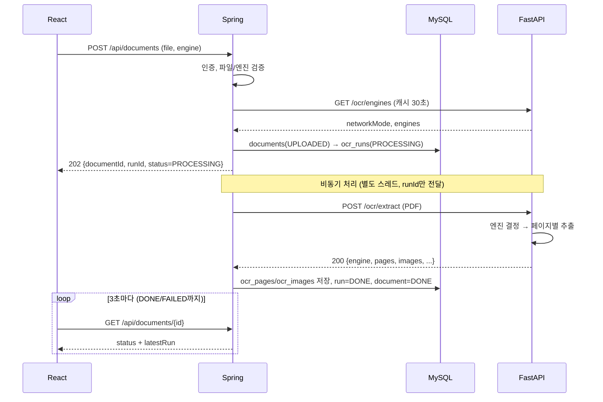

---
## 1. API 요약
 `document` 레포. **변경은 이 문서를 먼저 PR로 수정하고 팀에 공지한 뒤 구현한다**
- **1~14**: Spring Boot (Base URL `http://localhost:8080`, React가 호출)
- **F1~F3**: FastAPI (Base URL `http://localhost:8000`, Spring만 호출하는 내부 전용)
- `?` = 선택값 · 현황: `예정` / `개발중` / `완료`

| #   | Method | Path                                                        | 설명                 | 인증  | 성공  | 타입        | 요청                                    | 응답                                                                        | 담당  | 현황  |
| --- | ------ | ----------------------------------------------------------- | ------------------ | --- | --- | --------- | ------------------------------------- | ------------------------------------------------------------------------- | --- | --- |
| 1   | POST   | `/api/v1/auth/signup`                                          | 회원가입               | X   | 201 | json      | email, password, name                 | userId, email, name, createdAt                                            |     | 완료  |
| 2   | POST   | `/api/v1/auth/login`                                           | 로그인(JWT 발급)        | X   | 200 | json      | email, password                       | accessToken, tokenType, expiresIn, user                                   |     | 완료  |
| 3   | GET    | `/api/v1/users/me`                                             | 내 정보               | O   | 200 | -         | -                                     | userId, email, name, createdAt                                            |     | 완료  |
| 4   | GET    | `/api/v1/engines`                                              | 현재 망 모드 / 사용 가능 엔진 | O   | 200 | -         | -                                     | networkMode, defaultEngine, engines[]                                     |     | 예정  |
| 5   | POST   | `/api/v1/documents`                                            | PDF 업로드 + OCR 요청   | O   | 202 | multipart | file, engine?, extractImages?         | documentId, runId, status, engine, networkMode                            |     | 예정  |
| 6   | GET    | `/api/v1/documents`                                            | 내 문서 목록 (페이징)      | O   | 200 | query     | page?, size?, sort?, status?          | content[], page, size, totalElements, totalPages, hasNext                 |     | 예정  |
| 7   | GET    | `/api/v1/documents/{documentId}`                               | 문서 상세 + 최신 OCR 결과  | O   | 200 | -         | -                                     | 문서 정보, latestRun(RunDetail)                                               |     | 예정  |
| 8   | DELETE | `/api/v1/documents/{documentId}`                               | 문서 삭제              | O   | 200 | -         | -                                     | null                                                                      |     | 예정  |
| 9   | GET    | `/api/v1/documents/{documentId}/file`                          | 원본 PDF             | O   | 200 | -         | -                                     | PDF(바이너리)                                                                 |     | 예정  |
| 10  | GET    | `/api/v1/documents/{documentId}/runs`                          | OCR 실행 이력          | O   | 200 | -         | -                                     | RunSummary[]                                                              |     | 예정  |
| 11  | GET    | `/api/v1/documents/{documentId}/runs/{runId}`                  | 특정 실행 상세           | O   | 200 | -         | -                                     | RunDetail                                                                 |     | 예정  |
| 12  | POST   | `/api/v1/documents/{documentId}/reprocess`                     | 다른 엔진으로 재처리        | O   | 202 | json      | engine, extractImages?                | documentId, runId, status, engine, networkMode                            |     | 예정  |
| 13  | GET    | `/api/v1/documents/{documentId}/runs/{runId}/export`           | 결과 내보내기            | O   | 200 | query     | format(txt\|json)                     | 파일(txt/json)                                                              |     | 예정  |
| 14  | GET    | `/api/v1/documents/{documentId}/runs/{runId}/images/{imageId}` | 추출 이미지             | O   | 200 | -         | -                                     | PNG(바이너리)                                                                 |     | 예정  |
| F1  | GET    | `/health`                                                   | 헬스체크               | -   | 200 | -         | -                                     | status                                                                    |     | 예정  |
| F2  | GET    | `/ocr/v1/engines`                                              | 망 모드 / 엔진 목록       | -   | 200 | -         | -                                     | networkMode, defaultEngine, engines[]                                     |     | 예정  |
| F3  | POST   | `/ocr/v1/extract`                                              | PDF에서 텍스트/이미지 추출   | -   | 200 | multipart | file, engine?, extract_images?, lang? | engine, networkMode, pageCount, totalMs, avgConfidence, pages[], images[] |     | 예정  |

### 1.1 미결 사항 / 합의 체크리스트

| #   | 항목                        | 제안                                   | 결정  |
| --- | ------------------------- | ------------------------------------ | --- |
| 1   | 최대 파일 크기                  | 20MB                                 |     |
| 2   | 최대 페이지 수                  | 50                                   |     |
| 3   | 이미지 전달 방식                 | base64 (용량 문제 시 공유 볼륨 경로)            |     |
| 4   | ``/PDF 뷰어의 인증        | Blob 방식 (또는 짧은 수명의 서명 URL)           |     |
| 5   | AUTO의 텍스트 레이어 임계값         | 20자                                  |     |
| 6   | 비밀번호 정책                   | 8~64자, 영문+숫자+특수                      |     |
| 7   | 토큰 만료                     | 1시간                                  |     |
| 8   | 폴링 주기 / 최대                | 3초 / 10분                             |     |
| 9   | OCR 처리 타임아웃               | 300초                                 |     |
| 10  | FastAPI 인증                | 없음 (내부망 전제), 필요 시 공유 API Key 헤더 추가   |     |
| 11  | 엔진 이름 표기                  | 대문자 (`PADDLE` 등), Ollama 모델명은 서버 설정값 |     |
| 12  | `lang` 파라미터를 Spring이 노출할지 | 노출하지 않음(기본 `ko,en` 고정)               |     |


---

## 2. 시스템 개요

```
[web]  ──(JSON/multipart)──>  [Spring Boot :8080]  ──(multipart/JSON)──>  [FastAPI :8000]
React                          인증, 업로드, DB 저장                         OCR 처리, 엔진 선택
                                    │                                          │
                                  MySQL                               PyMuPDF / Paddle / Tesseract
                                                                      Ollama / OpenAI
```

|구간|호출 주체 → 대상|문서 위치|
|---|---|---|
|web ↔ Spring|React → Spring|§6|
|Spring ↔ FastAPI|Spring → FastAPI (내부 전용)|§7|

**원칙**

- React는 **Spring만** 호출한다. FastAPI를 직접 호출하지 않는다.
- 회원/문서/OCR 결과의 DB 저장은 **Spring만** 한다. FastAPI는 DB를 모른다.
- FastAPI는 사용자 개념이 없다. 사용자별 접근 제어는 Spring이 한다.
- FastAPI는 외부에 노출하지 않는다(내부 네트워크/로컬 전용).
---

## 3. 공통 규칙

### 3.1 요청

|항목|규칙|
|---|---|
|Content-Type|JSON: `application/json; charset=UTF-8` / 업로드: `multipart/form-data`|
|인증 헤더|`Authorization: Bearer {accessToken}`|
|필드명|camelCase (FastAPI 내부 API의 form 필드만 snake_case, §7 참고)|
|문자 인코딩|UTF-8|
|ID 타입|Long (JSON number)|
|허용 Origin (CORS)|`http://localhost:5173` (Vite 기본 포트), 허용 헤더 `Authorization`, `Content-Type`|

### 3.2 인증 (JWT)

|항목|값|
|---|---|
|방식|Bearer JWT (HS256)|
|만료|3600초 (1시간)|
|Claims|`sub`=userId, `email`, `iat`, `exp`|
|갱신|없음 (만료 시 재로그인)|
|인증 제외 경로|`/api/v1/auth/**`, `/swagger-ui/**`, `/v3/api-docs/**`|

- 토큰이 없거나 형식이 잘못되면 `401 UNAUTHORIZED`
- 만료된 토큰이면 `401 TOKEN_EXPIRED` (프론트는 이 코드로 로그인 화면 이동)

### 3.3 응답 형식

모든 JSON 응답은 아래 봉투(envelope)를 사용한다. (파일 다운로드 성공 응답은 제외)

성공

```json
{ "success": true, "data": { } }
```

실패

```json
{
  "success": false,
  "error": {
    "code": "DOCUMENT_NOT_FOUND",
    "message": "문서를 찾을 수 없습니다.",
    "details": [ { "field": "email", "reason": "이메일 형식이 아닙니다." } ]
  }
}
```

|필드|설명|
|---|---|
|`error.code`|§5의 코드. 프론트 분기 처리는 **message가 아닌 code 기준**|
|`error.message`|사용자에게 보여줄 수 있는 한국어 메시지|
|`error.details`|선택. 검증 실패(`INVALID_REQUEST`) 시 필드별 사유|

### 3.4 날짜/시간

- ISO 8601, KST 오프셋 포함: `2026-10-17T10:45:00+09:00`
- 값이 없으면 `null` (필드 생략 금지. 응답 필드는 항상 존재한다)

### 3.5 페이징

|파라미터|기본값|규칙|
|---|---|---|
|`page`|0|0부터 시작|
|`size`|10|1~50|
|`sort`|`createdAt,desc`|`createdAt,asc` 또는 `createdAt,desc`만 허용|

응답

```json
{
  "content": [ ],
  "page": 0,
  "size": 10,
  "totalElements": 23,
  "totalPages": 3,
  "hasNext": true
}
```

### 3.6 파일 제한

|항목|값|
|---|---|
|형식|PDF만 (확장자 `.pdf` **그리고** 파일 시작 바이트 `%PDF` 모두 검증)|
|최대 크기|20MB (multipart 전체 25MB)|
|최대 페이지|50페이지 (Spring이 업로드 시 1차 검증, FastAPI가 처리 시 2차 검증)|
|저장 파일명|서버가 UUID로 저장, 원본 파일명은 DB(`original_name`)에만 보관|

### 3.7 타임아웃

|구간|값|
|---|---|
|React → Spring|30초 (업로드는 즉시 202 응답하므로 충분)|
|Spring → FastAPI `/ocr/extract`|300초|
|Spring의 run 처리 제한|300초 초과 시 run을 `FAILED`로 처리 (`errorMessage`: "OCR 처리 시간 초과")|

### 3.8 소유권

- 모든 문서/실행 결과는 **본인 것만** 조회/삭제/재처리할 수 있다.
- 타인의 문서에 접근하면 존재 여부를 숨기기 위해 `404 DOCUMENT_NOT_FOUND`를 반환한다.

---

## 4. Enum 정의

### DocumentStatus (문서 상태 = 가장 최근 run의 상태)

|값|의미|
|---|---|
|`UPLOADED`|파일 저장 완료, run 생성 전 (매우 짧은 순간)|
|`PROCESSING`|OCR 진행 중|
|`DONE`|최신 run 성공|
|`FAILED`|최신 run 실패|

### RunStatus

`PROCESSING` → `DONE` | `FAILED`

### Engine

|값|설명|사용 가능 망|비고|
|---|---|---|---|
|`AUTO`|페이지별 자동 선택|둘 다|텍스트 레이어가 있으면 PYMUPDF, 없으면 기본 OCR 엔진(`OCR_ENGINE`). **외부 전송은 하지 않는다** (기본 엔진이 `openai`로 명시된 경우만 예외)|
|`PYMUPDF`|PDF 내장 텍스트 추출|둘 다|OCR 아님. 스캔 페이지는 빈 텍스트가 반환될 수 있음 (실패 아님)|
|`PADDLE`|PaddleOCR|둘 다|로컬|
|`TESSERACT`|Tesseract|둘 다|로컬|
|`OLLAMA`|로컬 비전 LLM|둘 다|로컬. 모델 사전 설치 필요. 느릴 수 있음|
|`OPENAI`|OpenAI Vision|**`OPEN`만**|문서가 외부로 전송됨. `CLOSED`에서는 `ENGINE_NOT_ALLOWED`|

### NetworkMode

|값|의미|
|---|---|
|`CLOSED`|폐쇄망. 외부 통신 엔진 차단|
|`OPEN`|개방망. 외부 API 엔진 허용|

망 모드는 **FastAPI 서버의 환경변수(`NETWORK_MODE`)로 결정**되고, 사용자가 요청으로 바꿀 수 없다. Spring은 FastAPI가 알려준 값을 그대로 기록한다.

### PageSource

|값|의미|
|---|---|
|`TEXT_LAYER`|PDF에 내장된 텍스트에서 추출 (confidence는 `null`)|
|`OCR`|이미지 OCR 결과|

---

## 5. 에러 코드

### 5.1 Spring 에러 코드

|HTTP|code|발생 상황|
|---|---|---|
|400|`INVALID_REQUEST`|필수값 누락, 형식/길이 위반, 파라미터 범위 오류|
|400|`UNSUPPORTED_FILE_TYPE`|PDF가 아님 (확장자 또는 매직바이트)|
|400|`ENGINE_NOT_ALLOWED`|현재 망 모드/설치 상태에서 사용할 수 없는 엔진|
|401|`UNAUTHORIZED`|토큰 없음/형식 오류/서명 오류|
|401|`TOKEN_EXPIRED`|토큰 만료|
|401|`LOGIN_FAILED`|이메일 또는 비밀번호 불일치 (어느 쪽인지 구분하지 않음)|
|404|`DOCUMENT_NOT_FOUND`|문서 없음 또는 타인 문서|
|404|`RUN_NOT_FOUND`|실행 이력 없음 (해당 문서 소속이 아닌 경우 포함)|
|404|`IMAGE_NOT_FOUND`|이미지 없음|
|404|`FILE_NOT_FOUND`|DB에는 있으나 디스크에 파일이 없음|
|409|`EMAIL_DUPLICATED`|이미 가입된 이메일|
|409|`ALREADY_PROCESSING`|처리 중인 문서에 재처리/삭제 요청|
|413|`FILE_TOO_LARGE`|20MB 초과|
|500|`INTERNAL_ERROR`|예기치 못한 서버 오류|
|502|`OCR_SERVER_ERROR`|FastAPI 호출 실패 (엔진 목록 조회 등 동기 구간)|

### 5.2 FastAPI 에러 코드

|HTTP|code|발생 상황|Spring 처리|
|---|---|---|---|
|400|`INVALID_REQUEST`|필수 필드 누락/형식 오류|run `FAILED` + errorMessage|
|400|`UNSUPPORTED_FILE_TYPE`|PDF 아님/손상|run `FAILED` + errorMessage|
|400|`PAGE_LIMIT_EXCEEDED`|50페이지 초과|run `FAILED` + errorMessage|
|400|`ENGINE_NOT_ALLOWED`|망 모드상 금지된 엔진|업로드 전 검증에서 막는 것이 원칙, 통과 시 run `FAILED`|
|503|`ENGINE_UNAVAILABLE`|엔진 준비 안 됨 (모델 없음, Ollama 미기동 등)|run `FAILED` + errorMessage|
|500|`OCR_FAILED`|처리 중 예외|run `FAILED` + errorMessage|

### 5.3 에러가 발생하는 시점 (중요)

OCR 처리는 **비동기**라서 에러 전달 방식이 두 가지다.

|시점|방식|예|
|---|---|---|
|**업로드 요청 중** (Spring이 즉시 판단 가능)|HTTP 4xx/5xx 응답|파일 형식, 크기, **50페이지 초과(`400 INVALID_REQUEST`)**, 엔진 허용 여부, 인증|
|**업로드 이후 OCR 처리 중** (FastAPI 구간)|요청은 이미 202로 끝남 → run `status=FAILED` + `errorMessage`|엔진 오류, 타임아웃, (Spring을 통과한) 페이지 초과|

프론트는 폴링으로 `FAILED`를 확인하고 `latestRun.errorMessage`를 표시한다.

---

## 6. Spring API 상세

### 6.1 회원가입

`POST /api/v1/auth/signup` · 인증 불필요 · 성공 `201`

**Request Body**

|필드|타입|필수|규칙|
|---|---|---|---|
|`email`|string|O|이메일 형식, 최대 255자, 서버에서 소문자로 정규화|
|`password`|string|O|8~64자, 영문+숫자+특수문자 각 1개 이상|
|`name`|string|O|1~50자, 앞뒤 공백 제거|

```json
{ "email": "user@test.com", "password": "Passw0rd!", "name": "홍길동" }
```

**Response `201`**

|필드|타입|설명|
|---|---|---|
|`userId`|number||
|`email`|string||
|`name`|string||
|`createdAt`|string||

```json
{
  "success": true,
  "data": { "userId": 1, "email": "user@test.com", "name": "홍길동", "createdAt": "2026-10-17T10:45:00+09:00" }
}
```

**에러**: `400 INVALID_REQUEST`(검증 실패, `details`에 필드별 사유), `409 EMAIL_DUPLICATED`

> 가입 즉시 로그인되지 않는다. 프론트는 가입 성공 후 로그인 화면으로 이동한다. 비밀번호는 BCrypt 해시로만 저장한다.

---

### 6.2 로그인

`POST /api/v1/auth/login` · 인증 불필요 · 성공 `200`

**Request Body**

|필드|타입|필수|규칙|
|---|---|---|---|
|`email`|string|O||
|`password`|string|O||

**Response `200`**

|필드|타입|설명|
|---|---|---|
|`accessToken`|string|JWT|
|`tokenType`|string|항상 `Bearer`|
|`expiresIn`|number|만료까지 초 (3600)|
|`user`|object|`{ userId, email, name }`|

```json
{
  "success": true,
  "data": {
    "accessToken": "eyJhbGciOiJIUzI1NiJ9...",
    "tokenType": "Bearer",
    "expiresIn": 3600,
    "user": { "userId": 1, "email": "user@test.com", "name": "홍길동" }
  }
}
```

**에러**: `400 INVALID_REQUEST`, `401 LOGIN_FAILED`

---

### 6.3 내 정보

`GET /api/v1/users/me` · 인증 필요 · 성공 `200`

**Response `200`**: `userId`, `email`, `name`, `createdAt`

```json
{ "success": true, "data": { "userId": 1, "email": "user@test.com", "name": "홍길동", "createdAt": "2026-10-17T10:45:00+09:00" } }
```

**에러**: `401 UNAUTHORIZED`, `401 TOKEN_EXPIRED`

---

### 6.4 엔진 목록 / 망 모드

`GET /api/v1/engines` · 인증 필요 · 성공 `200`

프론트의 엔진 선택 드롭다운과 망 모드 배지 표시에 사용한다. Spring이 FastAPI `GET /ocr/engines`를 호출해 전달하며 **30초 캐시**한다.

**Response `200`**

|필드|타입|설명|
|---|---|---|
|`networkMode`|string|`CLOSED` \| `OPEN`|
|`defaultEngine`|string|서버 기본 OCR 엔진|
|`engines[]`|array||
|`engines[].name`|string|Engine enum|
|`engines[].available`|boolean|지금 사용 가능한가|
|`engines[].external`|boolean|외부로 데이터가 전송되는가 (`OPENAI`만 true)|
|`engines[].reason`|string \| null|사용 불가 사유|

```json
{
  "success": true,
  "data": {
    "networkMode": "CLOSED",
    "defaultEngine": "PADDLE",
    "engines": [
      { "name": "AUTO",      "available": true,  "external": false, "reason": null },
      { "name": "PYMUPDF",   "available": true,  "external": false, "reason": null },
      { "name": "PADDLE",    "available": true,  "external": false, "reason": null },
      { "name": "TESSERACT", "available": true,  "external": false, "reason": null },
      { "name": "OLLAMA",    "available": false, "external": false, "reason": "모델이 설치되지 않았습니다." },
      { "name": "OPENAI",    "available": false, "external": true,  "reason": "폐쇄망 모드에서는 사용할 수 없습니다." }
    ]
  }
}
```

**에러**: `401`, `502 OCR_SERVER_ERROR` (FastAPI 응답 없음)

---

### 6.5 문서 업로드 + OCR 요청

`POST /api/v1/documents` · 인증 필요 · 성공 `202 Accepted`

OCR은 오래 걸릴 수 있으므로 **즉시 응답하고 비동기로 처리**한다. 결과는 §6.7을 폴링해 확인한다.

**Request** `multipart/form-data`

|파트|타입|필수|기본값|규칙|
|---|---|---|---|---|
|`file`|file|O||PDF, 최대 20MB|
|`engine`|string|X|`AUTO`|Engine enum|
|`extractImages`|boolean|X|`false`|PDF 내 이미지 추출 여부|

**Spring 처리 순서**

1. 인증 확인 → 파일 존재/크기/PDF 매직바이트/페이지 수(≤50) 검증, 페이지 수 확정
2. `engine` 검증 (enum 값, 현재 망 모드에서 사용 가능한지 — 엔진 캐시 기준)
3. 파일 저장 → `documents` 저장 (`UPLOADED`)
4. `ocr_runs` 생성 (`PROCESSING`, 망 모드는 엔진 정보 캐시 값) → 문서 상태 `PROCESSING`
5. 비동기 처리 시작 (runId만 전달) → **202 응답**

**Response `202`**

|필드|타입|설명|
|---|---|---|
|`documentId`|number||
|`runId`|number|방금 생성된 실행 ID|
|`originalName`|string||
|`fileSize`|number|bytes|
|`status`|string|항상 `PROCESSING`|
|`engine`|string|요청한 엔진 (완료 후 실제 사용 엔진으로 갱신됨)|
|`networkMode`|string||
|`createdAt`|string||

```json
{
  "success": true,
  "data": {
    "documentId": 12,
    "runId": 30,
    "originalName": "sample.pdf",
    "fileSize": 483920,
    "status": "PROCESSING",
    "engine": "AUTO",
    "networkMode": "CLOSED",
    "createdAt": "2026-10-17T10:45:00+09:00"
  }
}
```

**에러**

|code|조건|
|---|---|
|`INVALID_REQUEST`|`file` 파트 없음, `engine` 값 오류|
|`UNSUPPORTED_FILE_TYPE`|PDF 아님|
|`FILE_TOO_LARGE`|20MB 초과|
|`ENGINE_NOT_ALLOWED`|현재 사용할 수 없는 엔진 (예: 폐쇄망에서 `OPENAI`)|
|`OCR_SERVER_ERROR`|엔진/망 모드 확인을 위한 FastAPI 호출 실패|
|`UNAUTHORIZED` / `TOKEN_EXPIRED`||

**curl 예시**

```bash
curl -X POST http://localhost:8080/api/documents \
  -H "Authorization: Bearer $TOKEN" \
  -F "file=@sample.pdf;type=application/pdf" \
  -F "engine=AUTO" \
  -F "extractImages=false"
```

---

### 6.6 문서 목록

`GET /api/v1/documents` · 인증 필요 · 성공 `200`

**Query**

|파라미터|타입|기본값|설명|
|---|---|---|---|
|`page`|int|0||
|`size`|int|10|1~50|
|`sort`|string|`createdAt,desc`||
|`status`|string|(전체)|DocumentStatus 필터|

**Response `200`** — 페이징 형식(§3.5), `content[]` 항목:

|필드|타입|설명|
|---|---|---|
|`documentId`|number||
|`originalName`|string||
|`fileSize`|number||
|`pageCount`|number|업로드 시점에 확정됨|
|`status`|string|DocumentStatus|
|`latestRunId`|number||
|`latestEngine`|string||
|`createdAt`|string||
|`updatedAt`|string||

```json
{
  "success": true,
  "data": {
    "content": [
      {
        "documentId": 12, "originalName": "sample.pdf", "fileSize": 483920, "pageCount": 3,
        "status": "DONE", "latestRunId": 31, "latestEngine": "PADDLE",
        "createdAt": "2026-10-17T10:45:00+09:00", "updatedAt": "2026-10-17T10:45:09+09:00"
      }
    ],
    "page": 0, "size": 10, "totalElements": 1, "totalPages": 1, "hasNext": false
  }
}
```

**에러**: `400 INVALID_REQUEST` (page/size/sort/status 값 오류), `401`

---

### 6.7 문서 상세 + 최신 결과

`GET /api/v1/documents/{documentId}` · 인증 필요 · 성공 `200`

프론트가 **폴링하는 엔드포인트**이자 결과 화면의 기본 데이터 소스다.

**Path**: `documentId` (number)

**Response `200`**

|필드|타입|설명|
|---|---|---|
|`documentId`|number||
|`originalName`|string||
|`fileSize`|number||
|`pageCount`|number|업로드 시점에 확정됨|
|`status`|string|DocumentStatus|
|`createdAt` / `updatedAt`|string||
|`latestRun`|object|**RunDetail** (아래)|

**RunDetail 객체** (§6.11도 동일 형식)

|필드|타입|설명|
|---|---|---|
|`runId`|number||
|`engine`|string|완료 후에는 실제 사용 엔진 (`AUTO` 요청 → `PADDLE` 등)|
|`networkMode`|string||
|`status`|string|RunStatus|
|`extractImages`|boolean||
|`totalMs`|number \| null|총 처리시간(ms). 진행 중이면 `null`|
|`avgConfidence`|number \| null|0.0~1.0, `source=OCR` 페이지 평균. 해당 페이지가 없으면 `null`|
|`errorMessage`|string \| null|`FAILED`일 때 사유|
|`createdAt`|string||
|`finishedAt`|string \| null||
|`pages[]`|array|진행 중/실패 시 빈 배열|
|`pages[].pageNo`|number|1부터 시작|
|`pages[].source`|string|PageSource|
|`pages[].text`|string|페이지 텍스트 (없으면 빈 문자열)|
|`pages[].confidence`|number \| null|0.0~1.0, `TEXT_LAYER`는 `null`|
|`pages[].processingMs`|number||
|`images[]`|array|`extractImages=false`이면 빈 배열|
|`images[].imageId`|number||
|`images[].pageNo`|number||
|`images[].format`|string|`png`|
|`images[].width` / `height`|number||
|`images[].url`|string|§6.14 경로 (인증 헤더 필요)|

**진행 중 예시**

```json
{
  "success": true,
  "data": {
    "documentId": 12, "originalName": "sample.pdf", "fileSize": 483920, "pageCount": null,
    "status": "PROCESSING",
    "createdAt": "2026-10-17T10:45:00+09:00", "updatedAt": "2026-10-17T10:45:00+09:00",
    "latestRun": {
      "runId": 30, "engine": "AUTO", "networkMode": "CLOSED", "status": "PROCESSING",
      "extractImages": false, "totalMs": null, "avgConfidence": null, "errorMessage": null,
      "createdAt": "2026-10-17T10:45:00+09:00", "finishedAt": null,
      "pages": [], "images": []
    }
  }
}
```

**완료 예시**

```json
{
  "success": true,
  "data": {
    "documentId": 12, "originalName": "sample.pdf", "fileSize": 483920, "pageCount": 2,
    "status": "DONE",
    "createdAt": "2026-10-17T10:45:00+09:00", "updatedAt": "2026-10-17T10:45:09+09:00",
    "latestRun": {
      "runId": 30, "engine": "PADDLE", "networkMode": "CLOSED", "status": "DONE",
      "extractImages": true, "totalMs": 8421, "avgConfidence": 0.9312, "errorMessage": null,
      "createdAt": "2026-10-17T10:45:00+09:00", "finishedAt": "2026-10-17T10:45:09+09:00",
      "pages": [
        { "pageNo": 1, "source": "OCR", "text": "추출된 텍스트...", "confidence": 0.94, "processingMs": 2800 },
        { "pageNo": 2, "source": "TEXT_LAYER", "text": "내장 텍스트...", "confidence": null, "processingMs": 30 }
      ],
      "images": [
        { "imageId": 5, "pageNo": 1, "format": "png", "width": 640, "height": 480,
          "url": "/api/documents/12/runs/30/images/5" }
      ]
    }
  }
}
```

**실패 예시** (`latestRun`만 발췌)

```json
{ "runId": 30, "engine": "OLLAMA", "status": "FAILED", "totalMs": null, "avgConfidence": null,
  "errorMessage": "ENGINE_UNAVAILABLE: Ollama 서버에 연결할 수 없습니다.", "pages": [], "images": [] }
```

**에러**: `401`, `404 DOCUMENT_NOT_FOUND`

---

### 6.8 문서 삭제

`DELETE /api/v1/documents/{documentId}` · 인증 필요 · 성공 `200`

문서와 하위 run/page/image 데이터, 저장된 파일(원본 PDF, 추출 이미지)을 모두 삭제한다.

**Response `200`**

```json
{ "success": true, "data": null }
```

**에러**: `401`, `404 DOCUMENT_NOT_FOUND`, `409 ALREADY_PROCESSING` (처리 중에는 삭제 불가)

---

### 6.9 원본 PDF

`GET /api/v1/documents/{documentId}/file` · 인증 필요 · 성공 `200`

**Response**: 바이너리

- `Content-Type: application/pdf`
- `Content-Disposition: inline; filename*=UTF-8''{URL인코딩된 원본파일명}`

**에러**: `401`, `404 DOCUMENT_NOT_FOUND`, `404 FILE_NOT_FOUND` (에러는 JSON 봉투)

> `<iframe>`/`<embed>`/PDF 뷰어에서 인증 헤더를 붙이기 어렵다면 프론트에서 `fetch` → Blob → `URL.createObjectURL`로 표시한다.

---

### 6.10 실행(run) 이력

`GET /api/v1/documents/{documentId}/runs` · 인증 필요 · 성공 `200`

엔진별 성능 비교 화면용. 최신순 정렬, 페이징 없음(문서당 run은 소수로 가정).

**Response `200`**: 배열, 항목 필드

|필드|타입|
|---|---|
|`runId`|number|
|`engine`|string|
|`networkMode`|string|
|`status`|string|
|`totalMs`|number \| null|
|`avgConfidence`|number \| null|
|`errorMessage`|string \| null|
|`createdAt` / `finishedAt`|string / string \| null|

```json
{
  "success": true,
  "data": [
    { "runId": 31, "engine": "OLLAMA", "networkMode": "CLOSED", "status": "DONE",
      "totalMs": 41200, "avgConfidence": null, "errorMessage": null,
      "createdAt": "2026-10-17T11:00:00+09:00", "finishedAt": "2026-10-17T11:00:41+09:00" },
    { "runId": 30, "engine": "PADDLE", "networkMode": "CLOSED", "status": "DONE",
      "totalMs": 8421, "avgConfidence": 0.9312, "errorMessage": null,
      "createdAt": "2026-10-17T10:45:00+09:00", "finishedAt": "2026-10-17T10:45:09+09:00" }
  ]
}
```

**에러**: `401`, `404 DOCUMENT_NOT_FOUND`

---

### 6.11 실행(run) 상세

`GET /api/v1/documents/{documentId}/runs/{runId}` · 인증 필요 · 성공 `200`

**Response `200`**: §6.7의 **RunDetail** 객체와 동일 (`data` 바로 아래)

**에러**: `401`, `404 DOCUMENT_NOT_FOUND`, `404 RUN_NOT_FOUND`

---

### 6.12 재처리

`POST /api/v1/documents/{documentId}/reprocess` · 인증 필요 · 성공 `202`

저장된 원본 PDF를 다른 엔진으로 다시 처리한다. 기존 run은 유지되고 **새 run이 추가**된다.

**Request Body**

|필드|타입|필수|기본값|규칙|
|---|---|---|---|---|
|`engine`|string|O||Engine enum|
|`extractImages`|boolean|X|`false`||

```json
{ "engine": "OLLAMA", "extractImages": false }
```

**Response `202`**: §6.5와 동일 구조 (`documentId`, `runId`, `status=PROCESSING`, `engine`, `networkMode`, ...)

**에러**: `400 INVALID_REQUEST`, `400 ENGINE_NOT_ALLOWED`, `401`, `404 DOCUMENT_NOT_FOUND`, `404 FILE_NOT_FOUND`, `409 ALREADY_PROCESSING`, `502 OCR_SERVER_ERROR`

---

### 6.13 결과 내보내기

`GET /api/v1/documents/{documentId}/runs/{runId}/export` · 인증 필요 · 성공 `200`

**Query**

|파라미터|필수|값|
|---|---|---|
|`format`|O|`txt` \| `json`|

**format=txt**

- `Content-Type: text/plain; charset=UTF-8`
- 페이지 구분: `\n\n===== Page {pageNo} =====\n\n` 형태로 이어 붙임

**format=json**

- `Content-Type: application/json; charset=UTF-8`
- 봉투 없이 RunDetail에서 `images`를 제외한 객체를 그대로 반환

공통: `Content-Disposition: attachment; filename*=UTF-8''{원본파일명(확장자 제외)}_{engine}.{txt|json}`

**에러**: `400 INVALID_REQUEST` (format 값 오류, 또는 `DONE`이 아닌 run), `401`, `404 DOCUMENT_NOT_FOUND`, `404 RUN_NOT_FOUND`

---

### 6.14 추출 이미지

`GET /api/v1/documents/{documentId}/runs/{runId}/images/{imageId}` · 인증 필요 · 성공 `200`

**Response**: 바이너리, `Content-Type: image/png`

**에러**: `401`, `404 DOCUMENT_NOT_FOUND`, `404 RUN_NOT_FOUND`, `404 IMAGE_NOT_FOUND`

> ``는 인증 헤더를 못 붙이므로 프론트는 `fetch` → Blob URL로 표시한다. (미결 사항 §1.1 참고)

---

## 7. FastAPI 내부 API 상세

> Spring만 호출한다. React/외부에서 직접 호출하지 않는다. 모든 엔진은 **동일한 응답 포맷**을 반환해야 한다(엔진 교체 시 Spring 코드 변경 없음). 이 구간의 form 필드는 Python 관례에 따라 snake_case를 쓰고, JSON 응답은 camelCase를 쓴다.

### 7.1 F1. 헬스체크

`GET /health`

```json
{ "status": "ok" }
```

- 인프라 헬스체크 전용이라 **공통 응답 봉투를 적용하지 않는 예외**로 둔다.

### 7.2 F2. 엔진 목록

`GET /ocr/v1/engines`

응답 구조는 §6.4의 `data`와 동일하며, 공통 응답 봉투(`success`/`data`)로 감싼다.

```json
{
  "success": true,
  "data": {
    "networkMode": "CLOSED",
    "defaultEngine": "PADDLE",
    "engines": [
      { "name": "AUTO",    "available": true,  "external": false, "reason": null },
      { "name": "PYMUPDF", "available": true,  "external": false, "reason": null },
      { "name": "PADDLE",  "available": true,  "external": false, "reason": null },
      { "name": "OPENAI",  "available": false, "external": true,  "reason": "closed network mode" }
    ]
  }
}
```

- `AUTO`도 목록에 포함한다(`available: true`).
- `available`은 "설정상 허용" **그리고** "실제 사용 준비됨(모델 로드, Ollama 연결 가능 등)"을 모두 만족할 때 `true`.

### 7.3 F3. 텍스트/이미지 추출

`POST /ocr/v1/extract` · `multipart/form-data`

**Request**

|파트|타입|필수|기본값|설명|
|---|---|---|---|---|
|`file`|file|O||PDF|
|`engine`|string|X|`AUTO`|Engine enum|
|`extract_images`|bool|X|`false`|이미지 추출 여부|
|`lang`|string|X|`ko,en`|OCR 언어 힌트 (엔진이 지원하는 경우만 적용)|

**처리 규칙**

1. PDF 유효성/페이지 수(≤50) 검사
2. 망 모드/엔진 허용 여부 검사 (`CLOSED`에서 `OPENAI` 요청 → `400 ENGINE_NOT_ALLOWED`. **엔진 객체 자체를 로딩하지 않는다**)
3. 엔진 결정
    - `AUTO`: 페이지별로 텍스트 레이어의 글자 수가 **20자 이상**이면 `PYMUPDF`(`source=TEXT_LAYER`), 미만이면 기본 OCR 엔진(`source=OCR`)
    - 그 외: 지정 엔진으로 전체 페이지 처리
4. 페이지 순서대로 처리, 페이지별 처리시간 측정
5. 응답의 `engine`은 **실제 사용된 주 엔진** (`AUTO`에서 OCR이 한 번도 일어나지 않았으면 `PYMUPDF`)

**Response `200`** (공통 응답 봉투 적용, 아래 표는 `data`의 필드)

|필드|타입|설명|
|---|---|---|
|`engine`|string|실제 사용된 엔진|
|`networkMode`|string||
|`pageCount`|number||
|`totalMs`|number|전체 처리시간|
|`avgConfidence`|number \| null|`source=OCR` 페이지의 평균, 없으면 `null`|
|`pages[]`|array||
|`pages[].pageNo`|number|1부터|
|`pages[].source`|string|PageSource|
|`pages[].text`|string||
|`pages[].confidence`|number \| null|0.0~1.0|
|`pages[].processingMs`|number||
|`images[]`|array|`extract_images=false`면 빈 배열|
|`images[].pageNo`|number||
|`images[].format`|string|`png`|
|`images[].width` / `height`|number||
|`images[].dataBase64`|string|이미지 바이너리의 base64|

```json
{
  "success": true,
  "data": {
    "engine": "PADDLE",
    "networkMode": "CLOSED",
    "pageCount": 2,
    "totalMs": 5230,
    "avgConfidence": 0.94,
    "pages": [
      { "pageNo": 1, "source": "OCR", "text": "...", "confidence": 0.94, "processingMs": 2500 },
      { "pageNo": 2, "source": "TEXT_LAYER", "text": "...", "confidence": null, "processingMs": 30 }
    ],
    "images": [
      { "pageNo": 1, "format": "png", "width": 640, "height": 480, "dataBase64": "iVBORw0KGgo..." }
    ]
  }
}
```

**Error 응답** (HTTP 4xx/5xx 유지, 공통 에러 봉투 적용)

```json
{
  "success": false,
  "error": {
    "code": "ENGINE_NOT_ALLOWED",
    "message": "OPENAI is disabled in closed network mode",
    "details": []
  }
}
```

- HTTP 상태 코드(400/503/500 등)는 지금처럼 유지한다.
- `details`는 §2 공통 규칙과 같은 `[{ "field": "...", "reason": "..." }]` 형식이며, 없으면 빈 배열이다.

**curl 예시**

```bash
curl -X POST http://localhost:8000/ocr/v1/extract \
  -F "file=@sample.pdf;type=application/pdf" \
  -F "engine=AUTO" \
  -F "extract_images=false"
```

### 7.4 Spring 쪽 변환 규칙 (FastAPI 응답 → DB)

|FastAPI|Spring 처리|
|---|---|
|`engine`|`ocr_runs.engine`을 이 값으로 갱신|
|`networkMode`|`ocr_runs.network_mode` 확인/갱신|
|`totalMs`, `avgConfidence`|`ocr_runs.total_ms`, `avg_confidence`|
|`pages[]`|`ocr_pages`에 페이지별 저장 (`run_id`, `page_no` 유니크)|
|`images[]`|base64 디코딩 → `storage/images/{documentId}/{runId}/...png` 저장 → `ocr_images`에 경로 저장|
|`pageCount`|`documents.page_count`|
|에러 응답/연결 실패/타임아웃|`ocr_runs.status=FAILED`, `error_message="{code}: {message}"`, 문서 상태 `FAILED`|

---

## 8. 상태 전이와 처리 흐름

### 8.1 업로드 → OCR → 조회 시퀀스



### 8.2 상태 전이

**Document / Run**

```
업로드        UPLOADED ──(run 생성)──> PROCESSING ──┬──> DONE
                                                    └──> FAILED
재처리    DONE/FAILED ──(새 run 생성)──> PROCESSING ──┬──> DONE
                                                      └──> FAILED
```

|규칙|설명|
|---|---|
|문서 상태 = 최신 run 상태|재처리가 실패하면 문서는 `FAILED`로 보이지만, 이전 `DONE` run은 `/runs`에서 계속 조회 가능|
|동시 처리 금지|문서가 `PROCESSING`이면 재처리/삭제 → `409 ALREADY_PROCESSING`|
|타임아웃|`PROCESSING`이 300초를 넘으면 `FAILED` (`errorMessage`: "OCR 처리 시간 초과")|
|서버 재시작|기동 시 `PROCESSING`으로 남은 run을 `FAILED`로 정리 (`errorMessage`: "서버 재시작으로 중단됨")|
|엔진 필드|run 생성 시 요청한 엔진, 완료 시 FastAPI가 알려준 실제 엔진으로 갱신|

---

## 9. 프론트엔드 연동 가이드

### 9.1 인증 처리

1. 로그인 성공 → `accessToken` 저장 (메모리 또는 localStorage. 미니 프로젝트에서는 localStorage 허용)
2. axios 인터셉터로 모든 요청에 `Authorization: Bearer {token}` 부착
3. 응답이 `401`이면 토큰 삭제 후 로그인 화면 이동 (`TOKEN_EXPIRED`는 "세션이 만료되었습니다" 안내)

### 9.2 업로드 화면 흐름

1. 진입 시 `GET /api/engines` → 드롭다운 구성 (`available=false`는 비활성 + `reason` 툴팁, `external=true`는 "외부 전송" 경고 표시), `networkMode`를 배지로 표시
2. `POST /api/documents` → `202`면 `documentId`로 상세 화면 이동
3. 상세 화면에서 **3초 간격 폴링**: `status`가 `DONE` 또는 `FAILED`면 중단
    - 최대 10분 후 폴링 종료 + "처리 시간이 오래 걸리고 있습니다" 안내
    - 화면 이탈 시 폴링 정리

### 9.3 결과 화면

- 좌: 원본 PDF (`/file`을 Blob으로), 우: `latestRun.pages[]` 텍스트 (페이지 이동 동기화)
- 상단: 엔진, 망 모드, 처리시간, 평균 신뢰도
- `FAILED`: `latestRun.errorMessage` 표시 + 재처리 버튼
- 재처리: `POST /reprocess` → 다시 폴링
- 비교 화면: `GET /runs`로 엔진별 처리시간/신뢰도 표

### 9.4 에러 처리 원칙

- 분기는 `error.code`로, 표시는 `error.message`로
- `INVALID_REQUEST`는 `error.details[].field`를 입력창에 매핑
- 네트워크 오류/`502`는 "OCR 서버에 연결할 수 없습니다" 안내

### 9.5 Mock 개발

Spring의 `app.ocr.client=mock`이면 FastAPI 없이도 위 API가 모두 동작한다. 프론트는 처음부터 실제 Spring을 붙여 개발해도 된다. (Mock은 약 3초 후 `DONE` 처리, 고정 텍스트 반환)

---

### 변경 이력

| 버전   | 날짜         | 변경                                    | 작성  |
| ---- | ---------- | ------------------------------------- | --- |
| v0.1 | 2026-10-17 | 최초 초안                                 |     |
| v0.2 | 2026-10-17 | 상세화 (필드 표, 에러 시점, 상태 전이, 시퀀스, 연동 가이드) |     |
| v0.3 | 2026-10-19 | API 경로 `/api/v1` 적용, FastAPI 응답에 공통 봉투 적용(`/health` 제외), F2 예시에 AUTO 추가, 업로드 시 Spring이 페이지 수(≤50)를 1차 검증하고 `pageCount`를 업로드 시점에 확정, 재시작 시 PROCESSING 정리는 설정으로 켬 |     |
