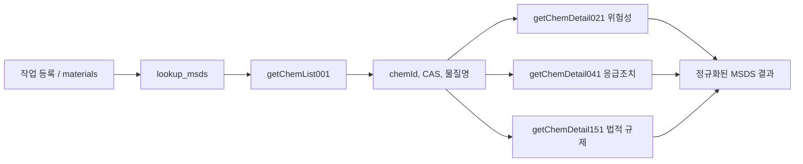

# 한국산업안전보건공단 MSDS 공공데이터 API 계약

- 제공기관: 한국산업안전보건공단
- 공공데이터포털 식별자: `15157612`
- 공식 문서: https://www.data.go.kr/data/15157612/openapi.do
- API base URL: `https://apis.data.go.kr/B552468/msdschem1`
- 전송 방식: HTTPS REST `GET`
- 응답 형식: XML
- 본 문서의 구현 기준일: 2026-11-04

## 1. 사용 목적과 서비스 경계

이 API는 작업 등록에서 추출한 화학물질명 또는 CAS 번호로 MSDS 정보를 조회한다. MSDS는 현재 프로젝트에서 의미 기반 RAG 검색용 문서로 적재하지 않고, `lookup_msds` 도구를 통해 필요할 때 조회한다.



공공데이터포털은 제공 정보를 MSDS 작성·검토 시 참고용으로 안내한다. 이 API 응답이 제조·수입자의 법정 MSDS 작성·제공 의무를 대체하지 않는다. 이용 전 최신 공식 문서의 이용 조건과 면책 안내를 확인한다.

## 2. 공통 HTTP 계약

| 항목 | 계약 |
| --- | --- |
| Method | `GET` |
| Base URL | `https://apis.data.go.kr/B552468/msdschem1` |
| Path | 기능별 operation path를 base URL 뒤에 추가 |
| 인증 | 필수 query parameter `serviceKey` |
| 응답 | XML (`application/xml` 또는 XML 문서) |
| 문자 처리 | UTF-8 XML 파싱, XML namespace가 있어도 local tag name으로 처리 |
| timeout | 애플리케이션 구현 기본값 10초 |

`serviceKey`는 URL query parameter이므로 요청을 만들 때 한 번 URL encode한다. 키를 로그, 예외 메시지, 응답 본문, 커밋한 문서에 남기지 않는다. HTTPS를 사용한다.

## 3. 기능 목록과 operation ID

모든 상세 operation은 `chemId`와 `serviceKey`를 필수 query parameter로 받는다.

| 기능 | Path / operation ID | 용도 |
| --- | --- | --- |
| 화학물질 목록 | `/getChemList001` · `getChemList001` | 국문명/CAS/UN/KE/EN 번호로 검색하고 `chemId` 확인 |
| 1. 화학제품과 회사에 관한 정보 | `/getChemDetail011` · `getChemDetail011` | 제품·회사 정보 |
| 2. 유해성·위험성 | `/getChemDetail021` · `getChemDetail021` | GHS 분류, 경고표지, 예방조치문구 등 |
| 3. 구성성분의 명칭 및 함유량 | `/getChemDetail031` · `getChemDetail031` | 구성성분 |
| 4. 응급조치요령 | `/getChemDetail041` · `getChemDetail041` | 눈·피부·흡입·섭취 등 응급조치 |
| 5. 폭발·화재 시 대처방법 | `/getChemDetail051` · `getChemDetail051` | 화재 대응 |
| 6. 누출사고 시 대처방법 | `/getChemDetail061` · `getChemDetail061` | 누출 대응 |
| 7. 취급 및 저장방법 | `/getChemDetail071` · `getChemDetail071` | 안전 취급·저장 |
| 8. 노출방지 및 개인보호구 | `/getChemDetail081` · `getChemDetail081` | 노출 기준·보호구 |
| 9. 물리화학적 특성 | `/getChemDetail091` · `getChemDetail091` | 물리·화학 특성 |
| 10. 안정성 및 반응성 | `/getChemDetail101` · `getChemDetail101` | 안정성·반응성 |
| 11. 독성에 관한 정보 | `/getChemDetail111` · `getChemDetail111` | 독성 정보 |
| 12. 환경에 미치는 영향 | `/getChemDetail121` · `getChemDetail121` | 환경 영향 |
| 13. 폐기 시 주의사항 | `/getChemDetail131` · `getChemDetail131` | 폐기 정보 |
| 14. 운송에 필요한 정보 | `/getChemDetail141` · `getChemDetail141` | 운송 정보 |
| 15. 법적 규제현황 | `/getChemDetail151` · `getChemDetail151` | 국내외 법적 규제 |
| 16. 그 밖의 참고사항 | `/getChemDetail161` · `getChemDetail161` | 참고 정보 |

프로젝트의 현재 조회는 목록, 2번, 4번, 15번 기능만 호출한다. 다른 기능은 필요성이 정해지면 별도로 추가한다.

## 4. 화학물질 목록 검색 계약

### 요청

`GET /getChemList001`

| Parameter | 필수 | 형식 | 설명 |
| --- | --- | --- | --- |
| `serviceKey` | 예 | string | 공공데이터포털 발급 서비스 키 |
| `searchWrd` | 예 | string | 검색어. 국문명 또는 식별번호 |
| `searchCnd` | 예 | integer | 검색 종류 |
| `numOfRows` | 예 | integer | 페이지당 결과 수 |
| `pageNo` | 예 | integer | 1부터 시작하는 페이지 번호 |

`searchCnd` 값:

| 값 | 검색 종류 |
| ---: | --- |
| `0` | 국문명 |
| `1` | CAS No. |
| `2` | UN No. |
| `3` | KE No. |
| `4` | EN No. |

### 요청 예시

다음 예시는 `KOSHA_MSDS_SERVICE_KEY`가 셸 환경에 설정돼 있다고 가정한다. 실제 키를 문서나 셸 명령 기록에 직접 입력하지 않는다.

```bash
curl --get 'https://apis.data.go.kr/B552468/msdschem1/getChemList001' \
  --data-urlencode "serviceKey=${KOSHA_MSDS_SERVICE_KEY}" \
  --data-urlencode 'searchWrd=108-88-3' \
  --data-urlencode 'searchCnd=1' \
  --data-urlencode 'numOfRows=100' \
  --data-urlencode 'pageNo=1'
```

### 주요 응답 필드

```xml
<response>
  <header>
    <resultCode>00</resultCode>
    <resultMsg>...</resultMsg>
  </header>
  <body>
    <totalCount>...</totalCount>
    <items>
      <item>
        <chemId>...</chemId>
        <chemNameKor>...</chemNameKor>
        <casNo>...</casNo>
        <lastDate>...</lastDate>
        <enNo>...</enNo>
        <keNo>...</keNo>
        <unNo>...</unNo>
        <openYn>...</openYn>
        <koshaConfirm>...</koshaConfirm>
      </item>
    </items>
    <numOfRows>...</numOfRows>
    <pageNo>...</pageNo>
  </body>
</response>
```

`chemId`는 상세 기능을 호출할 때 사용한다. 목록 결과가 여러 건이라고 첫 결과를 임의로 선택하지 않는다.

## 5. 상세 조회 계약

### 요청

다음과 같이 필요한 상세 operation을 각각 호출한다.

```text
GET /getChemDetail021?chemId={chemId}&serviceKey={serviceKey}
GET /getChemDetail041?chemId={chemId}&serviceKey={serviceKey}
GET /getChemDetail151?chemId={chemId}&serviceKey={serviceKey}
```

| Parameter | 필수 | 형식 | 설명 |
| --- | --- | --- | --- |
| `chemId` | 예 | string/integer | 목록 기능이 반환한 화학물질 ID |
| `serviceKey` | 예 | string | 공공데이터포털 발급 서비스 키 |

### 주요 응답 구조

각 상세 기능은 `header`와 `body.items.item[]` 구조를 반환한다. `item`은 XML에서 하나 또는 여러 개일 수 있다.

| 필드 | 형식 | 설명 |
| --- | --- | --- |
| `header.resultCode` | string | 처리 결과 코드 |
| `header.resultMsg` | string | 처리 결과 메시지 |
| `body.items.item.itemDetail` | string | 항목의 본문 값. 긴 문장, 구분자, HTML 조각을 포함할 수 있음 |
| `body.items.item.lev` | integer | 항목 레벨 |
| `body.items.item.msdsItemCode` | integer | 항목 코드 |
| `body.items.item.upMsdsItemCode` | string | 상위 항목 코드 |
| `body.items.item.msdsItemNameKor` | string | 한국어 항목명 |
| `body.items.item.msdsItemNo` | string | 항목 구분 |
| `body.items.item.ordrIdx` | integer | 정렬 순서 |

분류 코드와 상세 내용은 API 버전·물질별로 달라질 수 있으므로 `itemDetail` 원문을 보존하고, 알 수 없는 항목을 버리지 않는 파서로 처리한다.

## 6. 애플리케이션 도구 계약

MSDS 클라이언트는 `app/publicdata/msds.py`에 있고, `KOSHA_MSDS_SERVICE_KEY`가 설정된 경우 `lookup_msds` 도구를 mock에서 실제 구현으로 교체한다. 이 도구는 별도의 HTTP route가 아니며 에이전트가 내부적으로 호출한다.

### 입력

```json
{
  "materials": ["108-88-3", "톨루엔"]
}
```

- `materials`: 물질명 또는 CAS 번호 문자열 배열
- 한 번 호출에 최대 20개
- CAS 형식과 일치하면 CAS 검색(`searchCnd=1`), 그 외에는 국문명 검색(`searchCnd=0`)
- 현재 국문명 검색은 공백 제거 후 완전 일치만 선택한다. 여러 CAS가 일치하면 임의 선택하지 않고 `found: false`를 반환한다.
- 목록 기능은 현재 첫 페이지 100건만 확인한다.

### 응답

```json
{
  "results": [
    {
      "query": "108-88-3",
      "found": true,
      "name": "톨루엔",
      "cas_no": "108-88-3",
      "ghs_classes": ["..."],
      "hazards": ["항목명: 상세내용"],
      "first_aid": "항목명: 상세내용",
      "regulations": ["항목명: 상세내용"],
      "source": "한국산업안전보건공단 물질안전보건자료 조회 서비스"
    }
  ]
}
```

| 출력 필드 | 원천 |
| --- | --- |
| `query`, `found` | 요청값 및 정확 매칭 결과 |
| `name`, `cas_no` | `getChemList001`의 `chemNameKor`, `casNo` |
| `ghs_classes` | 021 상세 중 `msdsItemNameKor`에 `분류`가 포함된 항목의 `itemDetail` |
| `hazards` | 021 상세의 항목명과 `itemDetail` |
| `first_aid` | 041 상세의 항목명과 `itemDetail`을 줄바꿈으로 결합 |
| `regulations` | 151 상세의 항목명과 `itemDetail` |
| `source` | 공식 서비스 표시명 |

찾지 못한 경우는 오류가 아니라 `{"query":"...","found":false}`로 반환한다. upstream 통신·XML 파싱·API 오류는 `ToolError`의 `MSDS_UPSTREAM_ERROR`로 반환한다.

## 7. 요청 및 호출 수

캐시에 없는 물질 하나를 상세 조회하면 목록 1회와 상세 3회, 총 4회의 공공 API 요청이 발생한다. 배열의 물질은 현재 순차 처리하며 최대 20개다. 캐시는 AI 애플리케이션 프로세스 메모리에 조회 키 기준 6시간 보관한다.

현재 캐시는 프로세스 간 공유되지 않고 재시작 시 사라진다. DB migration의 `msds_cache` 테이블은 있지만 이번 클라이언트가 아직 사용하지 않는다. 영속 캐시·동시성 제어·재시도·rate limit·목록 pagination은 후속 구현 범위다.

## 8. 설정과 배포

Compose의 `python-ai-model` 서비스에 다음 환경변수를 전달한다.

```dotenv
KOSHA_MSDS_SERVICE_KEY=<공공데이터포털에서 발급한 서비스 키>
```

키를 추가하거나 교체한 뒤에는 애플리케이션을 재생성해야 한다. 키가 비어 있으면 기존 mock `lookup_msds`가 유지된다.

```bash
cd main-infra-manage/docker
docker compose up -d --build python-ai-model
```

## 9. 오류 및 검증

| 상태 | 의미 | 확인할 항목 |
| --- | --- | --- |
| `found: false` | 빈 입력, 목록 결과 없음, 정확 매칭 없음, 또는 동일 이름 후보의 CAS가 여러 개임 | CAS 번호로 직접 검색하고 포털 목록의 공개 여부 확인 |
| `MSDS_UPSTREAM_ERROR` | 네트워크·timeout·HTTP 오류·XML 파싱 오류 또는 API가 성공 외 `resultCode` 반환 | 서비스 키 승인 상태, 쿼터, operation path, 공공 API 상태 |
| 도구가 mock으로 등록됨 | `KOSHA_MSDS_SERVICE_KEY`가 앱 컨테이너에 전달되지 않음 | Compose 해석값과 컨테이너 환경변수 존재 여부를 키 값 출력 없이 확인하고 서비스 재생성 |

오프라인 parser/등록 테스트:

```bash
cd main-ai-model
.venv/bin/python -m pytest -q tests/test_publicdata_msds.py
```

실제 연동 확인은 AI 컨테이너에서 수행한다. 아래 명령은 서비스 키를 출력하지 않고 CAS 한 건의 응답만 보여준다.

```bash
cd main-infra-manage/docker
docker compose exec -T python-ai-model python -c 'from app.agent.agent_deps import get_tool_registry; tool=next(t for t in get_tool_registry().tools() if t.name == "lookup_msds"); print("real_api_enabled=", not tool.mock); print(tool.handler({"materials":["108-88-3"]})["results"][0])'
```

예상 결과는 `real_api_enabled=True`, `found=True`, CAS `108-88-3` 및 물질명 `톨루엔`이다. 실제 호출 시 개인·현장 자료를 입력하지 않는다.

## 10. Qdrant와의 구분

MSDS는 정확한 CAS와 공식 필드 조회가 중요하므로 현재 Qdrant에 적재하지 않는다. `lookup_msds`가 CAS/물질명으로 조회하고, 필요하면 별도의 영속 `msds_cache`를 사용한다. Qdrant의 `kb_guides`와 `kb_accidents`는 의미 검색이 필요한 가이드·사고 문서에 사용한다.

## 11. 공식 참고

- [한국산업안전보건공단 물질안전보건자료 조회 서비스](https://www.data.go.kr/data/15157612/openapi.do)
- [API base URL](https://apis.data.go.kr/B552468/msdschem1)