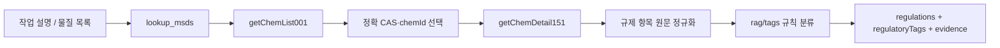

# MSDS 규제현황 자동 태깅·분류 초안

- 상태: 초안
- 작성 기준일: 2026-11-04
- 대상 데이터: 한국산업안전보건공단 MSDS 조회 서비스, 15번 법적 규제현황 (`getChemDetail151`)
- 관련 API 계약: [KOSHA MSDS 공공데이터 API 계약](kosha-msds-publicdata-api.md)

## 1. 목적

작업 등록에서 추출한 화학물질명 또는 CAS 번호로 공단 MSDS를 조회하고, 15번 법적 규제현황의 문구를 내부에서 합의한 안정적인 태그 코드로 변환한다. 태그는 적용 가능한 규제 신호와 원문 근거를 에이전트 응답에 제공하기 위한 것이다.

현재 구현은 규칙 기반 분류 결과를 반환한다. 이 결과만으로 작업을 승인·차단하거나 법적 적합성을 확정하지 않는다.

이 문서 후반에는 아차사고 RAG 검색용 분류·적재 계약도 별도로 정리한다. 두 체계는 목적과 데이터 구조가 다르므로 MSDS 규제 태그와 아차사고 분류 태그를 서로 대체하거나 혼합하지 않는다.

## 2. 범위와 시스템 경계



- MSDS의 규제현황은 CAS/화학물질 기준의 구조화 조회 데이터이며 Qdrant RAG 적재 대상이 아니다.
- 현행 코드는 `lookup_msds`가 규제 항목을 조회하고, `app/rag/tags` 규칙으로 태그를 생성한다.
- 원문 규제 문구와 분류 태그를 함께 반환해 결과를 추적할 수 있게 한다.
- 법령 조문 자체의 의미 검색은 별도 작업으로 조문을 파싱해 `source_type=LAW`인 RAG 데이터로 구성한다.

## 3. 외부 API 계약

공식 문서: [한국산업안전보건공단 MSDS 조회 서비스](https://www.data.go.kr/data/15157612/openapi.do)

| 항목 | 계약 |
| --- | --- |
| Base URL | `https://apis.data.go.kr/B552468/msdschem1` |
| Method / 응답 | HTTPS `GET` / XML |
| 인증 | `serviceKey` query parameter |
| 목록 기능 | `GET /getChemList001` |
| 규제 상세 기능 | `GET /getChemDetail151` |

### 3.1 화학물질 찾기

`GET /getChemList001` 요청 파라미터:

| 이름 | 필수 | 설명 |
| --- | --- | --- |
| `serviceKey` | 예 | 공공데이터포털 발급 키 |
| `searchWrd` | 예 | 화학물질명 또는 식별번호 |
| `searchCnd` | 예 | 국문명 `0`, CAS No. `1`, UN No. `2`, KE No. `3`, EN No. `4` |
| `numOfRows` | 예 | 페이지당 결과 수 |
| `pageNo` | 예 | 페이지 번호, 1부터 시작 |

목록 결과에서 `chemId`, `chemNameKor`, `casNo`, `lastDate`를 읽는다. CAS 입력은 CAS 완전 일치로 확인하고, 물질명 입력은 공백 제거 후 국문명 완전 일치로 확인한다. 서로 다른 CAS 후보가 남으면 임의로 하나를 선택하지 않고 `found=false`로 처리한다.

### 3.2 규제 상세 조회

`GET /getChemDetail151` 요청 파라미터:

| 이름 | 필수 | 설명 |
| --- | --- | --- |
| `serviceKey` | 예 | 공공데이터포털 발급 키 |
| `chemId` | 예 | 목록 API가 반환한 화학물질 ID |

응답은 XML `header`와 `body.items.item[]` 구조다. 각 항목에서 다음 필드를 읽는다.

| 필드 | 용도 |
| --- | --- |
| `header.resultCode`, `header.resultMsg` | API 처리 결과 확인 |
| `item.msdsItemNameKor` | 규제 법령/항목 이름 |
| `item.itemDetail` | 규제 정보 원문. 분류의 근거로 보존 |
| `item.lev`, `item.msdsItemCode`, `item.upMsdsItemCode` | 원본 항목 계층/분류 보조 정보 |
| `item.msdsItemNo`, `item.ordrIdx` | 항목 식별 및 원래 순서 보존 |

`item`은 여러 개일 수 있으며, 항목명을 제거하거나 상세 문구를 하나의 요약으로 덮어쓰지 않는다. 현재 클라이언트는 `msdsItemNameKor`와 `itemDetail`을 결합한 문자열을 `regulations`로 유지한다. 향후 감사·재분류를 위해 나머지 원본 필드도 보존하는 것이 권장된다.

## 4. 내부 도구 계약

`lookup_msds`는 HTTP route가 아닌 에이전트 내부 도구다. 현재 입력과 출력은 다음과 같다.

### 입력

```json
{
  "materials": ["108-88-3", "톨루엔"]
}
```

- `materials`: 물질명 또는 CAS 번호 배열, 최대 20개.
- CAS 형식 입력은 `searchCnd=1`, 그 외는 `searchCnd=0`으로 목록 검색한다.
- 결과가 모호하거나 검색되지 않으면 오류 대신 해당 항목에 `found=false`를 반환한다.

### 출력

```json
{
  "results": [
    {
      "query": "108-88-3",
      "found": true,
      "name": "톨루엔",
      "cas_no": "108-88-3",
      "regulations": [
        "산업안전보건법에 의한 규제: 작업환경측정대상물질"
      ],
      "regulatory_tags": [
        {
          "code": "WORKPLACE_MEASUREMENT",
          "label": "작업환경측정 대상",
          "law": "산업안전보건법",
          "evidence": [
            "산업안전보건법에 의한 규제: 작업환경측정대상물질"
          ]
        }
      ],
      "source": "한국산업안전보건공단 물질안전보건자료 조회 서비스"
    }
  ]
}
```

| 필드 | 의미 |
| --- | --- |
| `regulations` | API 원문을 항목명과 상세 문구로 결합한 목록 |
| `regulatory_tags[].code` | 버전 관리되는 내부 태그 코드 |
| `regulatory_tags[].label` | 사람이 읽는 표시명 |
| `regulatory_tags[].law` | 근거가 속한 법령 분류 |
| `regulatory_tags[].evidence` | 태그를 생성한 원문 문구 |

`regulatory_tags`는 FastAPI 응답에서 DTO alias 규칙에 따라 `regulatoryTags`로 직렬화될 수 있다.

## 5. 현재 태그 규칙

분류 구현은 `app/rag/tags/regulatory.py`의 결정론적 phrase matcher다. 입력 공백·중간점 차이를 정규화한 뒤 일치 여부를 확인하고, 같은 코드는 한 번만 반환하되 서로 다른 근거 문구는 모두 보존한다.

| 내부 코드 | 표시명 | 법령 | 현재 인식 문구 |
| --- | --- | --- | --- |
| `WORKPLACE_MEASUREMENT` | 작업환경측정 대상 | 산업안전보건법 | `작업환경측정대상물질` |
| `SPECIAL_HEALTH_EXAM` | 특수건강진단 대상 | 산업안전보건법 | `특수건강진단대상물질` |
| `CONTROLLED_HAZARDOUS_SUBSTANCE` | 관리대상 유해물질 | 산업안전보건법 | `관리대상유해물질` |
| `PROCESS_SAFETY_REPORT` | 공정안전보고서 제출 대상 | 산업안전보건법 | `공정안전보고서(PSM) 제출 대상물질` 등 |
| `EXPOSURE_LIMIT_SET` | 노출기준 설정 물질 | 산업안전보건법 | `노출기준설정물질` |
| `PERMISSIBLE_LIMIT_SET` | 허용기준 설정 물질 | 산업안전보건법 | `허용기준설정물질` |
| `ACCIDENT_PREPARED_SUBSTANCE` | 사고대비물질 | 화학물질관리법 | `사고대비물질` |
| `DANGEROUS_SUBSTANCE_REGULATION` | 위험물안전관리법 규제 대상 | 위험물안전관리법 | 상세 항목명이 해당 법령 섹션임 |
| `DESIGNATED_WASTE` | 지정폐기물 | 폐기물관리법 | `지정폐기물` |
| `EXISTING_CHEMICAL_SUBSTANCE` | 기존화학물질 | 화학물질의 등록 및 평가 등에 관한 법률 | `기존화학물질` |

빈 값과 단독 `해당없음`, `자료없음`, `없음`, `-`는 태그를 만들지 않는다. 규칙에 없는 문구는 원문 `regulations`에 남고 자동 태그는 생성되지 않는다. 미매칭을 법적 비적용으로 해석해서는 안 된다.

## 6. 설정·오류·호출량

- 서비스 키는 `KOSHA_MSDS_SERVICE_KEY` 환경변수로 전달한다. 키가 없으면 실제 도구를 등록하지 않고 mock을 유지한다.
- 서비스 키는 query parameter로 전송되므로 HTTPS를 사용하고 URL 전체를 로그에 남기지 않는다.
- 물질 1개 cache miss 시 목록 1회와 상세 3회(`021`, `041`, `151`)로 최대 4회 호출한다.
- 현재 캐시는 프로세스 메모리에 조회값을 6시간 보관하며 재시작 시 사라진다. 영속 `msds_cache` 연결은 미구현이다.
- 통신/XML/API 오류는 `MSDS_UPSTREAM_ERROR`; 검색 불일치/모호성은 `found=false`다.

## 7. 검증 방법

오프라인 규칙 및 API parser 테스트:

```bash
cd main-ai-model
.venv/bin/python -m pytest -q tests/test_rag_tags.py tests/test_publicdata_msds.py
```

실제 API에서 한 건을 조회하고 태그 코드·법령만 출력한다. 서비스 키는 명령행이나 출력에 넣지 않는다.

```bash
cd main-infra-manage/docker
docker compose exec -T python-ai-model python -c 'from app.agent.agent_deps import get_tool_registry; tool=next(t for t in get_tool_registry().tools() if t.name=="lookup_msds"); result=tool.handler({"materials":["108-88-3"]})["results"][0]; print("real_api_enabled=",not tool.mock); print("found=",result["found"],"cas_no=",result.get("cas_no")); print("regulatory_tags=",[(tag["code"],tag["law"]) for tag in result.get("regulatory_tags",[])])'
```

예상 확인값은 `real_api_enabled=True`, `found=True`, CAS `108-88-3`, 그리고 규제 근거에 해당하는 태그 목록이다.

## 8. 안전·거버넌스 및 미결 사항

- 태그는 API 문구와 로컬 규칙의 일치 결과이며 법적 판단이나 사업장별 적용성 확정이 아니다.
- 자동 태그만으로 작업을 승인·차단하지 않는다. 고위험 조치는 최신 법령과 안전관리자 검토가 필요하다.
- API 원문 `itemDetail`, 코드/상하위 코드, 기준일, API 조회일을 영속 저장할지 결정해야 한다.
- 규칙 변경 시 태그 코드 버전 및 기존 결과 재분류 정책을 정의해야 한다.
- 동의어/문구 변형, 중복 규제 항목, API 데이터 오류, 혼합물 및 복수 CAS 처리를 안전 전문가와 검증해야 한다.
- `DANGEROUS_SUBSTANCE_REGULATION`처럼 섹션명만으로 판정하는 규칙은 `itemDetail`의 비적용 문구를 함께 검사하는 보완 검토가 필요하다.
- 필요하면 `regulatory_tags`를 기존 `msds_cache`의 JSON 필드로 영속화하거나 정규화 테이블로 저장한다. 현재는 조회 응답에만 포함된다.

## 9. 아차사고 RAG 분류·적재 연계

이 절은 아차사고 문서를 Qdrant에 적재하고 검색 필터로 분류 태그를 사용하는 별도 계약이다. MSDS의 `regulatory_tags`와는 다른 태그 체계다. MSDS 규제 태그는 `lookup_msds`가 KOSHA 규제현황 원문을 규칙으로 분류해 생성한다. 반면 아래 RAG 적재 API는 태그를 생성하지 않으며, 호출자가 분류·검토한 값을 payload로 전달해야 한다.

### 9.1 분류 축과 저장 위치

아차사고 검색의 분류 축은 다음과 같다. CAS와 GHS는 화학물질 관련 축의 식별 정보로 각각 별도 payload 필드에 저장한다.

| 축 | Qdrant 최상위 필드 | 예시 / 용도 |
| --- | --- | --- |
| 심각도 | `severity` | `NEAR_MISS`, `MINOR`, `SERIOUS`, `FATAL` |
| 사고 유형 | `accident_type` | `FIRE`, `EXPLOSION`, `FALL` 등 |
| 위험 요인 | `hazard` | `MECHANICAL`, `ELECTRICAL`, `CHEMICAL`, `ENVIRONMENTAL`, `HUMAN` |
| 작업 유형 | `work_type` | `GENERAL`, `HOT`, `CONFINED`, `HEIGHT`, `ELECTRICAL`, `LIFTING` |
| 화학물질 식별 | `cas`, `ghs` | 관련 CAS 번호와 GHS 분류 코드 |

필터는 Qdrant payload의 최상위 키를 대상으로 한다. 중첩된 `tags` 객체나 `chemical` 키는 현행 검색 필터 계약이 아니다. 분류값은 재현 가능한 코드로 저장하고, 검색에 쓰려는 필드는 `kb_accidents` 컬렉션의 인덱스·필터 계약과 맞춰야 한다. `year`는 연도 정수의 정확 일치 필터이며, MSDS의 규제현황과는 별개다.

### 9.2 적재 계약과 식별자

아차사고는 `kb_accidents` 컬렉션과 `source_type=NEAR_MISS`를 사용한다. Compose 내부 적재 주소는 `http://kb-ingest:8001/ingest/chunks`이고, 로컬 검증 주소는 `http://localhost:8001/ingest/chunks`다. 요청당 청크 수는 1~32개다.

```json
{
  "collection": "kb_accidents",
  "chunks": [{
    "point_id": "<UUIDv5>",
    "text": "제목, 설명 및 검토된 분류를 포함한 검색용 문장",
    "payload": {
      "kb_source_id": 12,
      "kb_chunk_id": 12,
      "source_type": "NEAR_MISS",
      "site_id": 3,
      "flagged": false,
      "severity": ["NEAR_MISS"],
      "accident_type": ["FALL"],
      "hazard": ["HUMAN"],
      "work_type": ["HEIGHT"],
      "cas": [],
      "ghs": [],
      "title": "배관 랙 발판 미끄러짐",
      "locator": "아차사고 #12",
      "text": "제목, 설명 및 검토된 분류를 포함한 검색용 문장"
    }
  }]
}
```

- `point_id`는 `uuid5(NAMESPACE_URL, f"{source_type}:{external_id}:{chunk_index}")` 규칙을 사용한다. 아차사고 한 건을 청크 하나로 보내는 경우 `point_id("NEAR_MISS", str(near_miss_id), 0)`을 사용해 재적재가 같은 point를 upsert하도록 한다.
- 현재 `/ingest/chunks`는 `kb_source_id`와 `kb_chunk_id`의 정수 여부만 확인하며, 업무 DB 행을 생성하거나 외래 키 관계를 확인하지 않는다. 초기 연동에서 아차사고 ID를 두 필드에 넣을 수는 있지만 이는 임시 매핑이며 `agent_kb` 테이블의 PK라고 간주하거나 그 FK 조회에 사용하면 안 된다.
- `payload`의 필수 항목은 `kb_source_id`, `kb_chunk_id`, `source_type`, `site_id`, `flagged`다. 태그 축은 `payload` 최상위에 전달한다. 태그 값에 대한 분류 적합성 검증은 ingest API에서 하지 않는다.
- 향후 `agent_kb` 원본·청크 행을 인용이나 동기화에 사용하려면 ingest가 실제 행을 생성하고 그 PK를 payload에 기록하도록 ID 계약을 확장해야 한다.

### 9.3 검색 경계와 응답 한계

- 검색은 항상 `flagged=false`를 적용한다. `flagged`는 태그 검토 여부가 아니라 프롬프트 인젝션 의심 문서 표시다. 아차사고를 검토 대기 상태로 표현하는 데 사용하지 않는다. 검토 후 적재하는 것이 권장되며, 검토 상태를 별도 관리해야 하면 `review_status` 같은 필드와 필터를 별도로 설계한다.
- `site_id`를 생략하면 공공 데이터 `site_id=0`만 검색한다. 양수 현장 ID를 지정하면 `site_id IN (0, 지정한 현장 ID)`로 검색한다. 아차사고 적재 payload에는 `0` 대신 실제 현장 ID를 넣어야 한다.
- 현재 RAG 검색 결과 payload에는 `severity`, `accident_type`, `hazard`, `work_type`, `cas`, `ghs`, `kb_chunk_id`가 포함되지 않는다. 태그를 필터로 사용하는 것과 태그를 검색 결과로 반환하는 것은 별도 계약이므로, 결과에 태그가 필요하면 `with_payload`, 결과 파서 및 도구 출력을 함께 확장해야 한다.
- `occurred_at`이나 `zone_id` 같은 추가 payload 키는 저장할 수 있지만 현재 Qdrant 인덱스·RAG 필터·검색 결과에 연결되어 있지 않다. 구역 검색을 지원하려면 세 연결을 모두 추가해야 한다. 시간 범위 검색도 저장 형식과 range filter를 별도로 정의해야 한다.
- 현재 ingest API에는 point 삭제 endpoint가 없다. 삭제 자동화가 필요하면 서버가 Qdrant 쓰기 키를 직접 보유하지 않도록 ingest 관리 API를 추가해야 한다.

### 9.4 권장 처리 순서와 설정

1. 아차사고 저장 후 분류 태그를 생성하거나 담당자가 입력한다.
2. 분류 태그를 검토한 뒤 제목·설명·태그를 검색 문장과 최상위 payload 필드로 구성한다.
3. 서버가 `KB_INGEST_API_TOKEN`으로 인증해 `kb-ingest`에 전송한다. embedding과 Qdrant 쓰기는 `kb-ingest`가 담당하며 `QDRANT_API_KEY`를 서버에 전달하지 않는다.
4. 태그 수정 시 동일한 UUIDv5 point ID로 재전송해 upsert한다. 적재 실패는 업무 DB 저장과 분리해 기록·재시도한다.

현행 코드에는 별도 초당 rate limit이 없으므로 호출자는 재시도 시 동일 point ID를 사용해야 한다. 미검토 태그가 검색에 노출되지 않도록 검토 완료 후 적재하는 방식을 우선한다.

## 10. 참고

- [KOSHA MSDS 공공데이터 API 계약](kosha-msds-publicdata-api.md)
- 구현: `main-ai-model/app/rag/tags/regulatory.py`
- 구현: `main-ai-model/app/publicdata/msds.py`
- 아차사고 RAG 필터: `main-ai-model/app/rag/filters.py`
- Qdrant payload·재적재 ID 규칙: `main-ai-model/scripts/init_qdrant.py`
- ingest API 계약: `main-ai-model/app/ingest_main.py`