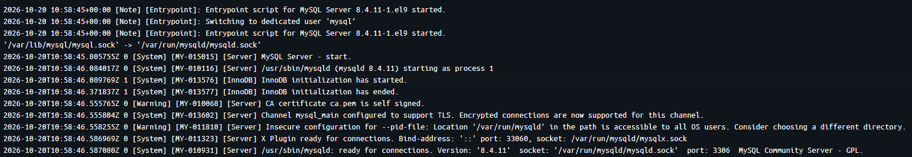

# 1. Database

```yml
# docker-compose.yaml
<...>
  ocr-mysql:
    container_name: mysql-container
    image: mysql:8.4.11-oraclelinux9
    shm_size: '256mb'
    restart: always
    volumes:
      - ../db/schema.sql:/docker-entrypoint-initdb.d/schema.sql:ro
      - mysql-data:/var/lib/mysql
    environment:
      MYSQL_HOST: ${MYSQL_HOST}
      MYSQL_PORT: ${MYSQL_PORT}
      MYSQL_DATABASE: ${MYSQL_DATABASE}
      MYSQL_USER: ${MYSQL_USER}
      MYSQL_PASSWORD: ${MYSQL_PASSWORD}
      MYSQL_ROOT_PASSWORD: ${MYSQL_ROOT_PASSWORD}
    ports:
      - "${MYSQL_PORT}:${MYSQL_PORT}"
    healthcheck:
      test: ["CMD-SHELL", "mysqladmin ping -h localhost -uroot -p$$MYSQL_ROOT_PASSWORD --silent"]
      interval: 10s
      timeout: 5s
      retries: 20

volumes:
  mysql-data:
    driver: local
```



MySQL은 별도의 `Dockerfile`을 통해 이미지 생성을 하지 않고 자체 Compose에서 이미지 생성과 동시에 Container를 실행 시켜 빌드 시간을 단축 시키는 방법으로 구축 완료 했다.

#### 1. Connect Host

```yml
ocr-mysql:
```

`ocr-mysql`은 Spring Boot 서버가 MySQL에 연결할 때 사용하는 서비스 이름이다. Docker Compose 환경에서는 일반적으로 `localhost`를 DB Host로 지정하는 경우가 많지만, 이 설정은 컨테이너 내부에서만 의미가 있는 주소이기 때문에 다른 컨테이너와 통신할 때는 올바른 연결이 되지 않는다.

즉, `localhost`는 현재 실행 중인 컨테이너 자체를 가리키는 값이고, 데이터베이스가 실행 중인 다른 컨테이너를 의미하지 않는다. 따라서 서버에서 `MYSQL_HOST`를 `localhost`로 설정하면 데이터베이스와 통신이 불가능해지고, 연결 에러와 로그가 반복적으로 발생할 수 있다.

이러한 문제를 방지하기 위해서는 Docker Compose에서 정의한 서비스 이름인 `ocr-mysql`을 Host 값으로 명시해주어야 한다. 이렇게 해야 Spring Boot 서버와 MySQL 컨테이너가 같은 네트워크 안에서 연결될 수 있다.

#### 2. Base Image

```yml
image: mysql:8.4.11-oraclelinux9
```


Docker는 `Docker Hub`를 통해 필요한 이미지를 손쉽게 내려받아 사용할 수 있다. MySQL 공식 이미지는 기본적으로 여러 구성 요소를 포함하고 있지만, `mysql:8.4.11-oraclelinux9`처럼 태그를 지정하면 운영체제 레이어를 경량화하고, 필요한 기능만 효율적으로 포함한 형태로 구성할 수 있다.

즉, `mysql:8.4.**` 계열은 용량이 다소 커질 수 있지만, `oraclelinux9` 태그를 사용하면 불필요한 기능을 줄여 이미지 크기와 초기 구동 시간을 낮출 수 있다. 이는 개발 환경에서 빠르게 컨테이너를 띄우고, 배포 시 불필요한 리소스 낭비를 줄이는 데 유리하다.

결론적으로 MySQL 이미지를 선택할 때는 단순히 버전만 보지 않고, 태그 구조와 경량화 여부까지 함께 고려하는 것이 중요하다.

#### 3. restart

```yml
restart: always
```

`restart: always`는 컨테이너가 예기치 않게 종료되었을 때 자동으로 다시 시작되도록 설정하는 옵션이다. 개발 환경에서는 DB 서버가 비정상 종료되면 즉시 복구가 필요하기 때문에, 이 설정을 통해 수동으로 재시작하는 번거로움을 줄일 수 있다.

특히 MySQL은 초기 구동 중 오류가 발생하거나 외부 환경 변화로 인해 일시적으로 종료될 수 있기 때문에, 자동 재시작 설정은 서비스 안정성을 높이는 데 큰 도움이 된다. 단, 의도적으로 종료해야 하는 상황에서는 별도로 컨테이너를 중지해 주어야 하므로, 이 옵션은 안정적인 개발 환경을 구성할 때 매우 유용하게 사용된다.


#### 4. Volume

```yml
volumes:
  - ../db/schema.sql:/docker-entrypoint-initdb.d/schema.sql:ro
  - mysql-data:/var/lib/mysql

volumes:
  mysql-data:
    driver: local
```

`../db/schema.sql:/docker-entrypoint-initdb.d/schema.sql:ro`는 MySQL Container가 최초 실행될 때 초기 스키마를 자동으로 적용하기 위한 경로이다. 이 경로는 Host의 SQL 파일을 Container 내부의 초기화 디렉터리에 Read-Only로 마운트한다. 이 설정 덕분에 Container가 새로 생성될 때마다 동일한 DDL/DML 구조를 반영할 수 있어 개발 환경을 빠르게 구성할 수 있다.

다음으로 `mysql-data:/var/lib/mysql`는 MySQL 데이터 저장 경로를 Named Volume으로 연결하여 DB 데이터를 영속적으로 유지하도록 설정한다. 이 볼륨을 사용하면 Container를 삭제하거나 재생성하더라도 기존 데이터가 사라지지 않아 데이터 손실을 방지할 수 있다. 마지막으로 `driver: local`은 로컬 디스크를 활용해 볼륨을 저장하도록 지정하여 개발 환경에서 가장 단순하고 안정적인 방식으로 데이터 저장소를 구성한다.

즉, Volume 설정은 단순히 파일을 넣는 기능이 아니라 초기 스키마 자동 적용과 DB 데이터 보존이라는 두 가지 목적을 동시에 수행한다. 이 부분이 없으면 매번 수동으로 DB를 초기화해야 하며, Container 재시작 시 데이터가 유지되지 않아 개발 생산성이 크게 떨어질 수 있다.

#### 5. Environment

```yml
environment:
  MYSQL_HOST: ${MYSQL_HOST}
  MYSQL_PORT: ${MYSQL_PORT}
  MYSQL_DATABASE: ${MYSQL_DATABASE}
  MYSQL_USER: ${MYSQL_USER}
  MYSQL_PASSWORD: ${MYSQL_PASSWORD}
  MYSQL_ROOT_PASSWORD: ${MYSQL_ROOT_PASSWORD}

ports:
  - "${MYSQL_PORT}:${MYSQL_PORT}"
```

`environment`는 MySQL Container가 초기화될 때 필요한 핵심 설정 값을 정의하는 단계이다. `MYSQL_DATABASE`, `MYSQL_USER`, `MYSQL_PASSWORD`는 애플리케이션이 연결할 기본 DB와 계정을 생성하는 데 사용되며, `MYSQL_ROOT_PASSWORD`는 루트 계정의 비밀번호를 설정한다. 여기서 값은 보통 `.env` 파일이나 Compose 실행 환경 변수로 분리해 두는 방식이 일반적이며, 보안 및 관리 편의성을 높여 준다.

`MYSQL_HOST`와 `MYSQL_PORT`는 Spring Boot 서버 또는 다른 서비스가 MySQL에 연결할 때 사용하는 주소 정보와 동일한 값을 유지해야 한다. 즉, 서버 코드와 Docker Compose 설정이 서로 일치하지 않으면 컨테이너 간 통신 또는 외부 접속이 실패하게 된다.

`ports` 항목인 `"${MYSQL_PORT}:${MYSQL_PORT}"`는 호스트 머신에서 실제로 DB에 접근할 수 있도록 포트를 외부에 노출한다. 이를 통해 로컬 개발 환경에서는 `localhost:3306` 또는 환경 변수 값으로 MySQL에 직접 접속할 수 있다. Workbench, DBeaver, IntelliJ Database Tool과 같은 데이터베이스 클라이언트는 이 포트를 통해 Container 내부 MySQL에 연결할 수 있다.

이 설정은 단순히 값만 넣는 것이 아니라, 애플리케이션과 DB가 안전하게 연결되도록 네트워크 정보와 인증 정보를 함께 정리해 주는 역할을 한다. 따라서 DB 환경 구성을 마친 뒤에는 서버 설정과 변수를 반드시 맞춰서 검증하는 과정이 필요하다.

#### 6. Health Check

```yaml
healthcheck:
  test: ["CMD-SHELL", "mysqladmin ping -h localhost -uroot -p$$MYSQL_ROOT_PASSWORD --silent"]
  interval: 10s
  timeout: 5s
  retries: 20
```

Health Check는 Container가 정상적으로 실행 중인지 지속적으로 점검하는 기능이다. 위 설정은 `mysqladmin ping` 명령을 실행해 MySQL이 실제로 응답하는지를 확인한다. `-h localhost`는 로컬 MySQL 엔진에 연결하여 서버 상태를 검사하고, `-uroot -p$$MYSQL_ROOT_PASSWORD`는 루트 계정으로 인증을 수행한다. `--silent` 옵션은 출력이 많아지는 것을 줄이고 상태 확인에 집중하게 한다.

`interval: 10s`, `timeout: 5s`, `retries: 20`은 각각 검사 간격, 시간 제한, 실패 허용 횟수를 의미한다. 즉, 10초마다 상태를 확인하고 5초 이내에 응답이 없으면 실패로 간주하며, 20회 연속 실패 시 컨테이너 상태를 비정상으로 판단한다.

이 기능을 활용하면 MySQL이 초기화 중이거나 비정상 종료된 상태인지 사전에 식별할 수 있다. 특히 Compose 환경에서 다른 서비스가 DB 준비 상태를 기다리기 어려울 때, Health Check는 서비스 의존성을 안정적으로 관리하는 데 매우 유용하다. 결과적으로 Container가 완전히 준비되지 않은 상태에서 앱이 연결을 시도하는 문제를 줄이고, 서비스 안정성을 높이는 역할을 한다.