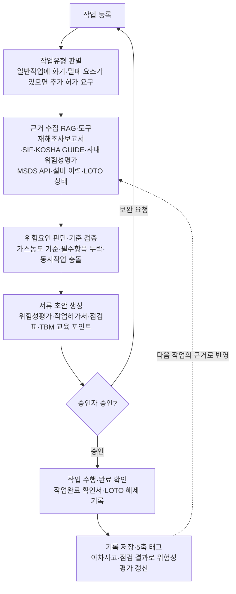

# 산업현장 안전관리 AI 에이전트 프로젝트 계획서

2026-10-26

## 1. 프로젝트 개요

산업현장의 위험작업과 일일 안전관리를 돕는 **범용 안전관리 AI 에이전트 시스템**을 만든다. 작업책임자가 오늘 작업을 등록하면 에이전트가 관련 지침과 사고사례를 찾아(RAG) 위험성평가·작업허가·점검표·TBM 교육 포인트를 만들고, 승인 요청과 일일 안전일지, 기록 보관까지 이어간다(에이전트). 모든 기록은 감독·감사·사고 조사에 대비한 이력으로 남는다.

- **대상**: 안전관리 조직이 갖춰진 대형 현장부터 안전관리자가 없는 50인 미만 사업장까지. 같은 엔진을 쓰고, 역할·기능·출력 방식을 설정으로 바꾼다.
- **사용자 역할**: 작성자(작업책임자·현장 반장), 승인자(안전관리자·관리감독자·대표), 관리자(설정·기록 조회). 작은 사업장에서는 한 사람이 여러 역할을 겸할 수 있다.
- **최종 승인은 반드시 사람**이 한다. 에이전트는 초안 작성, 누락·기준 위반 검출, 마감 알림, 기록 정리를 맡는다.
- **팀·기간**: 개발자 4명, **1개월**. 메인 프로젝트로 진행하며, 결과물과 함께 4명 모두 화면·서버·AI 에이전트를 직접 다뤄보는 것을 목표로 한다(8장).
- **1개월 완료 기준**: 공공 데이터 기반 에이전틱 RAG가 동작하고, 대표 시나리오 6개를 입력부터 승인 요청·인쇄·기록 조회까지 시연할 수 있다 (9장).
- **운영 방식**: 대기업 현장은 사내망 설치형, 소규모 사업장은 클라우드형으로 제공한다. LLM 호출을 한 곳에 모아 바꿔 끼울 수 있게 만든다. 1개월 데모는 공공 데이터와 가상 데이터로 한다.

## 2. 범위

범위는 **위험작업 관리와 일일 안전관리 전반**으로 한다. 첫 데모는 위험작업이 많은 플랜트·제조 현장을 기준으로 만들고, 공단의 업종별 가이드를 데이터로 추가해 다른 업종으로 넓힌다.

**두 가지 사용 모드**

| 구분 | 대형 현장 | 50인 미만 사업장 |
| --- | --- | --- |
| 에이전트 역할 | 검증 모드: 작성된 내용의 누락·기준 위반 검출 | 안내 모드: 무엇을 해야 하는지, 왜 이 위험요인이 나왔는지 쉬운 말로 설명 |
| 승인자 | 안전관리자 | 대표·관리감독자 |
| 출력 | 전산 시스템 등록 데이터 | 인쇄용 양식(PDF), 손서명 |
| 운영 | 사내망 설치형 | 클라우드형 |
| 부가 기능 | 등록 마감 현황, 일일 안전일지, 감사 대응 보고서 | 필요한 기능만 켜서 사용 |

**이 범위를 고른 이유**

- 매일 반복되는 서류 작업이라 시간을 줄여주는 효과가 바로 보인다.
- 위험성평가와 작업허가는 법적 의무이고, 50인 미만 사업장도 2024년 1월부터 중대재해처벌법 적용 대상이 되어 매일의 기록이 중요해졌다.
- 안전관리자가 없는 곳일수록 초안 작성과 기록 보관을 대신해 주는 효과가 크다.

**범위 밖 (확장 단계에서 추가)**

- 양중·굴착·정전 작업허가, LOTO, 변경관리(MOC)
- 외부 전산 시스템과의 실제 연동 (1개월은 API 규격만 정의)
- 신규자·건강이상자 관리대장 (건강정보는 민감정보라 별도 설계 필요)
- 유해위험방지계획서, 폐기물 처리 증명 같은 비정기 서류

**확장 순서**: 고위험 작업허가 추가(양중·굴착·정전) → 인쇄 양식 전체 → 외부 시스템 연동 → 업종 확대(건설·물류·서비스)

## 3. 매일 관리 항목

매일 6개 항목을 작성·승인하고, 아차사고는 발생할 때마다 등록한다. 항목들은 따로 놀지 않고 **작업 등록 → 위험성평가 → 작업허가·점검 → TBM → 일일 안전일지**로 이어지며, 모든 기록이 이력으로 남는다.

| 순서 | 항목 | 작성 → 확인 | 에이전트 역할 | 사람이 하는 일 | 1개월 인쇄 양식 | 공식 서식 출처 |
| --- | --- | --- | --- | --- | --- | --- |
| 1 | 당일 작업 등록 | 작성자 | 입력을 해석하고 고위험 여부 판별, 정보가 부족하면 되물음 | 작업 내용·인원 입력 | - | 사내 양식 기준 |
| 2 | 일일 위험성평가(JSA) | 작성자 → 승인자 | 작업 단계별 위험요인·감소대책 초안, 빈도×강도 점수 | 조치 확인 서명 | ○ | 노동부·공단 「새로운 위험성평가 안내서」(2023) |
| 3 | 작업허가(PTW) 신청·승인 | 작성자 → 승인자 | 화기·밀폐·고소 허가서 초안, 사진·도면 첨부란, 측정값 없으면 승인 요청 차단 | 측정값 입력, 사진 첨부, 승인 | 화기작업허가 ○ | KOSHA GUIDE 안전작업허가 관련 지침 |
| 4 | 장비·작업구역 일일 점검 | 작성자 → 승인자 | 오늘 투입 장비와 구역에 맞는 점검 항목만 선별 | 현장 확인·체크 | - | 공단 체크리스트, 안전보건규칙 |
| 5 | TBM 실시 기록 | 작성자 | 위험성평가·작업허가로 교육 포인트 생성, 사진의 날짜·인원 확인, 참석 인원 요약 | TBM 진행, 사진·서명 | ○ | 위험성평가 안내서 부록 |
| 6 | 일일 안전일지 | 승인자 | 오늘 작업허가·위험성평가로 순찰 계획, 전날 지적사항 조치 현황 요약 | 검토·확정 | - | 사내 양식 기준 |
| 수시 | 아차사고 보고 | 누구나 | 5축 자동 태깅, 같은 구역·작업 신청 시 경고 | 보고 | - | 사내 양식 기준 |

**기록 보관**: 누가 언제 작성·수정·승인했는지, 에이전트 초안과 사람이 고친 내용의 차이, 근거로 쓴 지침 조항, 첨부 사진의 촬영 시각을 모두 남긴다. "지난달 가스측정 값 없이 승인된 화기작업이 있었나" 같은 질문에 답하고, 기간별 위험성평가 실시율·허가 승인 현황·지적사항 조치율을 보고서로 정리한다.

**출력 방식**: 모든 항목을 하나의 JSON 데이터로 만들고, 이를 **전산 시스템 등록 데이터**와 **인쇄용 양식(PDF)** 두 가지로 내보낸다. 데이터가 하나라 두 출력의 내용이 어긋나지 않는다.

- **MSDS**는 관리 항목이 아니라 에이전트가 공단 API로 조회하는 데이터로 들어간다.
- 사업장마다 양식이 다르므로, 공단 서식을 기본 틀로 두고 **사업장 양식을 업로드하면 항목을 매핑**하는 구조로 만든다.
- 법정 기재항목은 시행규칙 개정 시 바뀌므로 국가법령정보센터로 개정 여부를 주기적으로 확인한다.

**1개월 범위**: 위 7개 항목 전부, 기록 조회, 인쇄 양식 3종(위험성평가, 화기작업허가, TBM). 작업허가는 **화기·밀폐공간·고소** 3종만 깊이 있게 만든다.

## 4. 데이터 확보 계획

지식 데이터는 정부 공개 자료로 바로 시작하고, 개별 공장 데이터와 암묵지는 이후 현장 연동 단계에서 확보한다. 1개월 동안은 공개 자료만으로 만든다. RAG는 모델 학습이 아니므로 대량 데이터가 아니라 업무에 맞는 문서 수백\~수천 건이면 동작한다.

**정부 공개 데이터 (즉시 사용)**

| 데이터 | 용도 | 형태 | 비고 |
| --- | --- | --- | --- |
| [고용노동부 재해조사보고서 (AI 학습용)](https://www.data.go.kr/catalog/15162988/fileData.json) | 유사 사고 원인·대책 검색 | CSV | 공공누리 제3유형(변경금지), 활용 방식 법무 확인 |
| [공단 사망사고 고위험요인(SIF) 아카이브](https://www.data.go.kr/catalog/15161362/openapi.json) | 고위험 작업·재해유발요인 | API, CSV | 위험성평가 결과·연계 법규 포함 |
| [KOSHA GUIDE](https://data.go.kr/catalog/15144147/openapi.json) | 작업별 기술 기준 | API(목록) + PDF | 본문은 PDF 파싱 필요, 법적 구속력 없음 |
| 위험성평가 안내서·업종별 가이드 | 위험요인 예시, 서식 | PDF | 4M 항목, 빈도×강도 산출 예시 포함 |
| [공단 MSDS API](https://www.data.go.kr/data/15157612/openapi.do) | 물질 유해성 조회 (도구 호출) | API | CAS No. 등으로 16개 항목 조회 |
| [AI허브 화학물질 위험성 예측 데이터](https://aihub.or.kr/aihubdata/data/view.do?currMenu=115&topMenu=100&dataSetSn=71816) | GHS 분류 보강 | JSON | 약 2만 건 |
| 산업재해 통계 마이크로데이터 | 업종별 위험 패턴 | CSV | 2017\~2023년, 발생형태별 분류 |

**정부도 갖고 있지 않은 데이터 (현장 연동 단계에서 확보)**

- 개별 사업장의 위험성평가표, 점검일지, 작업허가 이력: 사업주가 기록·보존하는 의무라 정부에 제출되지 않는다.
- 숙련자 암묵지: 정부가 2027년부터 데이터 라이브러리로 구축 예정이나 국가 관리 체계라 공개 다운로드 가능성은 낮다. 현장 연동 단계에서 숙련자 인터뷰로 직접 구축한다.

**검증용 정답 세트**: 안전 전문가와 함께 "이 작업이면 이 위험요인·허가가 나와야 정답" 수백 문항을 만든다. 1개월 동안은 30문항으로 시작해 완료 판정에 쓴다.

## 5. 분류 체계

모든 기록(아차사고, 점검 결과, 작업허가)에 5개 축의 태그를 붙인다. 공공 데이터와 사내 데이터를 같은 기준으로 묶고, RAG 검색을 "화기작업 + 인화성 물질 + 아차사고"처럼 필터링하기 위해서다.

| 축 | 값 | 근거 기준 |
| --- | --- | --- |
| 심각도 | 아차사고 / 경상 / 중상 / 사망, SIF 가능성 여부 | 공단 SIF 아카이브 (Potential·Precursor) |
| 발생형태 | 화재, 폭발·파열, 누출·접촉, 산소결핍, 끼임, 떨어짐, 부딪힘 등 | 산업재해 통계 분류 |
| 위험요인 | 기계적 / 전기적 / 화학적 / 작업환경 / 인적·관리 | 위험성평가 안내서, 4M |
| 작업유형 | 일반, 화기, 밀폐공간, 고소, 전기, 중량물 | 작업허가 체계 |
| 관련 물질 | CAS 번호, GHS 분류 | MSDS |

플랜트 현장에서는 화재·폭발·누출과 산소결핍의 비중이 커서, 화기·밀폐공간 허가와 MSDS 연동이 이 분류와 직접 엮인다. 아차사고 보고서는 위험성평가 갱신의 입력이 되어 "아차사고 → 위험성평가 → TBM·PTW" 순환을 만든다.

## 6. 에이전트 구조와 작업 흐름

에이전트는 작업 등록부터 근거 수집·판단·초안 작성까지 처리하고, 승인은 사람이 한다. 승인되지 않으면 보완 요청으로 신청 단계에 돌려보낸다.



완료 기록은 5축 태그와 함께 저장되고, 아차사고·점검 결과가 위험성평가를 갱신해 다음 작업의 근거가 된다. 검색이 한 번에 끝나지 않고 에이전트가 판단하며 반복하는 구조는 7장에서 다룬다.

## 7. 에이전틱 RAG 설계

일반 RAG는 질문 한 번에 검색 한 번으로 끝나지만, 에이전틱 RAG는 에이전트가 무엇을 찾을지 계획하고, 부족하면 다시 찾고, 근거와 기준으로 스스로 검증한 뒤 서류를 쓴다. 작업 하나에 사고사례·지침·물질정보·규칙을 모두 엮어야 하는 작업허가 업무에 맞는 구조다.

| 구분 | 일반 RAG | 이 프로젝트의 에이전틱 RAG |
| --- | --- | --- |
| 검색 횟수 | 1회 | 계획에 따라 여러 번, 부족하면 질의를 고쳐 재검색 (최대 3회) |
| 검색 대상 | 문서 묶음 하나 | 사고사례·지침·MSDS·규칙을 도구별로 나눠 호출 |
| 필터 | 없음 | 5축 태그로 좁힘 (예: 화기 + 인화성 + 화재·폭발) |
| 수치 판단 | LLM이 추정 | 규칙 엔진(코드)이 판정, LLM은 해석과 작성만 |
| 결과 검증 | 없음 | 모든 위험요인·대책에 출처 인용, 규칙 위반 시 초안 보류 |

**에이전트 루프**

1. **계획**: 신청 내용에서 작업·장소·물질·설비를 뽑고, 어떤 도구를 어떤 순서로 쓸지 정한다.
2. **검색**: 사고사례·지침·MSDS를 병렬로 조회한다.
3. **충분성 판단**: 작업유형별 필수 근거(예: 화기작업이면 화재·폭발 사례와 가연성가스 기준)가 다 모였는지 확인하고, 빠지면 질의를 고쳐 다시 찾는다.
4. **판단**: 위험요인과 감소대책을 정하고, 수치 기준은 규칙 엔진에 넘긴다.
5. **자기 검증**: 출처 없는 주장, 필수 항목 누락, 기준 위반을 검사한다.
6. **출력**: JSON 스키마로 양식을 채우고, 승인 요청을 만든다.

**도구 목록**

| 도구 | 하는 일 | 데이터 |
| --- | --- | --- |
| search\_accidents | 유사 사고·아차사고 검색 (5축 필터) | 재해조사보고서, SIF 아카이브, 사내 아차사고 보고 |
| search\_guides | 작업별 기준·대책·점검 항목 검색 | KOSHA GUIDE, 위험성평가 안내서, 공단 체크리스트·업종별 가이드 |
| lookup\_msds | 물질 유해성·응급조치 조회 | 공단 MSDS API |
| classify\_work | 작업유형 판별, 고위험 여부와 필요한 허가 | 작업유형 규칙 |
| check\_rules | 가스농도·필수항목·감시인 배치 판정 | 규칙 엔진 (코드) |
| check\_photo | TBM·작업구역 사진의 날짜·인원·현장 확인 | 첨부 사진 |
| fill\_form | 관리 항목 작성과 스키마 검증 | 항목별 JSON 스키마 |
| export\_form | 전산 등록 데이터·인쇄용 PDF 출력 | JSON 스키마 + 인쇄 템플릿 |
| search\_records | 기록 조회와 감사 대응 보고서 정리 | 작성·승인 이력 |
| request\_approval | 승인자에게 승인 요청, 마감 알림 | 설정된 역할 |

**기술 구성 (기존 미니 프로젝트 기준)**: 기존 React → Spring Boot → FastAPI, MySQL 구조 위에서 만든다. 인증, 응답 형식, 비동기 실행과 진행 상태 조회, AI 서버 연결, PDF 처리는 이미 있으므로 그대로 쓰고, 에이전트와 검색에 필요한 부분만 더한다.

| 계층 | 기존 프로젝트에 있는 것 (그대로 사용) | 이번에 추가하는 것 |
| --- | --- | --- |
| 화면 (React 19 + Vite) | API 호출 래퍼, 토큰 저장, 응답 형식 검증, 실행 상태 폴링 화면 | 대시보드 레이아웃, 승인 화면, 양식 입력 화면, 에이전트 진행 단계 표시 |
| 서버 (Spring Boot 4, Java 17) | JWT 로그인, 공통 응답 형식 {success, data, error}, 커밋 후 비동기 처리와 실행 상태 저장, FastAPI 클라이언트와 목업 클라이언트 전환(app.ocr.client), PDFBox | 사용자 역할(작성자·승인자·관리자), 업무 테이블, 에이전트 실행·단계 기록(agent\_runs, agent\_steps), MockAgentClient·FastApiAgentClient, 에이전트용 내부 조회 API, 인쇄 PDF 템플릿 |
| AI 서버 (FastAPI, Python 3.12, 서비스명 agent-model) | LLM 클라이언트 인터페이스와 가짜 클라이언트, NETWORK\_ENV=OPEN/CLOSED로 외부 엔진 차단, PDF 텍스트 추출·OCR | 에이전트 루프와 도구 10종, 도구 호출을 지원하는 LLM 클라이언트, 임베딩(OPEN이면 API, CLOSED면 설치형), 키워드+벡터 하이브리드 검색 |
| 저장소 | MySQL 8.4 (업무 데이터·작성·승인 이력) | Qdrant (벡터 검색 + 5축 태그 필터, 설치형 운영 가능), Flyway 마이그레이션 |
| 실행 환경 | Docker Compose (화면, Spring, agent-model, MySQL) | qdrant 서비스·볼륨, 환경 변수 추가 |

- AI 서버는 MySQL에 직접 붙지 않고 Spring 내부 API로 업무 기록을 조회한다. 권한과 이력이 한 곳에서 관리된다.
- 에이전트 진행 상황은 기존 OCR과 같은 방식(실행 저장 → 비동기 처리 → 화면 폴링)으로 보여준다. 실시간 스트리밍(SSE)은 3주차 이후 선택 과제다.
- NETWORK\_ENV=CLOSED가 대형 현장의 설치형·폐쇄망 운영에 그대로 대응한다. LLM과 임베딩 호출을 한 곳에 모아 설치형 모델로 바꿀 수 있게 한다.

## 8. 1개월 개발 계획

메인 프로젝트이므로 결과물과 함께 **4명 모두 화면부터 서버, AI 에이전트까지 직접 해보며 배우는 것**을 목표로 한다. 그래서 각자 공통 엔진 하나(깊이)와 **업무 기능 하나를 화면부터 에이전트까지(넓이)** 함께 맡는다. 1\~2주차에 전부 동작하게 만들고, 3\~4주차에는 각자 맡은 업무를 튜닝·확장한다.

| 개발자 | 1주차 (만들기) | 2주차 (만들기) | 3주차 (튜닝) | 4주차 (확장) |
| --- | --- | --- | --- | --- |
| A 검색 · 아차사고 | 검색·태그 규격 / 화기 데이터 관통 | 전체 데이터·근거 인용 / 아차사고 화면~경고 | 검색 품질 튜닝 / 태깅 정확도 개선 | 업종별 가이드 추가 / 시나리오 C 시연 |
| B 에이전트 · 일반작업 | 에이전트 루프 / 등록 대화 화면 | 되묻기·고위험 판별 / 위험성평가·TBM | 판별 정확도·속도 / 근거 인용 품질 | 판단 고도화 / 시나리오 A·F 시연 |
| C 규칙 · 허가 · 사진 | 규칙 엔진 / 화기 작업허가 | 밀폐·고소 허가 / 점검표·사진 1차 | 사진 인식 고도화 / 규칙 예외 보완 | 양중·굴착·정전 허가 / 시나리오 B 시연 |
| D 플랫폼 · 기록 AI | 공통 UI·이력 저장 / 스키마 렌더러 | 대시보드·승인 흐름 / 기록 질의·안전일지 | 감사 보고서 / 인쇄 PDF 3종 | 인쇄 양식 확대 / 시나리오 D·E 시연 |
| **주차 말 목표** | 시나리오 A 골격 관통 | **6개 시나리오 동작** | 정답 세트 성능 확보 | 확장·최종 시연 |

| 개발자 | 깊이: 공통 엔진 | 넓이: 업무 기능 (화면 → 서버 → 에이전트) | 주로 쓰는 AI 기술 | 시연 책임 |
| --- | --- | --- | --- | --- |
| A | 검색(RAG)·5축 태깅, 공공 데이터 적재, MSDS 조회, 근거 인용 | **아차사고**: 보고 화면 → 저장 → 자동 태깅 → 같은 구역 작업 신청 시 경고 | 임베딩·하이브리드 검색, 분류 | 시나리오 C |
| B | 에이전트 루프·도구 호출 구조, 안내·검증 모드 | **일반작업·위험성평가·TBM**: 등록 대화 화면 → 되묻기 → 고위험 판별 → 일일 위험성평가 → TBM 교육 포인트 | 에이전트 오케스트레이션, 대화형 생성 | 시나리오 A·F |
| C | 규칙 엔진·스키마 검증 | **고위험 작업허가·점검·사진 확인**: 허가 화면 → 측정값 판정 → 승인 차단 → 장비·구역 점검표 → 작업구역·TBM 사진 인식 | 규칙 + LLM 결합, 이미지 인식 | 시나리오 B |
| D | 플랫폼: 공통 UI, 대시보드, 승인 흐름, 이력 저장, 인쇄 PDF | **기록 위의 AI**: 질의 화면 → 기록 조회 도구 → 근거 있는 답·감사 보고서, 일일 안전일지 요약 생성 | 자연어 → 기록 조회, 기록 기반 요약 생성 | 시나리오 D·E |

D는 공통 작업이 크니 AI는 **기록 위에서 돌아가는 한 영역**만 맡는다. 질의응답·감사 보고서·안전일지 모두 자기가 만든 이력 저장 구조를 읽는 일이라 다른 사람을 기다리지 않는다. 사진 인식은 작업허가의 사진·도면 첨부와 같은 성격이라 C가, 안전일지는 기록 요약이라 D가 맡아 **A·C·D를 중상, B를 상으로 맞췄다.**

**4명 모두 똑같이 경험하는 것**

| 경험 | A | B | C | D |
| --- | --- | --- | --- | --- |
| 화면 만들기 (D의 공통 컴포넌트 사용) | ○ | ○ | ○ | ○ |
| 서버·API | ○ | ○ | ○ | ○ |
| 프롬프트 작성 | ○ | ○ | ○ | ○ |
| 자기 도구를 에이전트에 등록해 호출되게 하기 | ○ | ○ | ○ | ○ |
| RAG 검색 결과를 받아 쓰기 | ○ | ○ | ○ | ○ |
| 자기 업무 정답 세트로 성능 평가 | ○ | ○ | ○ | ○ |

핵심은 **모든 사람이 자기 업무용 도구와 프롬프트를 B의 에이전트 루프에 직접 붙인다**는 점이다. 그래야 에이전트가 내 도구를 언제 왜 부르는지를 4명 모두 손으로 겪는다. 스키마 기반 자동 화면은 양식 입력 화면에만 쓰고, 각자의 핵심 화면(등록 대화, 허가 판정, 아차사고 보고, 기록 질의)은 본인이 직접 만든다.

**서로의 엔진을 이해하게 만드는 장치**

- **주 1회 30분 모듈 설명회**: 각자 자기 엔진이 어떻게 동작하는지 설명한다.
- **교차 코드 리뷰**: A↔C, B↔D로 짝을 정해 서로의 코드를 리뷰한다.
- **도구 연결은 B와 짝 작업**: 각자 자기 도구를 에이전트에 붙일 때 B와 함께 하며 에이전트 구조를 배운다.

**단계별 나누는 기준**: 1\~2주차는 공통 엔진을 한 번만 제대로 만드는 것이 중요해 엔진 소유를 나누고, 3\~4주차는 같은 엔진 위에서 각자 맡은 업무의 품질과 확장을 끝까지 책임진다.

**난이도와 대응**

| 개발자 | 난이도 | 어려운 지점 | 대응 |
| --- | --- | --- | --- |
| A | 중상, 일정 예측 어려움 | 한글 PDF 추출, 수천 건 태깅 정확도, 동의어 검색 튜닝 | 1주차에 화기 관련 데이터만 먼저 추출→태깅→검색까지 관통해 품질 확인 |
| B | **상** (사진 인식을 넘겨 완화) | 되묻기 판단, 연속 도구 호출 안정성·속도, 통합 디버깅 집중 | 되묻기는 필수 항목 체크리스트로 시작. 경험이 가장 많은 사람을 배치 |
| C | 중상 | 지침을 규칙으로 옮기는 해석, 사진 속 날짜·현장·인원 인식 정확도 | 2주차에는 사진 첨부 여부·인원수만, 3주차에 날짜·현장 인식 고도화 |
| D | 중상 | 화면 범위가 넓음, 감사 질의는 틀리면 안 됨, 요약이 기록과 어긋나면 안 됨 | 기록 질의는 정해진 조회 유형 10개 정도를 AI가 골라 채우는 방식. 안전일지 1차는 정해진 형식으로 요약 |

**0일차 준비**: 기존 프로젝트에서 바꾸거나 더해야 하는 기반 작업이다. 1일차 시작 전에 끝내야 4명이 같은 환경에서 바로 시작한다.

| 할 일 | 내용 | 담당 |
| --- | --- | --- |
| 스키마 변경 방식 | 지금 schema.sql은 MySQL 최초 기동 때만 실행되어, 테이블을 바꾸려면 데이터를 지워야 한다. Spring에 Flyway를 넣고 schema.sql을 첫 마이그레이션으로 옮긴 뒤, 이후 테이블 추가는 번호 붙인 파일로 한다. 테이블별 담당자를 정한다. | D |
| 벡터 저장소 | compose에 Qdrant 서비스와 볼륨을 추가한다. | A |
| 임베딩 모델 | NETWORK\_ENV가 OPEN이면 API 임베딩, CLOSED면 설치형 임베딩을 쓰도록 기존 엔진 선택 방식을 따른다. | A |
| 환경 변수 | AI 시간 제한(현재 30초)과 출력 토큰(현재 1,000)을 에이전트용으로 올리고, QDRANT\_URL과 AI 서버 → Spring 내부 API 주소를 추가한다. LLM 모델과 월 비용 한도도 정한다. | B |
| 에이전트 실행 구조 | 기존 ocr\_runs처럼 agent\_runs(실행)·agent\_steps(단계 로그) 테이블을 만들고, Spring에 MockAgentClient·FastApiAgentClient를 MockOcrClient와 같은 방식으로 둔다. | B |
| 시연 데이터 | 가상 한 달치 작업·점검·아차사고 기록을 넣는 시드 스크립트를 만든다. 마이그레이션과 분리한다. | D |
| 공공 데이터 활용신청 | MSDS, KOSHA GUIDE 등 공공데이터포털 API 키를 발급받는다. 승인까지 며칠 걸릴 수 있어 가장 먼저 신청한다. | A |
| 저장소 정리 | users 역할 컬럼 추가, requirements.txt UTF-8 변환, .gitignore로 빠진 파일(LocalFileStorage, schema.sql)이 팀 저장소에 들어갔는지 확인한다. | 리드 (진행 중) |

**3일차 규격**: ① 항목 JSON 스키마와 도구 호출 형식(B), ② 검색 API와 5축 태그 형식(A), ③ 화면 공통 컴포넌트와 승인 흐름(D). 이후 각자 목업(MockAgentClient와 가짜 도구 응답)으로 병렬 개발하다가 실제 모듈로 바꿔 끼운다. 기존 테스트 코드 방식을 이어서 각자 자기 서비스·클라이언트 테스트를 함께 작성한다.

- **2주 완성 조건**: 3일차 규격이 3일 안에 나오고, 1주차 금요일에 가짜 응답으로라도 시나리오 A가 끝까지 돌아야 한다. 2주차에 처음 붙이면 통합 문제로 2주차가 다 간다.
- **3주차로 넘긴 것**: 사진 인식 고도화(2주차는 첨부 여부·인원수만), 감사 보고서 서식(2주차는 질의응답까지), 인쇄 PDF 2·3종. 늦어져도 시연 흐름을 막지 않는다.
- **판단 규칙은 정부 지침 기반**: 수치 기준과 필수 항목은 산업안전보건기준에 관한 규칙, KOSHA GUIDE, 위험성평가 안내서에서 가져오고, 규칙마다 근거 조항을 함께 저장해 출력에 인용한다. 정답 세트도 같은 근거로 각자 자기 업무 문항을 7\~8개씩 만든다. 현장 투입 전에는 실무자 검증을 받는다.
- **1개월 범위 밖**: 외부 시스템 실제 연동, 현장 데이터, LOTO, MOC, 신규자·건강이상자 관리대장. 양중·굴착·정전 허가와 업종 확대는 4주차 확장 과제로 시도한다.

## 9. 완성 예시 (데모 시나리오)

1개월 뒤 시연은 아래 6개 시나리오로 한다. 핵심은 **작업책임자가 짧게 요청하면 에이전트가 되묻고, 아침 등록 항목을 한 번에 만들어 승인까지 이어지는 장면**이다. 아래 설비명·수치는 시연용 가상 예시다.

**시연 화면 구성**: 상단에 마감 현황, 왼쪽 작업 등록 대화, 가운데 에이전트 진행 과정(도구 호출·검색 근거), 오른쪽 등록 항목 초안과 승인 버튼.

### 시나리오 A. 짧은 요청 → 되묻기 → 아침 등록 항목 한 번에 생성

**입력 (작업책임자)**

> 오늘 13시에 화기작업 있어. 필요한 거 만들어줘.

**에이전트가 되묻기**: 작업 장소, 화기 종류(용접·절단·그라인더), 주변 취급 물질, 인원과 종료 시간, 투입 장비.

> R-201 반응기 하부 배관 플랜지 볼트 교체. 고착되면 그라인더로 절단. 옆 T-105 탱크에 톨루엔. 3명, 15시까지. 크레인은 안 씀.

**에이전트 진행 과정**

1. 계획: 작업=배관 플랜지 교체, 공구=그라인더(불티 발생), 물질=톨루엔으로 추출
2. classify\_work: 그라인더 절단은 화기작업 → **화기작업허가 필요, 승인 전 작업 개시 불가**
3. lookup\_msds(톨루엔): 인화성 액체, 증기가 공기와 폭발성 혼합물 형성
4. search\_accidents(화기 + 인화성 + 화재·폭발): 유사 사고사례·아차사고 검색, 원인과 대책 요약
5. search\_guides: 화기작업 기준(가연물 제거·가스측정·화재감시자)과 작업구역 점검 항목 확인
6. check\_rules: 가연성가스 측정값 미입력 → **초안은 작성, 측정 전 승인 요청 차단**. 같은 구역 13\~15시 다른 허가와 충돌 없음 확인
7. 출력: 위험성평가(JSA), 화기작업허가, 작업구역 점검표, TBM 교육 포인트를 함께 생성

**출력 1. 일일 위험성평가(JSA) 초안 (일부)**

| 위험요인 | 발생형태 | 감소대책 | 근거 |
| --- | --- | --- | --- |
| 그라인더 불티가 톨루엔 증기에 착화 | 화재·폭발 | 작업 전·중 가연성가스 측정, 불티 비산방지포, 화재감시자 배치 | KOSHA GUIDE, MSDS |
| 배관 내 잔류 물질 누출 | 누출·접촉 | 배관 퍼지·세정 후 맹판 설치, 밸브 잠금(LOTO) | 사고사례 검색 결과 |
| 고착 볼트 절단 중 공구 반동 | 절단·베임 | 공구 방호덮개 확인, 보호구 착용 | 위험성평가 안내서 |

위험성평가서에는 위 위험요인마다 빈도×강도 점수를 매기고, 감소대책 적용 후 재평가 점수를 함께 적는다. 같은 위험요인과 대책이 화기작업허가서의 위험요인 섹션에도 들어간다.

**출력 2. 화기작업허가서 초안 (JSON, 일부)**

```json
{
  "문서": "화기작업허가서",
  "연계_허가": "일반작업허가 #(신청번호)",
  "작업장소": "R-201 반응기 하부 배관",
  "화기_종류": "그라인더 절단",
  "인근_위험물": [{"물질": "톨루엔", "위치": "T-105", "구분": "인화성 액체"}],
  "가스농도_측정": {"가연성가스_LEL": null, "상태": "측정 필요 - 승인 요청 불가"},
  "화재감시자": "지정 필요",
  "상태": "초안 (허가자 승인 대기 전)"
}
```

**출력 3. 과거 아차사고 참고**: 같은 구역·같은 작업유형으로 보고된 아차사고가 있으면 함께 보여주고, 그 위험요인을 허가서에 반영한다.

**출력 4. 점검표·TBM 교육 포인트**: 작업구역 점검표에는 그라인더 방호덮개, 소화기 비치, 불티 비산방지포 항목만 골라 넣는다. TBM에는 가스측정 결과 확인, 화재감시자 지정, 비상 시 작업중지 신호를 교육 포인트로 넣는다.

### 시나리오 B. 밀폐공간 작업 → 기준 미달 시 차단

탱크 내부 청소 신청에 산소농도 17.5%를 입력하면, check\_rules가 적정공기 기준(산소 18% 이상 23.5% 미만) 미달로 판정해 승인 요청을 막고 환기 후 재측정을 요구한다. 감시인·송기마스크 항목이 비어 있어도 같은 방식으로 막는다.

### 시나리오 C. 아차사고 보고 → 다음 고소작업에 경고

작업자가 "배관 랙 위 점검 중 발판이 미끄러져 넘어질 뻔함"을 보고하면, 에이전트가 심각도(아차사고)·발생형태(떨어짐)·작업유형(고소)·위치로 자동 태깅한다. 며칠 뒤 같은 배관 랙에서 고소작업허가 신청이 들어오면 이 아차사고를 근거로 띄우고, 발판 상태 확인과 안전대 부착설비를 필수 조치로 넣는다.

### 시나리오 D. 마감 현황 대시보드 → TBM 기록 → 일일 안전일지

아침 대시보드에 작업팀별 작성 현황과 마감까지 남은 미완료 항목(서명, 가스측정 값, 사진)을 띄운다. TBM 사진을 올리면 날짜 표시와 인원을 확인하고, 참석자 명부와 맞지 않으면 알린다. 승인자에게는 오늘 승인된 허가를 바탕으로 순찰 계획을 잡고, 전날 지적사항의 조치 여부와 장비 점검표를 묶은 일일 안전일지 초안을 만든다.

### 시나리오 E. 감사 대응 질의

안전관리자가 "지난달 화기작업 중 가스측정 값 없이 승인된 건이 있었나?"라고 물으면, 에이전트가 기록에서 해당 건을 찾아 작성자·승인자·승인 시각과 근거를 보여준다. 이어서 월간 위험성평가 실시율, 작업허가 승인 현황, 지적사항 조치율을 정리한 감사 대응 보고서를 만든다. 시연용으로 가상 한 달치 기록을 미리 넣어둔다.

### 시나리오 F. 안전관리자 없는 30인 제조업체 (안내 모드 + 인쇄)

대표가 "내일 공장 지붕 위 환풍기 교체해. 뭐 준비해야 돼?"라고 물으면, 에이전트가 안내 모드로 답한다. 2m 이상 높이의 작업이라 추락 방지 조치와 작업허가·위험성평가가 필요하다는 것부터 쉬운 말로 설명하고, 안전대 부착설비·작업발판 같은 조치를 이유와 함께 알려준다. 결과는 위험성평가서와 TBM 일지를 인쇄용 PDF로 내주고, 서명한 종이를 사진으로 올리면 기록으로 보관한다.

**완료 판정**: 정답 세트 30문항에서 고위험 판별과 핵심 위험요인 포함 여부를 확인하고, 위 6개 시나리오를 끊김 없이 시연할 수 있으면 1개월 목표 달성으로 본다.
