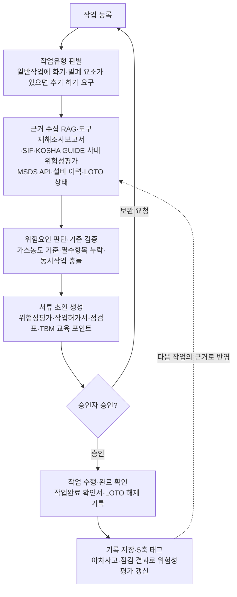
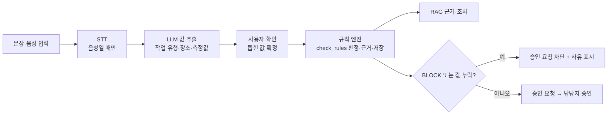

# 산업현장 안전관리 AI 에이전트 프로젝트 계획서 (v2)

2026-10-30 15:40 수정 (v1: 2026-10-26)

## 0. v2에서 바뀐 것

v1 이후 실제로 만들면서 정해지거나 바뀐 내용을 반영했다. 바뀌지 않은 장(2~6장, 9장)은 v1 그대로다.

| 구분 | v1 | v2 (지금 기준) | 반영 위치 |
| --- | --- | --- | --- |
| 사용자 역할 | 작성자·승인자·관리자 3종 | **회사 역할**(관리자·일반 회원) + **현장 역할**(작성자·승인자·현장 관리자) 두 단계. 한 사람이 현장마다 다른 역할 | 1장 |
| 인증 | 기존 JWT 로그인 그대로 사용 | 새로 구현 완료: 가입 → 이메일 인증 → 관리자 승인, refresh 쿠키·로그인 유지, 잠금, 임시 비밀번호, 내 정보 | 7장, 10장 |
| DB 스키마 | 0일차에 Flyway 도입(D) | DB 스키마 작업은 C가 맡음. Flyway V1~V10 + 규칙 시드(R__) | 8장, 10장 |
| 3일차 규격 ① 도구 호출 형식 | B가 정함 | 확정: 내부 경로 `/internal/v1/tools/{tool}`, `X-Internal-Token`, 공통 응답, 단계 기록은 실행 끝에 한 번에 | 7장 |
| check_rules | "규칙 엔진(코드)" | **구현 완료**: 판정·저장·웹/내부 API, 화기·밀폐 규칙. 값 누락은 위반 | 7-3장 |
| 규칙 엔진 확장 | 없음 | **하이브리드 입력**: 문장(텍스트)에서 LLM이 값만 뽑고 판정은 규칙 엔진 그대로. 텍스트는 2주차, 음성(STT)은 3~4주차 확장 | 7-4장, 8장 |
| 화기 작업허가 | 1주차 목표 | **구현 완료**: 작성 → 측정 → 판정 → 승인 요청, BLOCK이면 서버가 승인 요청 차단 | 7-3장, 10장 |
| C 일정 | 1주차 규칙 엔진·화기 허가 | 1~3일차를 인증에 썼지만 3일차 오후에 규칙 엔진·화기 허가까지 완료 (1주차 목표 달성) | 10장 |
| 역할 경계 | AI 서버는 MySQL에 직접 붙지 않음 | **회원·권한·안전 차단·기록은 Spring, ai-model은 AI 처리만** (7-0장) | 7-0장 |
| 실행 환경 | compose 4개 서비스 | 포트·환경 변수·설정 규칙 정리, compose 반영은 통합 때. 개발 중에는 C PC의 서버·DB·Qdrant를 같이 씀 | 11장 |
| 판정 응답 | 위반 항목만 | 적용한 규칙 전체 결과 **checks[]**(PASS·FAIL·MISSING) 추가 | 7-3장 |
| 에이전트 실행 규격 | 정할 예정 | **확정**: 요청 모양, slots 그대로 저장, 실패 시 steps, 초안 저장 방식, 단계 매핑 | 7-2장 |
| check\_rules 도구 | mock | ai-model에 **실제 도구** 추가 (Spring 규칙 엔진 호출, mock과 같은 입출력). 등록은 B | 7-2장 |
| 측정값 되묻기 | 값이 없으면 되묻기 | 등록 단계에서는 되묻지 않고 **초안 생성 + 승인 차단**. 화기 확인 3항목은 허가 화면에서 사람이 체크 | 7-3장 |
| 결재선 | 작성자 → 승인자 | **확정**: 작성자는 요청자, 결재 단계는 승인자 역할(`APPROVER` 등). 기본은 3장 그대로 1단계, 대형 현장은 정책으로 단계 추가. TBM은 1단계 확인 추가. 작업책임자는 작성자 | 7-5장 |
| 보완 요청 | 별도 흐름 | **반려로 통일** (사유 필수, 누락 항목 선택). 재결재는 항상 1단계부터 | 7-5장 |
| 대시보드 누락 집계 | 누락 항목 | **마감 전 미완료 항목**으로 정의 (차단 때문에 누락된 채 승인되는 건은 생기지 않음) | 7-5장 |
| 기록 조회 | 조회 유형 10개 정도 | **`search_records` 도구 하나 + 조회 유형 11개**, 요청·응답 JSON 확정 | 7-5장 |
| 양식 JSON 스키마 | B·D 확인 필요 | **표준 JSON Schema(2020-12)**, B의 Pydantic 양식 모델에서 자동 생성, 화면 정보는 `x-` 키 | 7-5장 |
| 역할·자기 승인·미리보기 (10/30) | 현장 역할 3종 | 한 현장에 역할 하나, **위 역할이 아래 권한 포함**. 자기 승인은 현장 모드로(안내 허용·검증 금지), "자기 승인" 표시. 문서 상태 ↔ 결재 상태 표, 승인 API 목록, 승인 전 미리보기(저장 안 함) | 1장, 7-5장 |
| 파일 저장 위치 (10/30) | 정하지 않음 | `storage/attachments/{현장}/{연}/{월}/`, `storage/documents/{현장}/{양식}/{연}/{월}/`. 업무 기록은 DB, 파일은 첨부·생성 문서만 | 11장 |
| 도입 필요성 (10/30) | 개요 수준 | 사업장 규모별(50인 미만 안내·대규모 검증) 문제점·법적 의무·도입 효과, 작업별 법적 근거와 지원 범위, 기대효과. AI는 결정·승인을 대체하지 않음 | 1-A장 |
| 루프 설계 (10/30) | 에이전트 루프 6단계 | 루프 엔지니어링 관점으로 정리: 결정적 검증·사람 앞에서 멈춤·외부 기억은 이미 갖춤. 진전 없음 감지·예산 상한·컨텍스트 정리·평가 루프를 확장 방향으로. D의 기록 위 AI(질의·안전일지·감사 보고서·마감 알림)는 숫자 코드 대조를 핵심으로 | 7-6장 |

## 1. 프로젝트 개요

산업현장의 위험작업과 일일 안전관리를 돕는 **범용 안전관리 AI 에이전트 시스템**을 만든다. 작업책임자가 오늘 작업을 등록하면 에이전트가 관련 지침과 사고사례를 찾아(RAG) 위험성평가·작업허가·점검표·TBM 교육 포인트를 만들고, 승인 요청과 일일 안전일지, 기록 보관까지 이어간다(에이전트). 모든 기록은 감독·감사·사고 조사에 대비한 이력으로 남는다.

- **대상**: 안전관리 조직이 갖춰진 대형 현장부터 안전관리자가 없는 50인 미만 사업장까지. 같은 엔진을 쓰고, 역할·기능·출력 방식을 설정으로 바꾼다.
- **사용자 역할 (v2)**: 두 단계로 나눈다.
  - **회사 역할**: 관리자(ADMIN, 가입 승인·현장 권한·계정 관리, 모든 현장 조회) / 일반 회원(MEMBER).
  - **현장 역할**: 일반 회원은 현장마다 작성자(WRITER, 작업책임자·현장 반장) / 승인자(APPROVER, 안전관리자·관리감독자·대표) / 현장 관리자(SITE_ADMIN) 중 하나를 받는다. 한 사람이 A 현장 작성자, B 현장 승인자일 수 있다.
  - 한 현장에서 역할은 하나다. 대신 **위 역할이 아래 역할 권한을 포함**한다: 작성자(작성·제출) < 승인자(+결재) < 현장 관리자(+현장 설정·인원) < 회사 관리자(모든 현장). 그래서 작은 사업장에서는 승인자 한 사람이 작성과 승인을 겸한다 (자기 승인은 현장 모드로 정함, 7-5장). 화면 상단의 현장 선택에 따라 메뉴와 권한이 달라진다.
- **최종 승인은 반드시 사람**이 한다. 에이전트는 초안 작성, 누락·기준 위반 검출, 마감 알림, 기록 정리를 맡는다.
- **팀·기간**: 개발자 4명, **1개월**. 메인 프로젝트로 진행하며, 결과물과 함께 4명 모두 화면·서버·AI 에이전트를 직접 다뤄보는 것을 목표로 한다(8장).
- **1개월 완료 기준**: 공공 데이터 기반 에이전틱 RAG가 동작하고, 대표 시나리오 6개를 입력부터 승인 요청·인쇄·기록 조회까지 시연할 수 있다 (9장).
- **운영 방식**: 대기업 현장은 사내망 설치형, 소규모 사업장은 클라우드형으로 제공한다. LLM 호출을 한 곳에 모아 바꿔 끼울 수 있게 만든다. 1개월 데모는 공공 데이터와 가상 데이터로 한다.

## 1-A. 사업장 규모별 안전관리 환경과 도입 필요성 (10/30 추가)

### 1-1. 도입 배경: 산업현장의 안전관리 환경과 필요성

제조업, 플랜트, 건설업, 물류업 등 산업 전반에서는 설비 정비, 화기작업, 밀폐공간 작업, 고소작업, 중량물 취급 등 다양한 위험작업이 발생한다. 사업주는 산업안전보건 관계 법령에 따라 유해·위험요인을 파악하고, 위험성평가 및 안전조치를 실시하며, 근로자 교육과 관련 기록을 관리해야 한다.

특히 2026년 6월 1일부터 시행된 개정 산업안전보건법 제36조는 위험성평가 과정에서 근로자 참여를 보장하고, 근로자대표가 요구하는 경우 참여를 보장하도록 하며, 평가 결과를 근로자에게 알리고 기록·보존하도록 규정하고 있다. 또한 중대재해로 이어질 수 있는 위험요인을 작업 전 안전점검회의 등을 통해 근로자에게 지속적으로 알리도록 노력할 것을 규정하고 있다.

그러나 사업장 규모와 기존 안전관리 체계에 따라 이러한 업무를 수행하는 환경에는 차이가 있다. 소규모 사업장은 안전관리 전담 인력과 문서 작성 역량이 부족해 법적 의무사항을 파악하고 관련 기록을 관리하는 데 어려움을 겪을 수 있다. 반면 대규모 사업장은 안전관리 조직과 전산 시스템을 갖추고 있어도 다수의 작업과 협력업체, 반복적인 문서 검토 및 승인 업무로 인해 관리 부담이 발생한다.

이에 본 프로젝트는 산업 전반의 다양한 작업환경에 적용할 수 있는 안전관리 AI 에이전트 시스템을 개발하고, 사업장의 안전관리 운영 환경에 따라 **50인 미만 안내 모드와 대규모 검증 모드**를 제공한다.

### 1-2. 사업장 규모별 안전관리 문제점 및 AI 에이전트 도입 효과

#### 1-2-1. 50인 미만 사업장 – 안내 및 작성 지원 중심

**주요 문제점**

- 안전관리 전담 인력이 부족하거나 담당자가 여러 업무를 겸하여 안전관리 업무에 충분한 시간을 투입하기 어렵다.
- 위험성평가 및 작업별 안전조치에 대한 이해와 문서 작성 경험이 부족할 수 있다.
- 작업별 위험요인과 감소대책을 적절하게 도출하지 못하거나 필요한 항목을 누락할 가능성이 있다.
- 위험성평가, 점검, 교육 및 작업 관련 기록이 종이 문서나 개별 파일로 분산되어 관리될 수 있다.
- 안전관리 활동을 수행하더라도 근로자 참여, 결과 공유, 개선조치 및 승인 이력을 체계적으로 증빙하기 어려울 수 있다.

**관련 법적 의무 및 위반 시 불이익**

- 산업안전보건법 제36조: 산업안전보건법이 적용되는 사업주는 사업장 내 유해·위험요인을 파악하고 위험성평가 및 개선대책을 수립·이행해야 한다. 근로자 참여, 근로자대표 참여 요구권 보장, 평가 결과 공유 및 기록·보존 의무도 적용된다.
- 산업안전보건법 시행령 제24조: 상시근로자 20명 이상 50명 미만인 제조업, 임업, 하수·폐수·분뇨 처리업, 폐기물 수집·운반·처리 및 원료 재생업, 환경 정화 및 복원업은 안전보건관리담당자를 1명 이상 선임해야 한다.
- 산업안전보건법 시행령 제16조 및 별표 3: 안전관리자 선임 여부는 업종과 상시근로자 수 등에 따라 달라지므로 50인 미만이라는 이유만으로 선임 의무가 없다고 판단할 수 없다.
- 중대재해처벌법 제3조 및 제4조: 상시근로자 5명 이상 사업 또는 사업장에는 중대산업재해 관련 규정이 적용된다. 안전보건관리체계 구축 및 이행 등 법정 의무를 위반하고 법에서 정한 중대산업재해가 발생하는 경우 사업주 또는 경영책임자 등에게 형사책임이 발생할 수 있다.

2026년 6월 1일부터 시행된 개정 산업안전보건법에 따른 위험성평가 관련 과태료는 위험성평가 미실시 최대 1,000만 원, 근로자 및 근로자대표 참여 보장 의무 위반 최대 500만 원, 평가 결과 공유 의무 위반 최대 500만 원, 기록·보존 의무 위반 최대 300만 원이다. 다만 과태료 적용 시기는 일반 사업장 기준 상시근로자 50명 이상은 2027년 1월 1일, 50명 미만은 2028년 1월 1일부터이며, 건설업은 공사금액 50억 원을 기준으로 구분한다.

**AI 에이전트 도입 효과**

- 작업 내용 입력을 통한 작업 단계별 위험요인 및 감소대책 초안 생성
- 정보가 부족한 경우 추가 질문을 통한 작업 조건과 위험요인 파악 지원
- 법령 및 안전보건공단 자료를 근거로 위험요인과 안전조치 사항을 쉬운 말로 안내
- 위험성평가서, 작업허가 관련 문서, TBM 기록 및 일일 안전일지 작성 지원
- 작성 문서의 PDF 출력과 사람의 서명·승인 및 기록 보관 지원
- 작업별 위험요인과 개선조치 이력을 축적하여 향후 점검 및 감독 대응 지원

**도입 가치:** 안전관리 인력과 문서 작성 역량이 부족한 사업장에서도 필요한 안전관리 업무를 쉽게 이해하고, 작업별 위험요인 파악부터 문서 작성과 기록 관리까지 체계적으로 수행하도록 지원한다.

#### 1-2-2. 대규모 사업장 – 검증 및 업무 효율화 중심

**주요 문제점**

- 여러 부서와 협력업체가 동시에 작업을 수행하여 작업별 위험성평가와 안전관리 기록이 다수 발생한다.
- 작업 등록 정보, 위험성평가, 작업허가 및 TBM 내용 간 불일치가 발생할 수 있다.
- 담당자가 작성한 문서에서 위험요인 및 안전대책이 누락되었는지 반복적으로 검토해야 한다.
- 문서 작성·수정·승인 과정이 복잡하고 담당자별 업무 이력 관리에 시간이 소요된다.
- 기존 전산 시스템에 저장된 작업 정보와 현장 안전관리 기록을 통합적으로 확인하기 어려울 수 있다.

**관련 법적 의무 및 위반 시 불이익**

- 산업안전보건법 제36조: 위험성평가, 근로자 참여, 결과 공유 및 기록·보존 의무는 사업장 규모만으로 면제되지 않는다.
- 산업안전보건법 시행령 제16조 및 별표 3: 해당 업종과 사업장 규모에 따라 안전관리자를 선임해야 하며, 보건관리자 등 다른 안전보건관리체계 관련 의무도 별도 기준에 따라 확인해야 한다.
- 중대재해처벌법 제4조 및 제5조: 사업 또는 사업장의 안전보건관리체계 구축·이행과 도급·용역·위탁 관계에서의 안전·보건 확보의무 등을 수행해야 한다.

관련 의무를 위반하면 위반사항에 따른 과태료 또는 행정상 제재가 발생할 수 있다. 또한 안전보건 확보의무 위반과 법정 요건에 해당하는 중대산업재해가 발생하면 경영책임자 등의 형사처벌 및 법인 벌금이 발생할 수 있다.

**AI 에이전트 도입 효과**

- 기존 위험성평가서와 안전관리 문서의 누락·기준 위반 검토
- 작업 단계별 위험요인과 감소대책의 적정성 검토 지원
- 작업 등록, 위험성평가, 작업허가 및 TBM 간 정보의 일관성 확인
- 규칙 엔진을 활용한 측정값 및 필수 안전조치 기준 검증
- 작성·수정·검토·승인 이력과 담당자별 업무 현황 관리
- 일일 안전일지 초안, 등록 마감 현황 및 감사 대응 보고서 생성
- 기존 전산 시스템에 등록할 수 있는 데이터 형태로 결과 제공

**도입 가치:** 기존 안전관리 조직과 업무체계를 대체하지 않고 반복적인 문서 검토와 누락 확인을 지원하여, 안전관리 담당자가 현장 위험요인 관리와 개선 활동에 집중할 수 있도록 한다.

### 1-3. 작업별 안전관리 의무와 시스템 지원 범위

작업허가서와 TBM 일지는 모든 사업장에 동일한 양식으로 일률적으로 강제되는 법정 서류는 아니다. 다만 특정 작업에 대해서는 산업안전보건법 및 산업안전보건기준에 관한 규칙에서 구체적인 안전조치와 확인 의무를 규정하고 있다.

| 작업 및 업무 | 법적 근거 및 요구사항 | 시스템 지원 기능 |
|---|---|---|
| 위험성평가 | 산업안전보건법 제36조: 위험성평가, 근로자 참여, 결과 공유 및 기록·보존 | 작업별 위험요인 및 감소대책 작성, 평가 기록 관리 |
| 안전보건교육 | 산업안전보건법 제29조: 정기교육, 채용 시 교육, 작업내용 변경 시 교육 등 | 작업별 교육 내용 및 TBM 자료 작성 지원 |
| 밀폐공간 작업 | 안전보건기준에 관한 규칙 제619조: 밀폐공간 작업 프로그램 수립·시행 및 작업 전 정보·작업자·가스 측정결과·보호구·비상연락체계 확인 | 산소·유해가스 측정값 확인, 작업자 및 보호구 정보 관리, 허가 승인 전 필수항목 검증 |
| 화재위험작업 | 안전보건기준에 관한 규칙 제241조: 작업 절차, 가연성물질 방호, 소화기구, 불티 비산방지 등 안전조치 및 작업 관련 사항 게시 | 화기작업허가, 안전조치 확인, 사진 및 점검 결과 기록 |
| 용접·용단 작업 | 안전보건기준에 관한 규칙 제241조의2: 정해진 조건에 해당하는 장소에서 화재감시자 지정·배치 | 화재감시자 지정 여부 및 관련 확인사항 검증 |
| 작업 전 안전정보 공유 | 산업안전보건법 제36조제4항: 위험성평가 결과 공유 및 중대재해 위험요인의 작업 전 안전점검회의 등을 통한 주지 노력 | 위험성평가와 작업허가 내용을 바탕으로 TBM 교육 포인트 생성 및 실시 기록 |

본 시스템은 법정 안전조치 자체를 대체하는 것이 아니라, 작업 종류와 현장 조건에 따라 필요한 확인항목을 구성하고 안전조치의 수행 여부를 점검·기록할 수 있도록 지원한다. 특히 작업허가와 TBM은 법적 의무 및 사업장별 내부 절차에 맞춰 운영할 수 있도록 한다.

### 1-4. 종합 기대효과 및 운영 방향

본 시스템은 작업 등록부터 위험성평가, 작업허가, 장비·작업구역 점검, TBM, 일일 안전일지 및 아차사고 기록까지 연결하여 산업현장의 안전관리 업무를 지원한다.

- **안전관리 업무 효율화:** 반복적인 문서 작성·검토·승인 업무의 부담 감소
- **위험요인 관리 강화:** 작업별 위험요인 및 감소대책 도출, 필수 안전조치와 누락사항 확인
- **법적 의무 이행 지원:** 법령 및 안전보건 자료에 기반한 업무 절차 안내와 기록 관리
- **증빙자료 관리 개선:** 작성·수정·승인 이력, 측정값, 사진 및 관련 근거의 체계적 축적
- **현장별 관리체계 반영:** 사업장별 양식과 승인 절차를 반영한 운영
- **산업 전반 확장성 확보:** 제조·플랜트 현장을 시작으로 업종별 안전보건 자료와 규칙을 추가하여 적용 분야 확대

50인 미만 사업장은 클라우드 기반 안내 모드와 PDF 출력·서명 방식을 통해 안전관리 업무의 접근성을 높이고, 대규모 사업장은 사내망 설치형 검증 모드와 전산 시스템 등록을 통해 기존 안전관리 체계의 효율성을 높인다.

**본 시스템은 안전관리자 또는 사업주의 법적 책임과 현장 판단을 대체하지 않는다. AI는 문서 초안 작성, 위험요인 검토, 기준 위반 및 누락 확인, 기록 정리를 지원하며, 최종적인 위험성평가와 안전조치의 결정 및 승인은 담당자가 수행한다.**

#### 1-4-1. 시스템 설정과의 연결 (10/30)

- 두 모드는 현장 설정 `sites.mode`로 고른다: **안내 모드 = `GUIDE`**, **검증 모드 = `VERIFY`** (DB 기본값 `VERIFY`). 에이전트 실행도 현장 모드로 돌고, 자기 승인 허용 여부도 이 값으로 정한다 (7-5장).
- 근로자 참여·결과 공유·기록 보존(법 제36조)은 TBM 참석자·교육 요점, 결재·이력(`record_histories`), 위험성평가 기록으로 남긴다. 근로자 참여 기록을 위험성평가 자체에 붙이는 방식은 위험성평가 작성 API와 함께 정한다.
- 법령 내용 확인: 개정 시행일(2026-06-01)과 과태료 적용 시기(50명 이상 2027-01-01, 50명 미만 2028-01-01, 건설업은 공사금액 50억 원 기준)는 고용노동부 고양지청 공지, 과태료 금액은 법무법인 율촌 해설로 확인했다 (2026-10-30). 시연·발표 자료에 쓰기 전에 고용노동부 안내 자료 원문으로 한 번 더 확인한다.

## 2. 범위

범위는 **위험작업 관리와 일일 안전관리 전반**으로 한다. 첫 데모는 위험작업이 많은 플랜트·제조 현장을 기준으로 만들고, 공단의 업종별 가이드를 데이터로 추가해 다른 업종으로 넓힌다.

**두 가지 사용 모드**

| 구분 | 대형 현장 | 50인 미만 사업장 |
| --- | --- | --- |
| 에이전트 역할 | 검증 모드: 작성된 내용의 누락·기준 위반 검출 | 안내 모드: 무엇을 해야 하는지, 왜 이 위험요인이 나왔는지 쉬운 말로 설명 |
| 승인자 | 안전관리자 | 대표·관리감독자 |
| 출력 | 전산 시스템 등록 데이터 | 인쇄용 양식(PDF), 손서명 |
| 운영 | 사내망 설치형 | 클라우드형 |
| 부가 기능 | 등록 마감 현황, 일일 안전일지, 감사 대응 보고서 | 필요한 기능만 켜서 사용 |

**이 범위를 고른 이유**

- 매일 반복되는 서류 작업이라 시간을 줄여주는 효과가 바로 보인다.
- 위험성평가와 작업허가는 법적 의무이고, 50인 미만 사업장도 2024년 1월부터 중대재해처벌법 적용 대상이 되어 매일의 기록이 중요해졌다.
- 안전관리자가 없는 곳일수록 초안 작성과 기록 보관을 대신해 주는 효과가 크다.

**범위 밖 (확장 단계에서 추가)**

- 양중·굴착·정전 작업허가, LOTO, 변경관리(MOC)
- 외부 전산 시스템과의 실제 연동 (1개월은 API 규격만 정의)
- 신규자·건강이상자 관리대장 (건강정보는 민감정보라 별도 설계 필요)
- 유해위험방지계획서, 폐기물 처리 증명 같은 비정기 서류

**확장 순서**: 고위험 작업허가 추가(양중·굴착·정전) → 인쇄 양식 전체 → 외부 시스템 연동 → 업종 확대(건설·물류·서비스)

## 3. 매일 관리 항목

매일 6개 항목을 작성·승인하고, 아차사고는 발생할 때마다 등록한다. 항목들은 따로 놀지 않고 **작업 등록 → 위험성평가 → 작업허가·점검 → TBM → 일일 안전일지**로 이어지며, 모든 기록이 이력으로 남는다.

| 순서 | 항목 | 작성 → 확인 | 에이전트 역할 | 사람이 하는 일 | 1개월 인쇄 양식 | 공식 서식 출처 |
| --- | --- | --- | --- | --- | --- | --- |
| 1 | 당일 작업 등록 | 작성자 | 입력을 해석하고 고위험 여부 판별, 정보가 부족하면 되물음 | 작업 내용·인원 입력 | - | 사내 양식 기준 |
| 2 | 일일 위험성평가(JSA) | 작성자 → 승인자 | 작업 단계별 위험요인·감소대책 초안, 빈도×강도 점수 | 조치 확인 서명 | ○ | 노동부·공단 「새로운 위험성평가 안내서」(2023) |
| 3 | 작업허가(PTW) 신청·승인 | 작성자 → 승인자 | 화기·밀폐·고소 허가서 초안, 사진·도면 첨부란, 측정값 없으면 승인 요청 차단 | 측정값 입력, 사진 첨부, 승인 | 화기작업허가 ○ | KOSHA GUIDE 안전작업허가 관련 지침 |
| 4 | 장비·작업구역 일일 점검 | 작성자 → 승인자 | 오늘 투입 장비와 구역에 맞는 점검 항목만 선별 | 현장 확인·체크 | - | 공단 체크리스트, 안전보건규칙 |
| 5 | TBM 실시 기록 | 작성자 | 위험성평가·작업허가로 교육 포인트 생성, 사진의 날짜·인원 확인, 참석 인원 요약 | TBM 진행, 사진·서명 | ○ | 위험성평가 안내서 부록 |
| 6 | 일일 안전일지 | 승인자 | 오늘 작업허가·위험성평가로 순찰 계획, 전날 지적사항 조치 현황 요약 | 검토·확정 | - | 사내 양식 기준 |
| 수시 | 아차사고 보고 | 누구나 | 5축 자동 태깅, 같은 구역·작업 신청 시 경고 | 보고 | - | 사내 양식 기준 |

**기록 보관**: 누가 언제 작성·수정·승인했는지, 에이전트 초안과 사람이 고친 내용의 차이, 근거로 쓴 지침 조항, 첨부 사진의 촬영 시각을 모두 남긴다. "지난달 가스측정 값 없이 승인된 화기작업이 있었나" 같은 질문에 답하고, 기간별 위험성평가 실시율·허가 승인 현황·지적사항 조치율을 보고서로 정리한다.

**출력 방식**: 모든 항목을 하나의 JSON 데이터로 만들고, 이를 **전산 시스템 등록 데이터**와 **인쇄용 양식(PDF)** 두 가지로 내보낸다. 데이터가 하나라 두 출력의 내용이 어긋나지 않는다.

- **MSDS**는 관리 항목이 아니라 에이전트가 공단 API로 조회하는 데이터로 들어간다.
- 사업장마다 양식이 다르므로, 공단 서식을 기본 틀로 두고 **사업장 양식을 업로드하면 항목을 매핑**하는 구조로 만든다.
- 법정 기재항목은 시행규칙 개정 시 바뀌므로 국가법령정보센터로 개정 여부를 주기적으로 확인한다.

**1개월 범위**: 위 7개 항목 전부, 기록 조회, 인쇄 양식 3종(위험성평가, 화기작업허가, TBM). 작업허가는 **화기·밀폐공간·고소** 3종만 깊이 있게 만든다.

## 4. 데이터 확보 계획

지식 데이터는 정부 공개 자료로 바로 시작하고, 개별 공장 데이터와 암묵지는 이후 현장 연동 단계에서 확보한다. 1개월 동안은 공개 자료만으로 만든다. RAG는 모델 학습이 아니므로 대량 데이터가 아니라 업무에 맞는 문서 수백\~수천 건이면 동작한다.

**정부 공개 데이터 (즉시 사용)**

| 데이터 | 용도 | 형태 | 비고 |
| --- | --- | --- | --- |
| [고용노동부 재해조사보고서 (AI 학습용)](https://www.data.go.kr/catalog/15162988/fileData.json) | 유사 사고 원인·대책 검색 | CSV | 공공누리 제3유형(변경금지), 활용 방식 법무 확인 |
| [공단 사망사고 고위험요인(SIF) 아카이브](https://www.data.go.kr/catalog/15161362/openapi.json) | 고위험 작업·재해유발요인 | API, CSV | 위험성평가 결과·연계 법규 포함 |
| [KOSHA GUIDE](https://data.go.kr/catalog/15144147/openapi.json) | 작업별 기술 기준 | API(목록) + PDF | 본문은 PDF 파싱 필요, 법적 구속력 없음 |
| 위험성평가 안내서·업종별 가이드 | 위험요인 예시, 서식 | PDF | 4M 항목, 빈도×강도 산출 예시 포함 |
| [공단 MSDS API](https://www.data.go.kr/data/15157612/openapi.do) | 물질 유해성 조회 (도구 호출) | API | CAS No. 등으로 16개 항목 조회 |
| [AI허브 화학물질 위험성 예측 데이터](https://aihub.or.kr/aihubdata/data/view.do?currMenu=115&topMenu=100&dataSetSn=71816) | GHS 분류 보강 | JSON | 약 2만 건 |
| 산업재해 통계 마이크로데이터 | 업종별 위험 패턴 | CSV | 2017\~2023년, 발생형태별 분류 |

**정부도 갖고 있지 않은 데이터 (현장 연동 단계에서 확보)**

- 개별 사업장의 위험성평가표, 점검일지, 작업허가 이력: 사업주가 기록·보존하는 의무라 정부에 제출되지 않는다.
- 숙련자 암묵지: 정부가 2027년부터 데이터 라이브러리로 구축 예정이나 국가 관리 체계라 공개 다운로드 가능성은 낮다. 현장 연동 단계에서 숙련자 인터뷰로 직접 구축한다.

**검증용 정답 세트**: 안전 전문가와 함께 "이 작업이면 이 위험요인·허가가 나와야 정답" 수백 문항을 만든다. 1개월 동안은 30문항으로 시작해 완료 판정에 쓴다.

## 5. 분류 체계

모든 기록(아차사고, 점검 결과, 작업허가)에 5개 축의 태그를 붙인다. 공공 데이터와 사내 데이터를 같은 기준으로 묶고, RAG 검색을 "화기작업 + 인화성 물질 + 아차사고"처럼 필터링하기 위해서다.

| 축 | 값 | 근거 기준 |
| --- | --- | --- |
| 심각도 | 아차사고 / 경상 / 중상 / 사망, SIF 가능성 여부 | 공단 SIF 아카이브 (Potential·Precursor) |
| 발생형태 | 화재, 폭발·파열, 누출·접촉, 산소결핍, 끼임, 떨어짐, 부딪힘 등 | 산업재해 통계 분류 |
| 위험요인 | 기계적 / 전기적 / 화학적 / 작업환경 / 인적·관리 | 위험성평가 안내서, 4M |
| 작업유형 | 일반, 화기, 밀폐공간, 고소, 전기, 중량물 | 작업허가 체계 |
| 관련 물질 | CAS 번호, GHS 분류 | MSDS |

플랜트 현장에서는 화재·폭발·누출과 산소결핍의 비중이 커서, 화기·밀폐공간 허가와 MSDS 연동이 이 분류와 직접 엮인다. 아차사고 보고서는 위험성평가 갱신의 입력이 되어 "아차사고 → 위험성평가 → TBM·PTW" 순환을 만든다.

## 6. 에이전트 구조와 작업 흐름

에이전트는 작업 등록부터 근거 수집·판단·초안 작성까지 처리하고, 승인은 사람이 한다. 승인되지 않으면 보완 요청으로 신청 단계에 돌려보낸다.



완료 기록은 5축 태그와 함께 저장되고, 아차사고·점검 결과가 위험성평가를 갱신해 다음 작업의 근거가 된다. 검색이 한 번에 끝나지 않고 에이전트가 판단하며 반복하는 구조는 7장에서 다룬다.

## 7. 에이전틱 RAG 설계

일반 RAG는 질문 한 번에 검색 한 번으로 끝나지만, 에이전틱 RAG는 에이전트가 무엇을 찾을지 계획하고, 부족하면 다시 찾고, 근거와 기준으로 스스로 검증한 뒤 서류를 쓴다. 작업 하나에 사고사례·지침·물질정보·규칙을 모두 엮어야 하는 작업허가 업무에 맞는 구조다.

| 구분 | 일반 RAG | 이 프로젝트의 에이전틱 RAG |
| --- | --- | --- |
| 검색 횟수 | 1회 | 계획에 따라 여러 번, 부족하면 질의를 고쳐 재검색 (최대 3회) |
| 검색 대상 | 문서 묶음 하나 | 사고사례·지침·MSDS·규칙을 도구별로 나눠 호출 |
| 필터 | 없음 | 5축 태그로 좁힘 (예: 화기 + 인화성 + 화재·폭발) |
| 수치 판단 | LLM이 추정 | 규칙 엔진(코드)이 판정, LLM은 해석과 작성만 |
| 결과 검증 | 없음 | 모든 위험요인·대책에 출처 인용, 규칙 위반 시 초안 보류 |

**에이전트 루프**

1. **계획**: 신청 내용에서 작업·장소·물질·설비를 뽑고, 어떤 도구를 어떤 순서로 쓸지 정한다.
2. **검색**: 사고사례·지침·MSDS를 병렬로 조회한다.
3. **충분성 판단**: 작업유형별 필수 근거(예: 화기작업이면 화재·폭발 사례와 가연성가스 기준)가 다 모였는지 확인하고, 빠지면 질의를 고쳐 다시 찾는다.
4. **판단**: 위험요인과 감소대책을 정하고, 수치 기준은 규칙 엔진에 넘긴다.
5. **자기 검증**: 출처 없는 주장, 필수 항목 누락, 기준 위반을 검사한다.
6. **출력**: JSON 스키마로 양식을 채우고, 승인 요청을 만든다.

**도구 목록**

| 도구 | 하는 일 | 데이터 |
| --- | --- | --- |
| search\_accidents | 유사 사고·아차사고 검색 (5축 필터) | 재해조사보고서, SIF 아카이브, 사내 아차사고 보고 |
| search\_guides | 작업별 기준·대책·점검 항목 검색 | KOSHA GUIDE, 위험성평가 안내서, 공단 체크리스트·업종별 가이드 |
| lookup\_msds | 물질 유해성·응급조치 조회 | 공단 MSDS API |
| classify\_work | 작업유형 판별, 고위험 여부와 필요한 허가 | 작업유형 규칙 |
| check\_rules | 가스농도·필수항목·감시인 배치 판정 | 규칙 엔진 (코드) |
| check\_photo | TBM·작업구역 사진의 날짜·인원·현장 확인 | 첨부 사진 |
| fill\_form | 관리 항목 작성과 스키마 검증 | 항목별 JSON 스키마 |
| export\_form | 전산 등록 데이터·인쇄용 PDF 출력 | JSON 스키마 + 인쇄 템플릿 |
| search\_records | 기록 조회와 감사 대응 보고서 정리 | 작성·승인 이력 |
| request\_approval | 승인자에게 승인 요청, 마감 알림 | 설정된 역할 |

**기술 구성 (v2)**: 기존 React → Spring Boot → FastAPI, MySQL 구조 위에서 만든다. 응답 형식, 비동기 실행과 진행 상태 조회, AI 서버 연결, PDF 처리는 기존 것을 그대로 쓴다. **인증은 기존 것을 쓰지 않고 새로 만들었다** (회원 승인·현장 권한이 필요해서).

| 계층 | 기존 프로젝트에서 그대로 쓰는 것 | 이번에 추가·변경한 것 (상태) |
| --- | --- | --- |
| 화면 (React 19 + Vite, `main-vite-web`) | API 호출 래퍼, 응답 형식 검증, 실행 상태 폴링 화면 | 회원 화면 9종 (**연동 완료**) · 작업 등록·작업허가·AI 작업 등록 대화·회원 관리 화면 (**연결 코드 완료**, 실제 서버 관통 확인 전) · 공통 레이아웃 (D) · 대시보드, 승인 화면, 양식 입력 화면(스키마 렌더러), 에이전트 진행 단계 표시 (예정) |
| 서버 (Spring Boot 4.1, Java 17, `main-server`) | 공통 응답 형식 {success, data, error}, 커밋 후 비동기 처리와 실행 상태 저장, FastAPI·목업 클라이언트 전환(app.ocr.client), PDFBox | 인증·회원·현장 권한 (완료), 업무 테이블 스키마·엔티티 (V2~V8 완료), 규칙 엔진·`/internal/v1/tools/check_rules` (완료), 에이전트 실행 연결 MockAgentClient·FastApiAgentClient (완료), 초안 → 업무 DB 저장 (테스트 중), 승인·이력·대시보드 API, 인쇄 PDF (양식 디자인은 D) |
| AI 서버 (FastAPI, Python 3.12, `main-ai-model`) | LLM 클라이언트 인터페이스와 가짜 클라이언트, NETWORK\_ENV=OPEN/CLOSED, PDF 텍스트 추출 | 에이전트 루프와 도구 10종 (B), 도구 레지스트리(`registry.register`), 도구 호출 LLM 클라이언트, 임베딩·하이브리드 검색 (A), **check\_rules 실제 도구·Spring 내부 API 클라이언트 (C, 등록은 B)**, 기록 질의·안전일지 AI (D) |
| 저장소 | MySQL 8.4 | **Flyway 마이그레이션 V1~V10 + R__ 규칙 시드 (완료)**, 감사 증거 보호 트리거(V9), Qdrant (A) |
| 실행 환경 | Docker Compose | qdrant 서비스·볼륨, 환경 변수 추가 (통합 때, 11장) |

- AI 서버는 MySQL에 직접 붙지 않고 Spring 내부 API로 조회·판정한다. 권한과 이력이 한 곳에서 관리된다.
- 에이전트 진행 상황은 기존 OCR과 같은 방식(실행 저장 → 커밋 후 비동기 처리 → 화면 폴링)으로 보여준다. 실시간 스트리밍(SSE)은 3주차 이후 선택 과제다.
- NETWORK\_ENV=CLOSED가 대형 현장의 설치형·폐쇄망 운영에 그대로 대응한다. LLM과 임베딩 호출을 한 곳에 모아 설치형 모델로 바꿀 수 있게 한다.

### 7-0. 역할 경계: 안전·권한은 Spring, AI는 판단 보조 (v2 추가)

**ai-model(FastAPI)은 AI 처리만 하고, 회원·권한·안전 차단·기록의 기반은 main-server(Spring Boot)가 맡는다.** 모든 기능은 이 경계를 지킨다.

| 맡는 곳 | 하는 일 |
| --- | --- |
| **Spring (기반)** | 로그인·회원·현장 권한, 업무 기록 저장(업무 DB의 유일한 쓰기 창구), 규칙 판정과 **승인 요청 차단**, 감사 이력, 에이전트 실행 기록, 외부(웹) 요청의 유일한 입구 |
| **ai-model (AI)** | 에이전트 루프, 검색(RAG), 값 추출, 초안 작성. 결과는 **제안**일 뿐 최종 판정·차단·저장은 하지 않는다 |

- 웹은 Spring만 부른다. ai-model은 외부에 열지 않고 Spring만 부른다 (지금 있는 `/api/v1/test/*`와 웹 프록시 `/test/api`는 개발 확인용이며 통합 때 막는다).
- ai-model → Spring 호출은 내부 토큰(`X-Internal-Token`)으로만, Spring → ai-model 호출도 토큰으로 확인한다 (통합 때).
- 현장 번호·실행 번호·사용자는 Spring이 정해 넘긴다. LLM이 정하지 않는다.
- ai-model은 업무 DB(MySQL 업무 스키마)에 직접 붙지 않는다. 자기 지식 DB(`agent_kb`, 읽기 전용 계정으로 실행)와 Qdrant만 쓴다.
- AI가 실패하거나 응답이 없으면 **안전한 쪽**으로 둔다: 판정을 못 하면 승인 요청 차단 (Spring에서 최종 확인).

### 7-1. 인증·회원 (완료, v2 추가)

기존 JWT 로그인 대신 아래 규칙으로 새로 만들었다. 상세 API와 오류 코드는 「로그인·회원가입 웹 작업 요청」 문서.

| 항목 | 정한 값 |
| --- | --- |
| 가입 | 가입 → 이메일 인증(메일 링크 10분) → 관리자 승인(회사 역할 + 현장 역할 지정) → 로그인 가능 |
| 토큰 | access token 15분(본문) + refresh token(HttpOnly 쿠키, Path=/api/v1/auth, 회전·재사용 탐지) |
| 로그인 유지 | 체크: 로그아웃 전까지(365일, 쓸 때마다 연장) / 미체크: 30분 미사용 시 종료, 브라우저 닫으면 종료 |
| 잠금 | 로그인 10회 실패 시 잠금. 비밀번호 재설정 또는 관리자가 해제 |
| 비밀번호 | 8~64자, 영문·숫자·특수문자 각 1개 이상, 현재 + 최근 3개 재사용 금지. 변경 시 다른 기기 세션 종료 |
| 관리자 | 첫 관리자는 환경 변수(ADMIN_EMAIL·ADMIN_PASSWORD)로 생성, 첫 로그인 때 비밀번호 변경 강제. 임시 비밀번호 발급·잠금 해제·사용 중지·대면 이메일 확인 |
| 계정 상태 | 요청마다 확인 → 잠금·중지가 access token 만료를 기다리지 않고 바로 반영 |
| 내 정보 | 조회·수정(동시 수정 시 409), 이메일 변경(새 주소 확인 메일), 현장 선택 저장 |
| 메일 | 로컬은 서버 로그에 링크 출력(MAIL_MODE=log), 운영은 SMTP |

### 7-2. 에이전트 ↔ Spring 도구 호출 규격 (3일차 규격 ①, v2 추가)

B·C가 check\_rules로 먼저 맞췄고, A·D의 내부 조회 도구도 같은 규칙을 쓴다.

| 항목 | 확정 내용 |
| --- | --- |
| 경로 | `POST /internal/v1/tools/{tool}` ({tool} = AI 서버 레지스트리 이름, 예: check\_rules, search\_records) |
| 인증 | `X-Internal-Token: {INTERNAL_API_TOKEN}`. /internal/** 는 JWT 대신 토큰 필터만, 상수 시간 비교, compose 내부망에서만 열기. 토큰이 비어 있으면 Spring이 뜨지 않음 |
| 응답 | 공통 `{success, data, error}` 그대로. 업무상 거부(예: 규칙 위반 BLOCK)는 오류가 아니라 success: true |
| 오류 매핑 | AI 서버가 Spring `error.code`를 ToolError code로 바꿈: INVALID\_REQUEST·SITE\_NOT\_FOUND → TOOL\_INPUT\_INVALID, NOT\_FOUND → TOOL\_TARGET\_NOT\_FOUND, 401·5xx·연결 실패·시간 초과 → TOOL\_UNAVAILABLE. 원문 메시지는 로그에만 |
| 단계 기록 | 도구 호출마다 기록하지 않는다. AI 서버가 단계(steps)를 모아 **실행 끝에 응답으로 한 번에** 돌려주고, Spring이 agent\_runs 결과와 같은 트랜잭션에 agent\_steps로 저장. 실패해도 그때까지의 steps를 오류 응답에 싣는다 (B 구현 예정) |
| 실행 요청 | Spring → AI 서버 실행 요청에 `runId`, `siteId`(정수)를 넘긴다. 에이전트 코드가 이 값을 도구 인자에 채워 Spring을 부른다 (LLM이 현장 번호를 정하지 않음, 도구의 LLM 인자 스키마에도 넣지 않음) |
| 도구 설명 | 도구 주인이 이름·설명·입력 JSON 스키마를 쓰고, 레지스트리 등록은 B |
| 시간 제한 | 도구 호출당 연결 2초·읽기 3초. 저장하지 않는 호출만 1회 재시도, 기록을 저장하는 호출은 재시도 안 함. Spring → AI 서버 실행 호출은 연결 2초·응답 **120초** (넘으면 실행 FAILED, 통합 때 실측 후 조정) |
| 전제 | agent\_runs 행이 도구 호출 전에 커밋돼 있어야 한다 (판정 기록이 실행 ID를 외래키로 참조) |

**작업 등록 실행 규격 (확정)**

| 항목 | 확정 내용 |
| --- | --- |
| 요청 | `POST /api/v1/agent/work-register` `{runId, siteId, permitId?, message, slots, mode}`. 통합 채팅(`/api/v1/agent/chat`)은 B가 확정 후 알림 |
| slots | AI 서버는 대화 상태를 저장하지 않는다. Spring이 응답의 `slots`를 **JSON 그대로** 저장하고 다음 요청에 그대로 보낸다 (필드를 해석·매핑하지 않음, `askedKeys` 같은 새 필드 보존) |
| 응답 | `WorkRegisterResult` 그대로 (runStatus, slots, ask, drafts, citations, approvalGate, verification, steps, llmSources) → `agent_runs.output_json`에 저장 |
| 실패 | 공통 오류 모양 `{success: false, error: {code, message, details}}` + `steps` |
| 단계 매핑 | TOOL → TOOL\_CALL, `evidence.plan` → PLAN, `evidence.sufficiency` → SUFFICIENCY, `evidence.search`는 따로 저장하지 않음 (실제 검색은 TOOL 단계로 남음), `judgment` → JUDGE, `verification` → VERIFY, 끝에 Spring이 ASK\_USER(되묻기) 또는 OUTPUT(완료)를 붙임. OK/ERROR → DONE/FAILED |
| 근거 매핑 | `citations[].kind` KB(청크 UUID) / RULE(규칙 코드) / MSDS(CAS 또는 물질 이름) → evidence\_citations |
| 초안(drafts) | DONE이면 바로 DRAFT로 저장. `approvalGate.canRequest=false`면 승인 요청 차단, `needsReview` 위험요인과 `verification`은 화면에 표시. 같은 작업에서 DONE이 다시 오면 제출 전 초안은 덮어쓰고(이력 남김), 제출한 문서는 새 판(revision) |
| 승인 요청 | 에이전트는 `request_approval`을 부르지 않는다. 승인 요청은 Spring에서만 |

**Spring 실행 연결 (구현 완료, 10/29)**

| 항목 | 내용 |
| --- | --- |
| API | `POST /api/v1/agent/work-register` `{siteId, conversationId?, permitId?, message}` → 202 `{conversationId, runId}` / `GET /api/v1/agent/runs/{runId}` 상태·결과(AI 응답 그대로)·단계·근거 / `GET /api/v1/agent/conversations/{id}/messages` |
| 흐름 | 대화·사용자 메시지·실행(PROCESSING) 저장 → 커밋 후 비동기로 AI 서버 호출 → 결과(상태·단계·근거·답변)를 한 트랜잭션에 저장. 화면은 실행 상태를 폴링 |
| AI 서버 선택 | `app.agent.client` = mock(기본, 되묻기 → 완료 가짜 응답) / fastapi(실제 ai-model) |
| 보호 | 대화·실행은 만든 사람만 조회, permitId는 그 현장의 수정 가능한 허가서만, 처리 중인 대화에 다음 메시지 409 |
| 멈춘 실행 | 180초(`stale-after-seconds`, AI 호출 최대 시간보다 길어야 기동)가 지나도록 PROCESSING이면 AGENT\_TIMEOUT 실패. 다음 메시지가 올 때와 1분 주기로 정리 |
| 저장하지 않는 것 | KB 근거는 응답에 출처 종류·컬렉션이 없어 output\_json에만 |

**초안 → 업무 DB 저장 (10/30, 테스트 중)**

DONE이면 결과 저장과 **같은 트랜잭션**에서 초안을 작성 중(DRAFT)으로 저장한다. 저장 중 오류면 실행 결과까지 함께 롤백되고, 초안 값이 업무 규칙에 맞지 않으면 아무것도 저장하지 않고 실행을 `AI_BAD_RESPONSE`로 실패 처리한다.

| 대상 | 저장 방식 |
| --- | --- |
| 작업 | 제목 = 위험성평가 작업 요약, 종류 = 첫 허가서 종류(없으면 분류 결과, 없으면 일반), 날짜 = `slots.workDate`(없으면 오늘 + "날짜 확인" 안내), 시각 = 날짜 + `HH:MM`, 인원, 설명 = 장소 + 발화 |
| 위험성평가 (일일) | 위험요인마다 항목. 작업 단계 = 작업 요약, 발생형태는 아는 첫 값만 코드로(화재→FIRE 등, 모르는 이름은 비움), 등급 = 빈도×강도(yaml `app.risk.level`, 12 이상 HIGH·6 이상 MEDIUM, 임시), 대책은 줄바꿈. 원문 전체는 form\_data |
| 작업허가서 | 종류별 1건 (`PermitService` 그대로, 허가번호 자동). 감시자 = FIRE\_WATCHER(화기)·ATTENDANT(밀폐), 책임자 = SUPERVISOR. AI 초안은 `form.draft`에만 → 사람이 체크한 화기 확인 3항목은 덮어쓰지 않음. **측정값은 저장하지 않음** (현장 입력). 시각이 없으면 만들지 않고 안내 |
| TBM | 작업 날짜로 1건, 교육 포인트(JSON 배열), 작업 연결(`tbm_works`) |
| 점검표 | **저장하지 않음** (점검 대상 구역·장비 id가 없음. 2주차 점검표 API에서) |
| 이력·연결 | 저장·수정마다 `AI_DRAFT` 이력(행위자 = 실행 id), 각 기록과 실행에 `agent_run_id`, 실행 대상 = WORK. 실행 결과에 `saved`(작업·위험성평가·허가서·TBM id, 날짜 가정 여부, 안내 문장) |

- **같은 대화에서 다시 DONE**: 대화가 묶인 허가서(`permitId`)의 작업, 아니면 앞선 실행이 만든 작업을 찾아 **고칠 수 있는 기록은 덮어쓰고**, 승인 요청·승인된 기록은 그대로 두고 안내를 남긴다. 반려 후 새 판은 승인 API와 함께 만든다.
- 웹은 실행 결과의 `saved`로 저장된 작업·허가서 화면으로 이동한다 (실행 조회 응답에 permitId가 없던 문제 해소).
- B 요청: `slots.workDate`(YYYY-MM-DD, "내일" 등을 풀어 넣음).

**check\_rules 실제 도구 (ai-model, C)**

- `app/agent/rule_tools/check_rules.py` + 공통 클라이언트 `app/integrations/internal_api.py`. B의 mock과 같은 입출력이라 에이전트 코드를 고치지 않는다 (Spring `checks[]` → `evaluations[]`, 측정 항목은 item·unit·value·criterion, 감시자는 role·assignee).
- B 담당 파일은 고치지 않았다. 설정(`INTERNAL_API_BASE_URL`·`INTERNAL_API_TOKEN`), 레지스트리 등록, `_check_rules`의 `site_id`·`run_id`·`permit_id` 인자는 B가 붙인다.
- `site_id` 없이 부르면 `TOOL_INPUT_INVALID` → 에이전트가 판정 실패로 기록하고 승인 차단 (안전하게 실패, 전체 흐름으로 확인).
- `permit_id`는 허가 종류가 하나일 때만. 고소처럼 규칙이 아직 없는 허가는 판정 항목 없이 notes에 남고, Spring이 승인 요청을 막는다 (7-3장).

### 7-3. check\_rules 규칙 엔진과 작업허가 (완료, v2 추가)

**규칙 엔진**

- **판정은 규칙 데이터로만** 한다. LLM은 판정하지 않는다. 같은 입력이면 항상 같은 결과다. 규칙마다 근거(legal\_basis)를 저장하고 출력에 그대로 인용한다.
- 규칙 데이터는 R\_\_rules\_seed.sql로만 바꾼다. **원문을 확인하지 못한 근거는 넣지 않는다.**
- 연산자: RANGE, GTE, GT, LTE, LT, EQ, IN, REQUIRED. 결과는 위반 중 가장 무거운 것(BLOCK > WARN > PASS).
- **값이 없으면 위반**으로 본다 (측정값을 빼먹어서 통과되지 않게). 측정은 작업 직전 현장에서 하므로, 작업 등록 대화에서는 되묻지 않고 **초안은 만들되 승인 요청을 막고** 사유로 보여 준다. 값이 들어오면 다시 판정한다.
- 판정 응답은 `violations`(어긋난 규칙만, 저장)와 **`checks`(적용한 규칙 전부, PASS·FAIL·MISSING, 저장하지 않음)**를 함께 준다. 허가서 초안의 측정값·배치 칸은 checks로 채운다.
- 대상 문서를 넘기면 판정을 저장(rule\_evaluations·rule\_violations, 수정·삭제 불가)하고, 없으면 미리 확인만 한다. **승인 요청 차단은 저장된 최신 판정**으로 한다.
- 같은 판정을 웹(`POST /api/v1/rules/check`, 로그인 + 현장 권한)과 에이전트(`POST /internal/v1/tools/check_rules`, 내부 토큰)가 함께 쓴다.
- 입력 이름: `measurement.{O2, CO2, LEL, H2S, CO, NH3, CL2}` (단위 고정: O2·CO2 %, LEL %LEL, 나머지 ppm), `form.{양식 필드명}` (예/아니오 항목은 true/false).

**현재 규칙 (10개)**

| 작업 | 규칙 | 기준 | 근거 |
| --- | --- | --- | --- |
| 밀폐 | 산소 | 18% 이상 23.5% 미만 | 기준규칙 제618조 |
| 밀폐 | 탄산가스 / 일산화탄소 / 황화수소 | 1.5% / 30ppm / 10ppm 미만 | 기준규칙 제618조 |
| 밀폐 | 가연성 가스 | 10 %LEL 미만 | KOSHA GUIDE H-80-2021 8.5 <표 2> |
| 화기 | 가연성 가스 | 10 %LEL 미만 (도달하면 중단) | 공단 소규모 사업장 화기작업 안전대책(2016, P-35-2012 기준), P-94-2021 6.1(3)(나) |
| 화기 | 화재감시자 지정 | 입력 필요 | 기준규칙 제241조의2제1항 |
| 화기 | 소화기구 비치 / 비산방지 / 인화성 증기 제거 | 확인(true) | 기준규칙 제241조제2항제3·4·5호, P-94 6.1(3) |

- 조건이 붙은 조항(제241조제2항 "가연성물질이 있는 장소", 제241조의2 "작업반경 11m 이내" 등)은 지금은 해당 작업 전체에 적용한다. 예외 처리는 3주차 "규칙 예외 보완".
- 남은 후보: 밀폐 감시인·송기마스크, 고소 2m 이상(P-94 6.3(5)), 허가 유효시간(P-94 4.6), 작업 중 측정 기준(지하작업장·가스도관 굴착 인화하한계 25% 이상 대피, 기준규칙 제296조).

**작업허가 (화기, 밀폐·고소도 같은 흐름)**

- 흐름: 작성(DRAFT) → 측정값 입력 → 판정 → BLOCK이면 BLOCKED, 아니면 DRAFT → 승인 요청(PENDING)
- 측정값은 고치지 않고 재측정 값을 추가한다. 판정에는 항목별 최근 값을 쓴다.
- 내용이나 측정값이 바뀌면 최근 판정이 무효가 되어 다시 판정해야 한다.
- **최근 판정이 없거나 BLOCK이면 서버가 승인 요청을 거부한다.** 에이전트를 거치지 않는 요청도 막는다.
- **적용 규칙이 0건인 허가(지금은 고소)도 승인 요청을 막는다.** 판정은 PASS로 남지만 규칙이 없는 것은 안전 확인이 아니다 (10/29 결정, 고소 규칙 추가 전까지).
- 승인 요청 뒤에는 내용·측정값을 바꿀 수 없다 (서버 + DB 트리거 이중 차단).
- **화기 확인 3항목**(소화기 비치 `form.extinguisher_ready`, 불티 비산 방지 `form.spark_prevention`, 인화성 증기 제거 `form.flammable_vapor_removed`)은 현장에서 직접 확인하는 행위라 **허가 화면에서 사람이 체크**한다. 대화에서 읽지 않고 비워 보내므로 등록 단계에서는 MISSING(BLOCK)이 정상이다. 체크하면 허가서 내용이 바뀌어 다시 판정한다.
- 승인 결재(approvals)·이력(record\_history) 연결은 승인 흐름 기능에서 붙인다 (7-5장).

### 7-4. 하이브리드 입력: 문장·음성 → 값 추출 → 규칙 판정 (v2 추가)

지금 규칙 엔진은 **정형 데이터**(측정값 숫자, 체크 항목 true/false)만 받는다. 현장에서는 "탱크 안에서 용접할 건데 산소 농도가 17.5%야"처럼 말이나 문장으로 들어오므로, 앞단에 **값 추출** 단계를 붙인다. 핵심은 **LLM은 문장에서 값을 뽑기만 하고, 판정과 차단은 지금 규칙 엔진과 서버가 그대로 한다**는 것이다.

**전체 흐름**

| 단계 | 하는 일 | 상태 |
| --- | --- | --- |
| ① 사용자 입력 | 텍스트 또는 음성. 예: "탱크 안에서 용접할 건데 산소 농도가 17.5%야" | — |
| ② 음성 인식 + 값 추출 | 음성은 STT로 텍스트 변환. LLM이 작업 유형(용접 → 화기), 장소(탱크 내부 → 밀폐), 값(`measurement.O2 = 17.5`)을 뽑고, 사용자가 화면에서 확인·확정 | **새로 추가** (텍스트 2주차, 음성 3~4주차) |
| ③ 규칙 엔진 | 확정된 값으로 check\_rules 판정 → BLOCK / WARN / PASS, 근거 인용 | 완료 (7-3장) |
| ④ 에이전틱 RAG | 필요하면 법령·지침·사고사례를 검색해 판정 근거와 예방 조치를 구성 | 계획대로 (A·B) |
| ⑤ 서버 최종 차단 | BLOCK이거나 필수 값이 빠지면 승인 요청 차단 → 조치 후 담당자 검토·승인 | 완료 (7-3장) |



**원칙**

- LLM은 판정하지 않는다. 숫자를 추정하거나 바꾸지 않고, 확실하지 않으면 비워 둔다 (빈 값은 규칙 엔진이 "측정값이 없습니다"로 막고, 승인 차단 사유로 보여 준다).
- 사용자가 확인·확정하기 전의 값으로는 판정을 저장하거나 승인 요청하지 않는다 (미리 확인만 가능).
- 추출 결과는 규칙 입력 이름(`measurement.O2`, `form.watcher_name` 등)과 단위(7-3장)에 그대로 맞춘다. 표현 정리(예: "산소 농도", "O2", "산소" → `O2`, "%" 제거)는 추출 단계에서 한다.
- 추출한 원문 문장과 뽑힌 값은 판정 입력 스냅샷에 함께 남긴다 (나중에 "무슨 말을 듣고 막았나" 확인).
- 판정 로직·규칙 데이터·저장 구조는 바꾸지 않는다. 앞단에 추출만 붙는 구조라 지금 만든 것이 그대로 쓰인다.

**범위와 담당**

| 항목 | 담당 | 시점 | 비고 |
| --- | --- | --- | --- |
| 텍스트 → 값 추출 (규칙 입력 형식 맞추기, 표현·단위 정리) | **C** | 2주차 | 계획서상 C의 AI 기술 "규칙 + LLM 결합". 밀폐 허가와 함께 시나리오 B를 문장 입력으로 시연 |
| 등록 대화 안에서 추출 호출·되묻기 | B | 2주차 | 기존 등록 대화·되묻기 작업의 일부. 추출 결과를 받아 씀 |
| 사용자 확인 화면 | 웹 (허가 화면) | 2주차 | 뽑힌 값을 보여 주고 확정 |
| 추출 정답 문항 | C (B·A와 같은 양식) | 2주차 | "문장 → 기대 추출값". 판정 정확도와 따로 잰다 |
| 음성 STT (API, OPEN 모드) | 확장 | 3~4주차 | 시연 범위. 현장 용어·소음 오류가 많아 확인 단계 필수 |
| 음성 STT (설치형, CLOSED 모드) | — | 1개월 범위 밖 | 설치형 STT 모델 필요 |

### 7-5. 승인 흐름·대시보드·기록 조회 (10/29 확정, v2 추가)

D의 기능 정의(10/29)를 계획서·DB(V6)에 맞춰 10/29 확정했다. 10/30에 역할 포함 관계·자기 승인·문서 상태 연결·미리보기를 더했다. DB 스키마 변경은 없다.

**현장 역할과 권한 (10/30)**

| 현장 역할 | 작성·제출 | 결재 (승인·반려) | 현장 설정·인원 | 결재 단계 `required_role`로 |
| --- | --- | --- | --- | --- |
| `WRITER` 작성자 | ○ | | | 쓸 수 없음 |
| `APPROVER` 승인자 | ○ | ○ | | `APPROVER` 단계 |
| `SITE_ADMIN` 현장 관리자 | ○ | ○ | ○ | `APPROVER`·`SITE_ADMIN` 단계 |
| 회사 `ADMIN` | ○ | ○ | ○ (모든 현장) | 모든 단계 |

- 한 현장에 역할 하나(`site_members` 기본 키 = 사용자·현장). 여러 역할을 겸하는 것은 위 포함 관계로 해결한다. 역할을 여러 개 주는 스키마 변경은 하지 않는다.
- 결재 가능한 사람 = 그 현장에서 단계의 `required_role` 이상인 사람, 단계에 지정자가 있으면 그 사람만.

**결재선**

- 작성자는 결재 단계가 아니라 **요청자**다. 결재 단계 역할은 `APPROVER`(안전관리자·관리감독자·작업허가권자·대표) / `SITE_ADMIN` / `ADMIN`이고, 위 역할은 아래 단계도 결재할 수 있다. 단계 이름은 자유, 특정인은 단계별 지정자로 맡긴다.
- 작업책임자는 **작성자**다. 반장이 대신 작성하는 현장의 작업책임자 확인은 결재 단계 대신 서명(`SUPERVISOR`)으로 남긴다.
- **기본 결재선은 3장 그대로 작성자 → 승인자 1단계**다 (결재선 정책이 없을 때, 50인 미만·시연). 일일 안전일지는 에이전트 초안을 승인자가 확정한다.
- **TBM은 실시 완료 후 승인자 1단계 확인을 추가**한다 (3장에서는 작성자만이었으나, 확인 후 수정을 잠그기 위해. 안내 모드는 자기 확인 허용이라 부담이 늘지 않는다). 순서: 작성 → 참석자 서명(`ATTENDEE`) → 실시 완료(DONE) → 확인.
- 대형 현장(검증 모드)은 현장별 결재선 정책으로 단계를 늘린다. 예: 위험성평가 [1] 관리감독자 확인 → [2] 안전관리자 검토 → [3] 최종 승인(지정자), 일일 안전일지 [1] 현장 확인 → [2] 관리감독자 확인. 결재선은 요청 시점에 복사한다.
- 작성자 = 승인자(자기 승인)는 **현장 모드**로 정한다 (인원수 자동 판정 아님, 현장 설정 `sites.mode`).

| 현장 모드 | 자기 승인 | 비고 |
| --- | --- | --- |
| 안내 모드 `GUIDE` (50인 미만·안전관리자 없음) | 허용 | 시나리오 F: 대표가 묻고, 만들고, 승인 |
| 검증 모드 `VERIFY` (대형 현장) | 금지 | 다른 결재자가 승인 |

- 자기 승인도 규칙 판정 차단을 우회하지 못한다 (차단이면 승인 요청 자체가 막힘). 결재·이력·서명에 요청자와 승인자가 같은 사람으로 남는다.
- 승인함·문서 상세·기록 조회에 **"자기 승인"** 표시, 승인자별 현황(`approver_statistics`)에 자기 승인 건수.
- 검증 모드에서 승인자가 작성자뿐이면: 안내 모드로 바꾸거나, `SITE_ADMIN`·회사 `ADMIN`이 결재하거나, 다른 사람에게 `APPROVER`를 준다.

**승인·반려**

- **보완 요청은 반려로 통일**한다. 사유 필수, 누락 항목은 선택해 반려 이력에 남긴다. 별도 보완 상태값은 두지 않는다.
- 반려 후: 위험성평가·작업허가는 새 판(revision), 점검표·TBM·안전일지는 같은 기록을 작성 중으로 되돌려 수정.
- **재결재는 항상 1단계부터**. 앞 단계 승인자는 고치기 전 내용을 승인한 것이라서다. 결정된 결재는 바꾸지 않고 새 결재를 만든다.
- 요청자는 결정 전 승인 요청을 회수할 수 있다. 결재 마감 = 요청 시각 + 현장 설정 `approval_due_minutes`.
- 작업허가 승인 조건에서 "TBM 완료"는 제외한다 (3장 순서상 TBM은 허가 뒤). 위험성평가 승인 완료는 조건으로 둔다.
- 승인함 탭: 내 승인 대기 / 내가 요청한 문서(반려 사유·누락 항목, 수정 후 재요청) / 전체 / 완료.

**문서 상태와 결재 상태 (10/30)**

결재 상태가 바뀔 때 문서 상태를 같은 트랜잭션에서 바꾸고, 이력(SUBMIT·APPROVE·REJECT·CANCEL)과 알림(요청 → 그 단계 결재 가능자, 결과 → 요청자)을 같이 남긴다.

| 문서 | 승인 요청 | 승인 | 반려 | 요청 회수 |
| --- | --- | --- | --- | --- |
| 위험성평가 | DRAFT → PENDING | APPROVED | REJECTED, 새 판(DRAFT) 작성 | DRAFT |
| 작업허가 | 판정 통과한 DRAFT → PENDING | APPROVED | REJECTED, 새 판(DRAFT) 작성 | DRAFT (다시 판정) |
| 점검표 | DRAFT → PENDING (결과 필수) | APPROVED | REJECTED → DRAFT로 되돌려 수정 | DRAFT |
| TBM | DONE 상태에서 요청 (문서는 DONE 유지) | APPROVED | DRAFT로 되돌림 | DONE 그대로 |
| 일일 안전일지 | DRAFT → PENDING (요약 필수) | APPROVED | DRAFT로 되돌림 | DRAFT |

- 다단계 결재: 단계 승인 → 다음 단계 PENDING (한 결재에 PENDING 단계는 하나, 현재 단계 결정을 먼저 저장한 뒤 다음 단계를 연다). 마지막 단계 승인 = 결재 승인 = 문서 승인. 어느 단계든 반려하면 남은 단계는 SKIPPED.
- 같은 문서에 대기 중 결재는 하나 (DB 유니크). 같은 결재를 두 사람이 동시에 처리하지 않게 결재 행을 잠그고 처리한다.
- 작업허가 승인·반려·회수 메서드는 승인 API와 함께 추가했다. 점검표 REJECTED → DRAFT 되돌리기는 점검표 API와 함께 한다.
- 작업허가 최종 승인 조건: 그 작업의 최신 판 위험성평가가 있으면 **승인 완료여야 한다** (없으면 통과, 위험성평가 작성 API가 생기면 필수로 바꾼다). 맞지 않으면 409 `INVALID_STATE`.
- 알림: 요청 → 그 단계를 결재할 수 있는 현장 인원(검증 모드면 요청자 제외), 결과(승인·반려) → 요청자. 같은 알림은 중복 키로 한 번만.

**승인 API (C, 10/30 구현·테스트 중, 미리보기는 다음)**

| 경로 | 동작 |
| --- | --- |
| `GET /api/v1/sites/{siteId}/approvals/pending` | 내 승인 대기 (내 역할로 결재할 수 있거나 나에게 지정된 지금 차례 단계) |
| `GET /api/v1/sites/{siteId}/approvals?mine=requested` | 내가 요청한 문서 (대기·반려·승인, 반려 사유·누락 항목) |
| `GET /api/v1/approvals/{id}` | 결재 상세 (단계·의견·누락 항목·자기 승인 여부) |
| `GET /api/v1/approvals/{id}/preview` | 승인 전 미리보기 (아래) |
| `GET /api/v1/previews/{targetType}/{targetId}` | 문서 화면 미리보기 (작업허가·위험성평가·TBM, 작성 중 포함) |
| `POST /api/v1/approvals/{id}/approve` | 지금 단계 승인 (의견 선택) |
| `POST /api/v1/approvals/{id}/reject` | 반려 (사유 필수, 누락 항목 선택) |
| `POST /api/v1/approvals/{id}/cancel` | 요청 회수 (요청자, 결정 전만) |

- 승인 요청은 문서별 경로 (`POST /api/v1/permits/{id}/submit`, `POST /api/v1/risk-assessments/{id}/submit`). 요청 때 결재선 정책을 복사해 결재·단계를 만든다. 정책이 없으면 1단계 `APPROVER` "승인".
- 위험성평가 조회: `GET /api/v1/risk-assessments/{id}`, `GET /api/v1/works/{workId}/risk-assessment`(작업의 최신 판, 에이전트 초안 확인용). 작성·수정 API는 다음.
- 결재 대상: 지금은 작업허가·위험성평가. TBM 확인·점검표는 각 API와 함께 붙인다.
- 권한 오류는 403 `FORBIDDEN`, 상태 오류(이미 결정, 내 차례 아님)는 409 `INVALID_STATE`, 동시 수정은 409 `CONFLICT_MODIFIED`.

**문서 미리보기 (10/30)**

실제로 나올 서류 모양을 승인 전에 본다. 미리보기와 정식 출력은 **같은 양식 판·같은 인쇄 템플릿·같은 데이터**로 만들고, 다른 점은 표시 문구와 저장 여부뿐이다.

| 시점 | 보는 사람 | 내용 | 표시 | 저장 |
| --- | --- | --- | --- | --- |
| 작성 중 (DRAFT·BLOCKED 등) | 작성자 | 저장된 최신 내용 | "작성 중 · 정식 문서 아님" | 저장 안 함 |
| 승인 대기 (PENDING) | 결재자 | 승인 요청 때 잠긴 내용 = 승인 후 그대로 출력될 내용 | "승인 전 미리보기" | 저장 안 함 |
| 승인 완료 (APPROVED) | 누구나 (현장 권한) | 확정 내용 + 승인자·승인 시각·서명 | 없음 (정식) | [출력] 시 생성 문서로 저장 (출력 순번·해시·데이터 스냅샷) |

- 승인 대기 중에는 내용이 잠겨 있으므로 결재자가 본 미리보기가 승인 후 출력과 다르지 않다. 서명·승인자 칸만 승인 후 채워진다.
- 미리보기는 파일을 만들지 않고 화면에 바로 보낸다. 정식 출력(생성 문서)만 남긴다. 다운로드·내보내기는 열람 기록에 남긴다.
- **구현 (10/30)**: 응답은 양식 종류·판, 문서 상태, 표시(`mark`·`markText`, 정식이면 없음), 작업, 문서 상세 그대로(`content`), 가장 최근 결재. 분담은 서버 API·승인 후 PDF 저장 C, 스키마 렌더러 화면(2주차)·인쇄 템플릿(3주차) D.
- 인쇄 템플릿(위험성평가·화기작업허가·TBM, D)이 나오기 전(2주차)에는 승인함 상세에서 스키마 렌더러 읽기 전용 화면으로 내용을 보여 준다. 템플릿이 나오는 3주차부터 실제 서류 모양 미리보기로 바꾼다.

**대시보드 미완료 항목**

필수 값이 없으면 승인 요청이 차단되므로 "누락된 채 승인된 문서"는 정상 운영에서 생기지 않는다. 대시보드는 **마감 전에 아직 제출되지 않은 것**을 보여 준다 (시나리오 D).

| 항목 | 기준 |
| --- | --- |
| 가스 측정값 | 오늘 작업의 화기·밀폐 허가가 작성 중이고 작업 전 측정값 없음 (허가 종류별 규칙 측정 항목) |
| TBM 미실시 | 작업이 있는 날 연결된 TBM 없음 (`tbm_deadline` 이후 강조) |
| 안전일지 미작성 | 작업이 있는 날 안전일지 없음 (`daily_log_deadline` 이후 강조) |
| 점검 | 미제출(DRAFT)과 승인 대기(PENDING)를 따로 |
| 개선조치 | OPEN·IN\_PROGRESS, 기한 지나면 지연 |
| 승인 지연 | 대기 중이고 결재 마감 지남 |
| 서명·사진 | 1개월 범위는 TBM 참석자 서명·TBM 사진만 |

- 기준 날짜는 작업일, 기간은 양 끝 포함, BLOCKED 작업은 전체에 포함하고 따로 표시, 팀 없는 작업은 "팀 미지정".
- **구현 (10/30)**: `GET /api/v1/sites/{siteId}/dashboard?date=`(항목 9종 항상, 건별 이동 대상·지연 표시, 팀별), `GET .../dashboard/summary?from=&to=`(날짜별 건수, 최대 31일). 취소 작업 제외. 측정 항목은 켜진 측정 규칙에서 가져온다. 개선조치·승인 지연은 날짜와 무관한 지금 기준.
- **마감 알림 (10/30)**: 5분마다(yaml) 현장별로 확인해 TBM 미실시·안전일지 미작성(마감 후, 현장·날짜마다 한 번), 개선조치 기한 지남(담당자, 하루 한 번), 승인 지연(지금 단계 결재 가능자, 단계마다 한 번)을 알린다. 중복 방지 키로 한 번만 보낸다.

**기록 조회 (`search_records`)**

- 조회 유형마다 API를 만들지 않고 **`POST /internal/v1/tools/search_records` 하나에 `queryType`**을 넣는다. 웹의 기록 질의는 에이전트 실행(`RECORD_QUERY`)을 거친다. AI는 SQL을 만들지 않는다.
- **필터 목록 API 없음 (10/30)**: 기록 조회는 기록 질문(LLM, `record-query`) 하나로 한다. AI 없이 필터로 찾는 목록 API(`GET /sites/{siteId}/records`)는 만들지 않는다. 문서 상세는 문서별 조회 API와 미리보기를 쓴다.
- **공식 기록만 (10/30)**: 측정값은 허가 화면에서 사람이 입력한 `permit_measurements`만, 판정은 허가서 공식 판정(`agent_run_id`가 없는 `rule_evaluations`)만 조회한다. 대화에서 말한 값과 대화 중 판정(`agent_run_id` 있음)은 기본 조회에서 빼고, 필요하면 "AI 대화 중 판정"으로 구분해 보여 준다.
- **화면 위치 (10/30 확정)**: 작업 등록 대화 화면에 **"기록 질문" 탭**을 붙인다. 한 입력창에서 AI가 등록·질문을 나누지 않는다 (질문을 등록으로 잘못 알아들으면 의도하지 않은 초안이 DB에 생김). 탭만 붙이고 각 탭 작업은 담당자가 각자 한다: 작업 등록 탭은 기존대로(화면 A, ai-model B), 기록 질문 탭은 D(화면·ai-model 질의 루프), 서버는 C.
  - 기록 질문: `POST /api/v1/agent/record-query` (`{siteId, conversationId?, message}` → 202 `{conversationId, runId, status}`), 상태 조회는 작업 등록과 같은 `GET /api/v1/agent/runs/{runId}`.
  - 대화 하나는 탭 하나. 탭마다 대화가 따로 이어진다. `/dashboard`의 "AI 질문" 홈은 이 화면으로 이동만 한다.
  - 화면 표시: 답변, 근거 기록 링크(원본 상세), 조회 조건(AI가 고른 유형·기간·종류), 진행 과정. 0건도 답으로, 조회 유형에 없는 질문은 "답할 수 없는 질문"과 예시 질문.
  - 한 입력창 자동 의도 분류는 3~4주차 확장 (애매하면 되묻고, 초안 생성 전 확인).
- 요청: `{siteId, agentRunId, queryType, params:{from, to, ...}}`. `siteId`·`agentRunId`는 코드가 채운다. 기간은 양 끝 포함, 최대 1년.
- 응답: `{queryType, conditions, total, truncated, summary, records, evidence:[{type, id}]}`. 결과 최대 100건. `evidence`는 답변 근거(evidence\_citations RECORD)로 저장한다. 조회마다 열람 기록(RECORD\_QUERY)을 남긴다.

| 유형 | 내용 |
| --- | --- |
| `missing_measurements` | 측정값 없이 승인된 허가 (시나리오 E) |
| `permit_approval_statistics` | 기간별 허가 요청·승인·반려·차단, 승인률 |
| `pending_approvals` | 승인 대기 |
| `rejected_revisions` | 반려 후 새 판 (위험성평가·작업허가) |
| `open_corrective_actions` | 미완료 개선조치 + 조치율 |
| `failed_inspections` | 점검 NG 기록 |
| `missing_tbm` | TBM 없는 작업 |
| `risk_assessment_rate` | 위험성평가 실시율 |
| `approver_statistics` | 승인자별 처리 현황 (단계별 결정자 기준) |
| `record_change_history` | 기록 변경 이력 |
| `blocked_records` | 규칙 차단 기록 (위반 규칙·측정값·근거 조항) |

**양식 JSON 스키마**

- 표준 JSON Schema(2020-12). B의 Pydantic 양식 모델(`forms.py`)에서 자동 생성하고, 화면 정보는 `x-` 키로 붙인다. 판 번호(`v1`, 추가만이면 `v1.1`, 호환 안 되면 `v2`)는 기록의 `form_schema_version`과 맞춘다.
- 서버 양식 정의(`form_templates`)에 등록하고, D의 스키마 렌더러와 서버·`fill_form` 검증이 같은 스키마를 쓴다.

### 7-6. 루프 설계와 확장 방향 (10/30, v2 추가)

에이전트가 "행동 → 결과 확인 → 다음 행동"을 반복하다 확인 가능한 조건에서 멈추게 하는 구조(루프 엔지니어링)로 지금 설계를 정리하고, 빈 곳을 확장 방향으로 둔다. 루프 자체는 ai-model(B), 루프를 감싸 안전하게 받아 주는 바깥 틀(실행 저장·시간 제한·인증·기록)은 Spring(C)이 맡는다 (7-0장).

**지금 갖춘 것**

| 요소 | 지금 설계 | 위치 |
| --- | --- | --- |
| 확인 가능한 종료 조건 | 실행 결과 `DONE` / `WAITING_INPUT`, 승인 요청 가능 여부(`approvalGate`) | 7-2장 |
| 환경을 건드리는 도구 | 도구 10종 (검색·MSDS·판별·판정·양식·기록 조회 등) | 7장 도구 목록 |
| 결정적 검증 | **수치·필수 항목 판정은 규칙 엔진**, LLM은 판정하지 않음. 같은 입력이면 같은 결과 | 7-3장 |
| 멈춤·사람에게 넘김 | 재검색 최대 3회, 되묻기(`WAITING_INPUT`), 실행 시간 제한 120초, 멈춘 실행 정리(180초), **최종 승인은 사람** | 7-2장 |
| 외부 기억 | AI 서버는 상태를 갖지 않음. Spring이 `slots`를 저장해 다음 메시지에 그대로 보냄 | 7-2장 |
| 오류 구분 | 도구 오류 코드로 회복 가능한 실패와 막는 실패를 나눔. 판정 실패면 승인 요청 차단 | 7-2·7-3장 |
| 바깥 틀 (10/30 보강) | 내부 API 전용 보안 체인(토큰 우회 차단), 에이전트 전용 실행기(동시 실행 수·대기열 상한), 끝난 실행 덮어쓰기 차단, 실행 단계 전부 저장 | 10장 |

**넘지 않는 선**: 루프는 메시지 한 번 안에서만 돌고 **사람 앞에서 멈춘다**. 측정값 입력, 화기 확인 체크, 승인 요청, 승인은 루프가 대신하지 않는다. 판정은 규칙 엔진만 한다. 확장도 이 선 안에서 한다.

**확장 방향**

| 구분 | 내용 | 담당 | 시점 |
| --- | --- | --- | --- |
| 진전 없음 감지 | 같은 도구를 같은 인자로 되풀이하거나 새 근거 없이 재검색하면 루프를 멈추고 되묻기·실패로 넘김 | B | 3주차 |
| 예산 상한 | 실행 한 번의 도구 호출 수·토큰 수 상한. 넘으면 중단하고 사유를 단계에 남김 (지금은 재검색 3회·120초가 대신함) | B (상한 값 저장·표시는 C) | 3주차 |
| 컨텍스트 정리 | 검색 결과는 인용에 필요한 조각만 남기고, 끝난 단계는 요약해 다음 판단에 넘김 (긴 대화·여러 허가 동시 작성 대비) | B·A | 3주차 |
| 인용 검증을 코드로 | 자기 검증 단계에서 답변·초안의 인용이 실제로 모은 근거 목록에 있는지 코드로 확인 (출처 없는 주장 차단을 LLM 자기 채점에 맡기지 않음) | B·A | 3주차 |
| 실패 유형별 재시도 | 일시 오류(연결·시간 초과)는 한 번 재시도, 입력 오류·대상 없음은 재시도 없이 되묻기, 판정 저장 호출은 재시도 금지 (check\_rules 도구는 이미 적용) | B | 3주차 |
| 평가 루프 | 정답 세트(30문항)를 변경마다 자동으로 돌려 고위험 판별·핵심 위험요인 포함률을 기록. 떨어지면 머지 전 확인 | 전원 (각자 업무 문항), 실행 틀은 B | 3주차 |
| 피드백 루프 | 에이전트 초안과 사람이 고친 내용의 차이(이력의 AI\_DRAFT → 수정), 답변 평가(agent\_feedback)를 모아 프롬프트·규칙 튜닝 입력으로 | C(수집)·각자(튜닝) | 3~4주차 |
| 사건 기반 루프 | 작업 중 측정값 이상 → 허가 중단 **제안** → 사람 확인 / 아차사고 보고 → 해당 구역 위험성평가 갱신 **제안** (5·6장 순환). 제안까지만 자동, 반영은 사람 | C·A | 4주차 확장 |

**기록 위의 AI 루프 (D)**

D의 AI는 작업 등록 루프와 성격이 다르다. 새 서류를 만드는 게 아니라 **이미 있는 기록을 읽어 답하고 요약**하므로, 틀리면 감사 대응이 무너진다 (8장 난이도 표). 그래서 루프의 핵심은 "조회는 정해진 유형만, 숫자는 코드로 대조"다.

| 루프 | 흐름 | 결정적 검증 | 멈춤·사람 | 시점 |
| --- | --- | --- | --- | --- |
| 기록 질의 | 질문 → 조회 유형·조건 선택 → `search_records` → 결과 확인 → (0건·너무 많음·`truncated`면 기간·조건 조정해 재조회) → 근거 있는 답 | 답변 속 **숫자·건수·기록 번호가 조회 결과에 있는지 코드로 대조**, 없으면 답변 보류. 모든 문장에 `evidence` 연결 | 재조회 최대 2회. 기간·허가 종류가 모호하면 되묻기. 조회 유형에 없는 질문은 "조회할 수 없는 질문"으로 답하고 끝냄 | 2주차 (대조는 3주차) |
| 일일 안전일지 | 마감(`daily_log_deadline`) 전 집계 작업(`DAILY_LOG_BUILD`)이 오늘 작업·허가·차단·점검·TBM·미완료 조치를 **SQL로 집계** → LLM이 정해진 형식으로 요약 → 초안 | 요약 문장의 수치가 집계(`stats`)와 같은지 코드로 대조. 집계는 LLM이 하지 않음 | 승인자가 검토·확정 (1단계). 전날 지적사항 미조치는 빠짐없이 목록으로 | 2주차 1차, 3주차 순찰 계획 추가 |
| 감사 보고서 | 기간 지정 → 여러 조회 유형 묶음(위험성평가 실시율·허가 승인 현황·지적사항 조치율·차단 기록·측정값 없이 승인된 허가) → 항목별 초안 → 인쇄 PDF | 항목마다 조회 결과와 수치 대조. 출력 시점 데이터를 `data_snapshot`으로 남겨 재현 가능 | 비동기 작업(`AUDIT_REPORT`)으로 실행. 사람이 확인 후 출력. 열람·내보내기는 열람 기록에 남김 | 3주차 |
| 마감 알림 | 마감 시각(`tbm_deadline`·`daily_log_deadline`·결재 마감)에 미완료 항목 집계 → 담당자 알림 | LLM 없이 집계만. 같은 알림은 `dedupe_key`로 한 번 | 알림까지만. 작성·제출은 사람 | 2주차 |
| 평가 루프 | D 정답 문항(질문 → 기대 조회 유형·조건·건수)을 변경마다 자동 실행 | 조회 유형 선택 정확도, 답변 수치 일치율 기록 | 떨어지면 머지 전 확인 | 3주차 |
| 피드백 루프 | 답변 평가(`agent_feedback`)와 "조회할 수 없는 질문" 기록을 모음 | 자주 나오는 질문 → 조회 유형 추가 후보 | 조회 유형 추가는 사람이 정의 → C가 구현 | 3~4주차 |

- **넘지 않는 선 (D)**: AI는 SQL을 만들지 않고 정해진 조회 유형만 고른다. 현장 id는 코드가 넣어 권한 밖 기록을 볼 수 없다. 조회마다 열람 기록을 남긴다. 안전일지·감사 보고서는 사람이 확정한다.
- 조회 결과가 0건인 것도 답이다 ("측정값 없이 승인된 허가: 0건"). 0건을 추측으로 채우지 않는다.

## 8. 1개월 개발 계획

메인 프로젝트이므로 결과물과 함께 **4명 모두 화면부터 서버, AI 에이전트까지 직접 해보며 배우는 것**을 목표로 한다. 그래서 각자 공통 엔진 하나(깊이)와 **업무 기능 하나를 화면부터 에이전트까지(넓이)** 함께 맡는다. 1\~2주차에 전부 동작하게 만들고, 3\~4주차에는 각자 맡은 업무를 튜닝·확장한다.

| 개발자 | 1주차 (만들기) | 2주차 (만들기) | 3주차 (튜닝) | 4주차 (확장) |
| --- | --- | --- | --- | --- |
| A 검색 · 아차사고 | 검색·태그 규격 / 화기 데이터 관통 | 전체 데이터·근거 인용 / 아차사고 화면~경고 | 검색 품질 튜닝 / 태깅 정확도 개선 | 업종별 가이드 추가 / 시나리오 C 시연 |
| B 에이전트 · 일반작업 | 에이전트 루프 / 등록 대화 화면 | 되묻기·고위험 판별 / 위험성평가·TBM | 판별 정확도·속도 / 근거 인용 품질 | 판단 고도화 / 시나리오 A·F 시연 |
| C 규칙 · 허가 · 사진 | 규칙 엔진 / 화기 작업허가 | 밀폐·고소 허가 / 문장 → 값 추출 / 점검표 | 사진 인식(1차+고도화) / 규칙 예외 보완 | 음성 입력(STT) / 양중·굴착·정전 허가 / 시나리오 B 시연 |
| D 플랫폼 · 기록 AI | 공통 UI·이력 저장 / 스키마 렌더러 | 대시보드·승인 흐름 / 기록 질의·안전일지 | 감사 보고서 / 인쇄 PDF 3종 | 인쇄 양식 확대 / 시나리오 D·E 시연 |
| **주차 말 목표** | 시나리오 A 골격 관통 | **6개 시나리오 동작** | 정답 세트 성능 확보 | 확장·최종 시연 |

| 개발자 | 깊이: 공통 엔진 | 넓이: 업무 기능 (화면 → 서버 → 에이전트) | 주로 쓰는 AI 기술 | 시연 책임 |
| --- | --- | --- | --- | --- |
| A | 검색(RAG)·5축 태깅, 공공 데이터 적재, MSDS 조회, 근거 인용 | **아차사고**: 보고 화면 → 저장 → 자동 태깅 → 같은 구역 작업 신청 시 경고 | 임베딩·하이브리드 검색, 분류 | 시나리오 C |
| B | 에이전트 루프·도구 호출 구조, 안내·검증 모드 | **일반작업·위험성평가·TBM**: 등록 대화 화면 → 되묻기 → 고위험 판별 → 일일 위험성평가 → TBM 교육 포인트 | 에이전트 오케스트레이션, 대화형 생성 | 시나리오 A·F |
| C | 규칙 엔진·스키마 검증 | **고위험 작업허가·점검·사진 확인**: 허가 화면 → 측정값 판정 → 승인 차단 → 장비·구역 점검표 → 작업구역·TBM 사진 인식 | 규칙 + LLM 결합, 이미지 인식 | 시나리오 B |
| D | 플랫폼: 공통 UI, 대시보드, 승인 흐름, 이력 저장, 인쇄 PDF | **기록 위의 AI**: 질의 화면 → 기록 조회 도구 → 근거 있는 답·감사 보고서, 일일 안전일지 요약 생성 | 자연어 → 기록 조회, 기록 기반 요약 생성 | 시나리오 D·E |

D는 공통 작업이 크니 AI는 **기록 위에서 돌아가는 한 영역**만 맡는다. 질의응답·감사 보고서·안전일지 모두 자기가 만든 이력 저장 구조를 읽는 일이라 다른 사람을 기다리지 않는다. 사진 인식은 작업허가의 사진·도면 첨부와 같은 성격이라 C가, 안전일지는 기록 요약이라 D가 맡아 **A·C·D를 중상, B를 상으로 맞췄다.**

**4명 모두 똑같이 경험하는 것**

| 경험 | A | B | C | D |
| --- | --- | --- | --- | --- |
| 화면 만들기 (D의 공통 컴포넌트 사용) | ○ | ○ | ○ | ○ |
| 서버·API | ○ | ○ | ○ | ○ |
| 프롬프트 작성 | ○ | ○ | ○ | ○ |
| 자기 도구를 에이전트에 등록해 호출되게 하기 | ○ | ○ | ○ | ○ |
| RAG 검색 결과를 받아 쓰기 | ○ | ○ | ○ | ○ |
| 자기 업무 정답 세트로 성능 평가 | ○ | ○ | ○ | ○ |

핵심은 **모든 사람이 자기 업무용 도구와 프롬프트를 B의 에이전트 루프에 직접 붙인다**는 점이다. 그래야 에이전트가 내 도구를 언제 왜 부르는지를 4명 모두 손으로 겪는다. 스키마 기반 자동 화면은 양식 입력 화면에만 쓰고, 각자의 핵심 화면(등록 대화, 허가 판정, 아차사고 보고, 기록 질의)은 본인이 직접 만든다.

**서로의 엔진을 이해하게 만드는 장치**

- **주 1회 30분 모듈 설명회**: 각자 자기 엔진이 어떻게 동작하는지 설명한다.
- **교차 코드 리뷰**: A↔C, B↔D로 짝을 정해 서로의 코드를 리뷰한다.
- **도구 연결은 B와 짝 작업**: 각자 자기 도구를 에이전트에 붙일 때 B와 함께 하며 에이전트 구조를 배운다.

**단계별 나누는 기준**: 1\~2주차는 공통 엔진을 한 번만 제대로 만드는 것이 중요해 엔진 소유를 나누고, 3\~4주차는 같은 엔진 위에서 각자 맡은 업무의 품질과 확장을 끝까지 책임진다.

**난이도와 대응**

| 개발자 | 난이도 | 어려운 지점 | 대응 |
| --- | --- | --- | --- |
| A | 중상, 일정 예측 어려움 | 한글 PDF 추출, 수천 건 태깅 정확도, 동의어 검색 튜닝 | 1주차에 화기 관련 데이터만 먼저 추출→태깅→검색까지 관통해 품질 확인 |
| B | **상** (사진 인식을 넘겨 완화) | 되묻기 판단, 연속 도구 호출 안정성·속도, 통합 디버깅 집중 | 되묻기는 필수 항목 체크리스트로 시작. 경험이 가장 많은 사람을 배치 |
| C | 중상 | 지침을 규칙으로 옮기는 해석, 사진 속 날짜·현장·인원 인식 정확도 | 2주차에는 사진 첨부 여부·인원수만, 3주차에 날짜·현장 인식 고도화 |
| D | 중상 | 화면 범위가 넓음, 감사 질의는 틀리면 안 됨, 요약이 기록과 어긋나면 안 됨 | 기록 질의는 정해진 조회 유형 10개 정도를 AI가 골라 채우는 방식. 안전일지 1차는 정해진 형식으로 요약 |

**0일차 준비 (v2 상태)**

| 할 일 | 내용 | 담당 | 상태 (10/28) |
| --- | --- | --- | --- |
| 스키마 변경 방식·DB 스키마 | Flyway 도입, schema.sql을 V1로, 이후 번호 붙인 파일로 (V2~V10, R\_\_rules\_seed) | C | **완료** |
| 저장소 정리 | users 역할 컬럼 등 | 리드 | **완료** (V2 sites·users·site\_members, 인증 구현) |
| 에이전트 실행 구조 | agent\_runs·agent\_steps 테이블, Mock·FastApi 에이전트 클라이언트 | C | 테이블·엔티티 **완료** / 실행 연결은 규격 확정, **C 다음 작업** |
| 환경 변수 | AI 시간 제한·출력 토큰 상향, QDRANT\_URL, `INTERNAL_API_BASE_URL`·`INTERNAL_API_TOKEN` | B | 내부 API 항목 **확정**, ai-model 설정 추가는 B 진행 예정 |
| 벡터 저장소 | compose에 Qdrant | A | 확인 필요 |
| 임베딩 모델 | OPEN이면 API, CLOSED면 설치형 | A | 확인 필요 |
| 공공 데이터 활용신청 | MSDS, KOSHA GUIDE API 키 | A | 확인 필요 |
| 시연 데이터 | 가상 한 달치 기록 시드 (마이그레이션과 분리) | D | 확인 필요 |

**3일차 규격 (v2 상태)**

| 규격 | 담당 | 상태 (10/28) |
| --- | --- | --- |
| ① 항목 JSON 스키마와 도구 호출 형식 | B | 도구 호출 형식·작업 등록 실행 규격 **확정** (7-2장). 항목 JSON 스키마 형식 **확정** (7-5장, 양식 6종 스키마 파일은 B) |
| ② 검색 API와 5축 태그 형식 | A | 검색 결과 → 근거 매핑, 태깅 결과 JSON 확인 필요 |
| ③ 화면 공통 컴포넌트와 승인 흐름 | D | 공통 UI **완료**. 결재선·승인·반려, 승인함·대시보드 항목, 기록 조회 유형 **확정** (7-5장) |

이후 각자 목업(MockAgentClient와 가짜 도구 응답)으로 병렬 개발하다가 실제 모듈로 바꿔 끼운다. 기존 테스트 코드 방식을 이어서 각자 자기 서비스·클라이언트 테스트를 함께 작성한다.

- **2주 완성 조건**: 3일차 규격이 3일 안에 나오고, 1주차 금요일에 가짜 응답으로라도 시나리오 A가 끝까지 돌아야 한다. 2주차에 처음 붙이면 통합 문제로 2주차가 다 간다.
- **3주차로 넘긴 것**: 사진 인식 고도화(2주차는 첨부 여부·인원수만), 감사 보고서 서식(2주차는 질의응답까지), 인쇄 PDF 2·3종. 늦어져도 시연 흐름을 막지 않는다.
- **v2 조정 (C)**: 2주차에 문장 → 값 추출(7-4장)을 넣고, 사진 1차(첨부 여부·인원수)는 3주차 사진 인식 고도화와 합친다. 음성(STT)은 4주차 확장 과제로 시연 범위만 한다.
- **판단 규칙은 정부 지침 기반**: 수치 기준과 필수 항목은 산업안전보건기준에 관한 규칙, KOSHA GUIDE, 위험성평가 안내서에서 가져오고, 규칙마다 근거 조항을 함께 저장해 출력에 인용한다. 정답 세트도 같은 근거로 각자 자기 업무 문항을 7\~8개씩 만든다. 현장 투입 전에는 실무자 검증을 받는다.
- **1개월 범위 밖**: 외부 시스템 실제 연동, 현장 데이터, LOTO, MOC, 신규자·건강이상자 관리대장. 양중·굴착·정전 허가와 업종 확대는 4주차 확장 과제로 시도한다.

## 9. 완성 예시 (데모 시나리오)

1개월 뒤 시연은 아래 6개 시나리오로 한다. 핵심은 **작업책임자가 짧게 요청하면 에이전트가 되묻고, 아침 등록 항목을 한 번에 만들어 승인까지 이어지는 장면**이다. 아래 설비명·수치는 시연용 가상 예시다.

**시연 화면 구성**: 상단에 마감 현황, 왼쪽 작업 등록 대화, 가운데 에이전트 진행 과정(도구 호출·검색 근거), 오른쪽 등록 항목 초안과 승인 버튼.

### 시나리오 A. 짧은 요청 → 되묻기 → 아침 등록 항목 한 번에 생성

**입력 (작업책임자)**

> 오늘 13시에 화기작업 있어. 필요한 거 만들어줘.

**에이전트가 되묻기**: 작업 장소, 화기 종류(용접·절단·그라인더), 주변 취급 물질, 인원과 종료 시간, 투입 장비.

> R-201 반응기 하부 배관 플랜지 볼트 교체. 고착되면 그라인더로 절단. 옆 T-105 탱크에 톨루엔. 3명, 15시까지. 크레인은 안 씀.

**에이전트 진행 과정**

1. 계획: 작업=배관 플랜지 교체, 공구=그라인더(불티 발생), 물질=톨루엔으로 추출
2. classify\_work: 그라인더 절단은 화기작업 → **화기작업허가 필요, 승인 전 작업 개시 불가**
3. lookup\_msds(톨루엔): 인화성 액체, 증기가 공기와 폭발성 혼합물 형성
4. search\_accidents(화기 + 인화성 + 화재·폭발): 유사 사고사례·아차사고 검색, 원인과 대책 요약
5. search\_guides: 화기작업 기준(가연물 제거·가스측정·화재감시자)과 작업구역 점검 항목 확인
6. check\_rules: 가연성가스 측정값 미입력 → **초안은 작성, 측정 전 승인 요청 차단**. 같은 구역 13\~15시 다른 허가와 충돌 없음 확인
7. 출력: 위험성평가(JSA), 화기작업허가, 작업구역 점검표, TBM 교육 포인트를 함께 생성

**출력 1. 일일 위험성평가(JSA) 초안 (일부)**

| 위험요인 | 발생형태 | 감소대책 | 근거 |
| --- | --- | --- | --- |
| 그라인더 불티가 톨루엔 증기에 착화 | 화재·폭발 | 작업 전·중 가연성가스 측정, 불티 비산방지포, 화재감시자 배치 | KOSHA GUIDE, MSDS |
| 배관 내 잔류 물질 누출 | 누출·접촉 | 배관 퍼지·세정 후 맹판 설치, 밸브 잠금(LOTO) | 사고사례 검색 결과 |
| 고착 볼트 절단 중 공구 반동 | 절단·베임 | 공구 방호덮개 확인, 보호구 착용 | 위험성평가 안내서 |

위험성평가서에는 위 위험요인마다 빈도×강도 점수를 매기고, 감소대책 적용 후 재평가 점수를 함께 적는다. 같은 위험요인과 대책이 화기작업허가서의 위험요인 섹션에도 들어간다.

**출력 2. 화기작업허가서 초안 (JSON, 일부)**

```json
{
  "문서": "화기작업허가서",
  "연계_허가": "일반작업허가 #(신청번호)",
  "작업장소": "R-201 반응기 하부 배관",
  "화기_종류": "그라인더 절단",
  "인근_위험물": [{"물질": "톨루엔", "위치": "T-105", "구분": "인화성 액체"}],
  "가스농도_측정": {"가연성가스_LEL": null, "상태": "측정 필요 - 승인 요청 불가"},
  "화재감시자": "지정 필요",
  "상태": "초안 (허가자 승인 대기 전)"
}
```

**출력 3. 과거 아차사고 참고**: 같은 구역·같은 작업유형으로 보고된 아차사고가 있으면 함께 보여주고, 그 위험요인을 허가서에 반영한다.

**출력 4. 점검표·TBM 교육 포인트**: 작업구역 점검표에는 그라인더 방호덮개, 소화기 비치, 불티 비산방지포 항목만 골라 넣는다. TBM에는 가스측정 결과 확인, 화재감시자 지정, 비상 시 작업중지 신호를 교육 포인트로 넣는다.

### 시나리오 B. 밀폐공간 작업 → 기준 미달 시 차단

탱크 내부 청소 신청에 산소농도 17.5%를 입력하면, check\_rules가 적정공기 기준(산소 18% 이상 23.5% 미만) 미달로 판정해 승인 요청을 막고 환기 후 재측정을 요구한다. 감시인·송기마스크 항목이 비어 있어도 같은 방식으로 막는다.

### 시나리오 C. 아차사고 보고 → 다음 고소작업에 경고

작업자가 "배관 랙 위 점검 중 발판이 미끄러져 넘어질 뻔함"을 보고하면, 에이전트가 심각도(아차사고)·발생형태(떨어짐)·작업유형(고소)·위치로 자동 태깅한다. 며칠 뒤 같은 배관 랙에서 고소작업허가 신청이 들어오면 이 아차사고를 근거로 띄우고, 발판 상태 확인과 안전대 부착설비를 필수 조치로 넣는다.

### 시나리오 D. 마감 현황 대시보드 → TBM 기록 → 일일 안전일지

아침 대시보드에 작업팀별 작성 현황과 마감까지 남은 미완료 항목(서명, 가스측정 값, 사진)을 띄운다. TBM 사진을 올리면 날짜 표시와 인원을 확인하고, 참석자 명부와 맞지 않으면 알린다. 승인자에게는 오늘 승인된 허가를 바탕으로 순찰 계획을 잡고, 전날 지적사항의 조치 여부와 장비 점검표를 묶은 일일 안전일지 초안을 만든다.

### 시나리오 E. 감사 대응 질의

안전관리자가 "지난달 화기작업 중 가스측정 값 없이 승인된 건이 있었나?"라고 물으면, 에이전트가 기록에서 해당 건을 찾아 작성자·승인자·승인 시각과 근거를 보여준다. 이어서 월간 위험성평가 실시율, 작업허가 승인 현황, 지적사항 조치율을 정리한 감사 대응 보고서를 만든다. 시연용으로 가상 한 달치 기록을 미리 넣어둔다.

### 시나리오 F. 안전관리자 없는 30인 제조업체 (안내 모드 + 인쇄)

대표가 "내일 공장 지붕 위 환풍기 교체해. 뭐 준비해야 돼?"라고 물으면, 에이전트가 안내 모드로 답한다. 2m 이상 높이의 작업이라 추락 방지 조치와 작업허가·위험성평가가 필요하다는 것부터 쉬운 말로 설명하고, 안전대 부착설비·작업발판 같은 조치를 이유와 함께 알려준다. 결과는 위험성평가서와 TBM 일지를 인쇄용 PDF로 내주고, 서명한 종이를 사진으로 올리면 기록으로 보관한다.

**완료 판정**: 정답 세트 30문항에서 고위험 판별과 핵심 위험요인 포함 여부를 확인하고, 위 6개 시나리오를 끊김 없이 시연할 수 있으면 1개월 목표 달성으로 본다.

## 10. 진행 현황 (2026-10-30 15:40 기준, 1주차 5일째)

### 완료

| 항목 | 내용 | 담당 |
| --- | --- | --- |
| DB 스키마 | V1 기존 OCR, V2 현장·사용자·현장 권한, V3 작업·위험성평가, V4 허가·측정·점검·TBM·첨부·사진 확인, V5 아차사고·태그, V6 승인·이력·서명·안전일지·생성 문서, V7 규칙·판정, V8 에이전트 대화·실행·단계·근거·피드백, V9 감사 증거 보호 트리거, V10 세션 종료 사유 | C |
| 인증·회원 서버 | 7-1장 전부. 웹 연동 확인 완료 (가입·인증·승인·로그인·비밀번호·이메일 변경) | C |
| 회원 화면 설계 | 웹 작업 요청서, 화면 완성본, 연동 수정 요청서 | C |
| 도구 호출 규격 | 7-2장 확정, check\_rules 도구 설명 | B·C |
| 규칙 엔진 | 판정기·판정 저장, 실제 DB 통합 테스트 (시나리오 B: 산소 17.5% → BLOCK) | C |
| 규칙 API | `/api/v1/rules/check`, `/internal/v1/tools/check_rules`, 내부 토큰 인증 | C |
| 규칙 데이터 | 밀폐 5개, 화기 5개 (7-3장) | C |
| 화기 작업허가 | 작업 최소 등록, 허가 작성·측정·판정·승인 요청, 실제 DB 흐름 테스트와 수동 확인 | C |
| 회원 화면 연동 | 수정 요청 반영 확인 (비밀번호 변경, refresh, 내 정보, 로그아웃, 이메일 변경) | 웹·C |
| 엔티티 | 기준 정보(현장 설정·구역·설비·화학물질·팀·작업자·배정·자격), 작업 요인·물질·배치, 위험성평가·위험요인, TBM·참석자, 아차사고·태그·작업 경고·개선 조치, 에이전트 대화·실행·단계·근거·피드백. 묶음마다 DB 통합 테스트(제약·트리거 차단 포함) | C |
| 판정 전체 결과 | 판정 응답에 checks[] (통과 포함) 추가 | C |
| check\_rules 실제 도구 | ai-model에 새 파일로 추가 (B 파일 변경 없음), 테스트 26건, 작업 등록 에이전트 전체 흐름으로 확인. 등록은 B | C |
| 작업 등록 실행 규격 | 확정 (7-2장) | B·C |
| 개발 환경 공유 | C PC의 서버·MySQL·Qdrant를 사내 IP로 공용 (A는 자기 로컬) | C |
| 규칙 0건 허가 차단 | 판정 규칙이 없는 허가(고소)는 승인 요청 409 | C |
| 에이전트 실행 연결 (Spring) | 작업 등록 대화 API, 커밋 후 AI 서버 호출, 단계·근거·메시지 저장, 멈춘 실행 정리 (7-2장). AI 코드 리뷰 지적 반영 | C |
| V4 나머지 엔티티 | 허가 체크·이벤트, 점검표·항목, 첨부, 사진 확인. DB 통합 테스트(트리거 차단 포함) (10/29 머지) | C |
| V6 엔티티 | 결재·결재선·이력·안전일지·알림·서명·양식·생성 문서·임시저장·비동기 작업 14개 테이블, 단위 11건·DB 통합 19건 (머지, 10/30 확인) | C |
| 웹 조회 API | 현장 작업 목록(기간, 허가서·위험성평가·TBM 상태 포함), TBM 조회(작업별·날짜별), 실행 상세에 siteId·permitId·workId (10/30 머지) | C |
| 승인 API | 승인 요청(허가서·위험성평가)·승인·반려(누락 항목)·회수, 승인함·내가 요청한 문서·결재 상세, 역할 서열·자기 승인(모드별), 위험성평가 승인 후 허가 최종 승인, 알림·이력, 위험성평가 조회 (10/30 머지) | C |
| 초안 → 업무 DB 저장 | DONE 초안을 작업·위험성평가·허가서·TBM DRAFT로 저장(점검표·측정값 제외), 재완료 시 덮어쓰기, 이력·`saved` 결과 (7-2장) (10/30 머지) | C |
| Spring 보강 (자체 재점검) | 내부 API 전용 보안 체인(인코딩 경로 토큰 우회 차단), 에이전트 예외 범위 좁힘·끝난 실행 덮어쓰기 차단, 에이전트 전용 실행기(크기 제한), 기동 시 AI 클라이언트 표시, 만료 토큰 테스트, 오류 응답 공통 작성기 (10/30 머지) | C |
| 웹 작업·허가 연결 | 작업 등록·조회, 작업허가 API 6개(생성·조회·수정·측정·판정·승인 요청), AI 작업 등록 대화(실행 시작·상태·대화 기록·추가 답변), 관리자 회원·현장 권한 화면. 허가 화면 맞춤 반영(밀폐 LEL, 화기 확인 3항목, checks[] 표시, 로그인 보호 라우트). 응답 유실·충돌 시 편집 잠금. Node 테스트 14건·빌드, 모의 API 브라우저 확인 (10/29, 웹 `77fbc5e`) | A |
| 플랫폼 정의 확정 | 결재선, 승인·반려(보완 통일), 승인함·대시보드 미완료 항목, 기록 조회 유형 11개와 요청·응답 JSON, 양식 JSON 스키마 형식 (7-5장) (10/29) | D·C |

### 진행 중·다음

| 항목 | 내용 | 담당 | 목표 |
| --- | --- | --- | --- |
| 대시보드 API·마감 알림 | 그날 미완료 항목 9종(지연 표시, 팀별), 기간 날짜별 집계, 마감 알림(TBM·안전일지·개선조치·승인 지연, 5분 주기, 중복 없음) | C | 테스트 통과, **머지 대기** (10/30, `feat/dashboard-api`) |
| 승인 미리보기 API | 결재·문서별 미리보기(작업허가·위험성평가·TBM), 상태별 표시 문구, 결재 정보, 저장 안 함 | C | **테스트 중** (10/30, `feat/approval-preview`, 대시보드 머지 후) |
| 기록 조회 도구 | `search_records` 조회 유형 11개, 기록 질문 실행 API `record-query` (7-5장) | C | 미리보기 후 (2주차 초) |
| 아차사고 서버 API | 보고·목록·태그 저장·같은 구역 경고 | C (태깅 JSON은 A) | A 확정 후 |
| 밀폐·고소 허가 | 같은 허가 흐름에 규칙 추가 (감시인·송기마스크, 2m 이상 등) | C | 2주차 |
| 문장 → 값 추출 | 텍스트에서 작업 유형·장소·측정값을 뽑아 규칙 입력으로 (7-4장), 추출 정답 문항 | C (등록 대화 연결은 B, 확인 화면은 웹) | 2주차 |
| 점검표 | 장비·구역 점검표 API·화면 연결 (엔티티는 V4 묶음) | C | 2주차 |
| 사진 인식 | 1차(첨부 여부·인원수)와 고도화를 합쳐 진행 | C | 3주차 |
| 음성 입력 | API STT로 텍스트 변환 → 같은 추출 (시연 범위) | C | 4주차 |
| OCR 정리 | 프로젝트에서 OCR이 빠짐. main-server의 OCR 코드는 에이전트 실행 연결 이후 제거 (테이블은 새 마이그레이션으로 정리 여부 결정) | C | 2주차 |
| ai-model 연결 준비 | `POST /api/v1/agent/work-register`(runId·siteId·permitId), `ToolError` 호출 버그 수정(우선), 내부 API 설정, check\_rules 실제 도구 등록, `_check_rules`에 site\_id·run\_id·permit\_id, 실패 시 steps, 요청 camelCase 수용 | B | 10/30 (작업 등록 경로) |
| 검색·태깅 규격 | 검색 결과 모양 확인, 아차사고 태깅 결과 JSON 확정 | A | 1주차 금 |
| 플랫폼 화면 | 승인함(내가 요청한 문서 탭), 대시보드 미완료 항목, 작업 등록 대화 화면의 기록 질문 탭(탭만 붙이고 각자 작업), 스키마 렌더러, 감사 보고서 문장 형식, 시연용 가상 기록(측정값 없이 승인된 화기 허가 포함) | D | 2주차 |
| 양식 JSON 스키마 | 양식 6종 스키마 파일(Pydantic 자동 생성), 판 번호 규칙, 화면 정보 `x-` 키(D와 맞춤) | B | 2주차 초 |
| 웹 ↔ 서버 실제 관통 확인 | 공용 서버로 작업 → 허가 → 측정 → 판정 → 승인 요청, 차단·미입력·규칙 0건 차단 확인, AI 대화는 mock·실제 구분 (시나리오 A·B) | A·C | 10/30 |
| 웹이 기다리는 서버 API (남은 것) | 위험성평가·TBM 작성·수정, TBM 실시 완료·확인, 점검표 저장·조회, 아차사고·구역·태그 코드·경고 API(아차사고 행 참고) | C | 2주차 |

### 일정 조정

- **C**: 1~3일차를 계획에 없던 인증·회원 재구현에 썼지만, 3일차에 규칙 엔진·화기 허가까지 끝내 1주차 목표를 맞췄다. 4일차에 A·B가 쓸 엔티티(기준 정보·작업·위험성평가·TBM·아차사고)를 먼저 만들어 서버 쪽 대기를 없앴다.
- **C 다음 순서**: 대시보드 API 머지 → 승인 미리보기 API(D 승인함 상세가 먼저 필요) → 기록 조회 도구(7-5장)·아차사고 API(A 확정 후) → 밀폐·고소 허가·문장 추출(2주차).
- **10/30**: B 작업 등록 경로(`/api/v1/agent/work-register`) 완성 → C 초안 → 업무 DB 저장 시작, A 웹과 공용 서버로 시나리오 A·B 실제 관통 확인. 1주차 금요일 목표(가짜 응답으로라도 시나리오 A 끝까지)를 이 확인으로 판정한다.
- **통합**: compose(infra) 반영은 통합 시점에 한 번에 한다 (11장 체크리스트).

### 열린 문제

| 문제 | 정할 사람 |
| --- | --- |
| 실패 코드와 HTTP 상태 표 (agent\_runs 오류 코드로 사용) | B |
| 실행 전체 시간 제한 (120초로 시작) | B·C, 통합 때 실측 |
| 밀폐공간 가연성 가스 기준: H-80 "10% 미만"과 P-94 양식 "HC 0%" 차이 (현재 H-80 사용) | 실무자 검증 때 |
| 조건부 조항(가연성물질 있는 장소, 작업반경 11m 등) 예외 처리 | C, 3주차 |
| 비밀번호 변경·사용 중지 후 다른 기기의 access token이 최대 15분 남음 (세션은 즉시 종료) | 현재 수용 |

## 11. 실행 환경과 설정 규칙 (v2 추가)

**설정 규칙**

- 포트·주소·기본값은 코드에 쓰지 않는다. `application.yaml` 또는 환경 변수 한 곳에만 둔다.
- 비밀값(JWT 시크릿, 관리자 비밀번호, 내부 토큰, 메일 비밀번호)은 **환경 변수로만** 받고 yaml·저장소에 값을 남기지 않는다.
- 스키마는 Flyway만 바꾼다 (`ddl-auto: validate`). 이미 적용된 마이그레이션 파일은 고치지 않고 새 번호로 추가한다.
- 판정·이력·서명·생성 문서 테이블은 추가만 된다 (V9 트리거). MySQL은 `--log-bin-trust-function-creators=1` 필요.

**포트 (로컬 개발)**

| 서비스 | 포트 |
| --- | --- |
| 웹 (vite) | 50001 (`/api` → 서버로 프록시) |
| 서버 (로컬 실행) | 8080 / 컨테이너 60001 |
| AI 서버 | 60100 |
| MySQL (로컬 도커) | 3307 |
| Qdrant (로컬 도커) | 6333 |

**서버 환경 변수**

| 변수 | 필수 | 설명 |
| --- | --- | --- |
| `JWT_SECRET` | ○ | 32바이트 이상. 없으면 서버가 뜨지 않음 |
| `MYSQL_HOST`·`MYSQL_PORT`·`MYSQL_DATABASE`·`MYSQL_USER`·`MYSQL_PASSWORD` | 통합 | 로컬 기본값 localhost:3307 |
| `WEB_BASE_URL` | ○ | 메일 링크가 가리킬 웹 주소. 로컬 `http://localhost:50001` |
| `ADMIN_EMAIL`·`ADMIN_PASSWORD` | 첫 기동 | 관리자가 한 명도 없을 때만 생성 |
| `COOKIE_SECURE` | 운영 | https 운영에서 true |
| `MAIL_MODE`·`MAIL_HOST` 등 | 운영 | 로컬은 log |
| `INTERNAL_API_TOKEN` | ○ | 32자 이상. **없으면 서버가 뜨지 않음.** AI 서버와 같은 값 |
| `APP_OCR_BASE_URL` | 통합 | AI 서버 주소 (에이전트 실행 연결 때 에이전트용 주소 설정으로 바꿈, OCR 정리와 함께) |

**AI 서버 환경 변수 (v2 추가)**

| 변수 | 필수 | 설명 |
| --- | --- | --- |
| `INTERNAL_API_BASE_URL` | 실제 도구 사용 시 | Spring 주소 (로컬 `http://localhost:8080`, 통합 `http://server-app:60001`) |
| `INTERNAL_API_TOKEN` | 실제 도구 사용 시 | Spring과 같은 값, 32자 이상 |
| `CHECK_RULES_TOOL` (B 권장안) | — | `mock` / `spring`. spring인데 위 두 값이 없으면 기동 실패 |
| `QDRANT_URL`·`QDRANT_READ_ONLY_API_KEY` | 검색 사용 시 | 에이전트 실행은 읽기 전용 키만 |
| `KB_DB_HOST`·`KB_DB_PORT`·`KB_DATABASE`·`KB_READER_PASSWORD` | 검색 사용 시 | 지식 DB(`agent_kb`)만. 업무 DB 계정은 쓰지 않음 |

**파일 저장 위치 (10/30, v2 추가)**

업무 기록(위험성평가·허가서·점검표·TBM·안전일지)은 DB 테이블 행이고 파일이 아니다. 파일로 남는 것은 첨부(사진·서명 이미지·손서명 종이 스캔)와 생성 문서(인쇄 PDF·감사 보고서)뿐이다.

```
{app.storage.dir}/                                   기본 ./storage (yaml 한 곳)
├─ attachments/{현장id}/{yyyy}/{MM}/{UUID}.{확장자}    첨부 (attachments.stored_path)
└─ documents/{현장id}/{양식종류}/{yyyy}/{MM}/
     {기록종류}-{기록id}-{출력순번}.pdf                생성 문서 (generated_documents.file_path)
     예: documents/1/HOT_WORK_PERMIT/2026/10/PERMIT-5001-1.pdf
```

- 루트는 하나, 그 아래를 **종류 → 현장 → 연월**로 나눈다. 현장 단위로 백업·이관·보관 기간 정리를 할 수 있고, 한 폴더에 파일이 쌓이지 않는다.
- 파일 이름은 항상 서버가 만든다. 사용자가 올린 원래 이름은 DB(`original_name`)에만 둔다. 루트 밖 경로는 저장소가 거부한다.
- DB에는 루트 기준 **상대 경로와 SHA-256**만 저장한다. 서버·디스크를 옮겨도 `app.storage.dir`만 바꾼다.
- 생성 문서는 덮어쓰지 않는다. 다시 출력하면 출력 순번이 올라간 새 파일이고, DB 행은 수정·삭제가 막혀 있다(V9). 경로 중복은 DB 유니크로 막는다.
- 미리보기는 파일로 저장하지 않는다 (7-5장 문서 미리보기).
- OCR이 쓰던 `{사용자id}/`, `images/` 경로는 OCR 제거 때 함께 정리한다.
- 적용: 2주차 첨부 업로드·인쇄 PDF API를 만들 때.

**개발 중 공용 환경 (v2 추가)**

- C PC의 Spring(8080)·MySQL(3307)·Qdrant(6333)를 사내 IP로 열어 같이 쓴다. A는 자기 로컬 환경을 쓰고 main을 자주 받는다.
- A·B·D는 각자 PC에서 웹(vite, `VITE_API_PROXY_TARGET`으로 C PC 지정)과 ai-model만 띄운다. 접속 방법은 「C PC 서버 접속 안내」.
- 비밀값(내부 토큰, 지식 DB 비밀번호, Qdrant 키)은 문서·저장소에 쓰지 않고 개인 메시지로만 전달한다. 업무 DB 계정과 root는 나눠 주지 않는다.
- Spring → AI 서버 실행 호출 주소는 하나라, 실행 흐름 테스트는 한 번에 한 사람 PC로 맞춘다.
- 데이터를 같이 쓰므로 테스트 데이터 이름에 담당자 표시를 붙이고, 지우거나 다시 만드는 작업은 C와 먼저 맞춘다.

**통합 때 체크리스트 (infra compose)**

- 서버 환경 변수 위 표 전부, AI 서버 환경 변수 표 전부 (`CHECK_RULES_TOOL=spring`)
- MySQL 8.4 + `--log-bin-trust-function-creators=1` (현재 infra compose는 postgres 기준이라 교체 필요)
- 헬스체크 경로: 서버에 `/health`가 없고 인증이 걸려 있어 따로 열어야 함
- `/internal/**`는 compose 내부망에서만 접근
- ai-model은 외부 포트를 열지 않음. `/api/v1/test/*`와 웹 프록시 `/test/api`는 통합 때 제거·차단 (7-0장)
- vite 프록시 대상 `http://server-app:60001`
