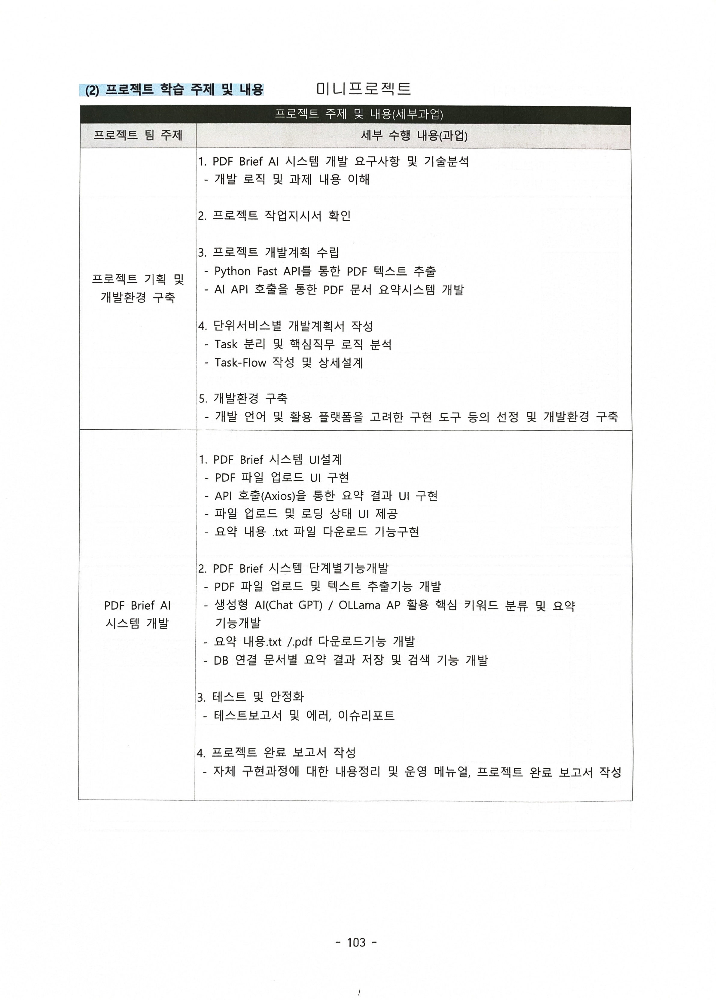

# 1. Mini Project Object Document

### Information

* **Dev Date :** 10/17/2026 ~ 10/24/2026 23:59:59
* **Member :**
  - 김영민 : Backend (`Server application develop`) 
  - 승진 : Frontend (`Web event handler`)
  - 최건우 : Infra, Frontend, Backend
      - Infra (`Docker -> Docker Compose`)
      - Frontend (`React build UI`)
      - Backend (`Dockerfile management`)
  - 최민기 : Backend (`OCR`)

### Objective

OpenAI API를 통해 PDF 파일의 이미지에서 텍스트 (Image-Text-to-Text)을 추출하여 결과 데이터통해 UI에 출력되도록 하는 방식 설계를 진행하고 AI Agent의 Parameter Size가 1B (100,000,000) 와 14B (1,400,000,000) 두 개의 모델을 선정하여 구성 가능한 환경에서 병목 현상이 일어나는지 테스트를 진행해 정확도가 높은 Application을 구축한다.

# 2. Project Feature Requirement

    

## 2.1 Applied Skill Stacks

| **Category**              | **Proposed Technology Stack**                         |
| ------------------------- | ----------------------------------------------------- |
| **Programing Language**   | JavaScript, Python (`v3.12.10`), Go (`v1.27.0`), Java |
| **Other Script Language** | Shell, YML                                            |
| **Database**              | MySQL (Docker Image with v8.4.11-oracle)              |
| **Infra & Delivery**      | Docker (v4.93.0), Kubernetes (v1.36.1)                |
| **Website Type**          | Dynamic Website (React with Vite)                     |

---

# ETC. 참조

* [1. Markdown Content Element Style](https://markdific.com/)
